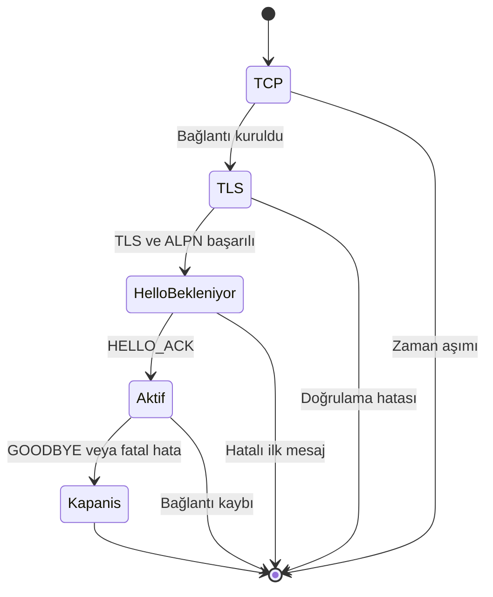
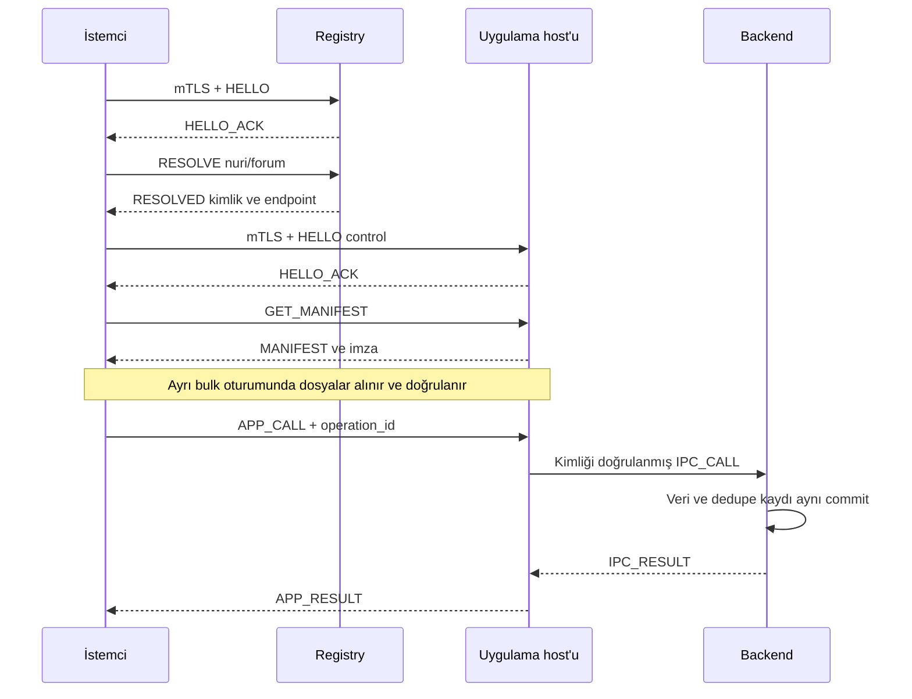

# ILMEK/1 — Uygulama Protokolü Sözleşmesi

**Sözleşme sürümü:** 1.0 — İlmek adlandırma ve UUIDv7 revizyonu  
**Belge tarihi:** 22 Ekim 2026  
**Durum:** İlk uygulama için normatif proje şartnamesi; yayımlanmış internet standardı veya denetlenmiş ürün değildir.  
**Ürün ve kurulum:** [README.md](README.md)  
**Adlandırma:** Proje **İlmek**, İngilizce protokol adı **Ilmek Protocol**, sürüm `ILMEK/1`, ALPN `ilmek/1`, uygulama adres şeması `ilmek://`. Teknik tanımlayıcılar ASCII'dir.

> Bu belge ILMEK/1 konuşan iki bağımsız uygulamanın aynı byte dizisini ve mesaj davranışını yorumlaması için yazılmıştır. MUST = zorunlu; MUST NOT = yasak; SHOULD = aksi gerekçelendirilmedikçe uygulanmalı. Uyumluluk, bu kuralları uygulamak ve test etmekle elde edilir; yalnızca bu belgeyi yazmakla kanıtlanmış olmaz.

## 1. Kesin mimari kararı

**Wi-Fi → IP → TCP → TLS 1.3 → ILMEK/1.**

- ILMEK/1, HTTP'nin bulunduğu uygulama katmanındadır. TCP veya IP'nin yerine geçmez.
- Node'lar standart IP yönlendirmesi yapar. Uygulama TLS bağlantısı istemci ile ilgili registry/host arasında sonlanır.
- HTTP, HTTPS, WebSocket ve gRPC üzerinden tünelleme MUST NOT kullanılmalı.
- TLS 1.3 kullanmak HTTPS kullanmak değildir.
- QUIC, CBOR, Protobuf, sıkıştırma ve uygulama seviyesinde özel UDP taşıması ILMEK/1.0 kapsamında değildir.
- Dosya gövdeleri ham byte, metadata UTF-8 JSON'dur.
- Büyük dosyalar ayrı `bulk` bağlantısında taşınır. Kontrol/RPC bağlantısına dosya aktarımı eklenmez.
- Bu seçim ilk iki-node ürünün uygulanabilirliğine yöneliktir; HTTP'den veya QUIC'ten her koşulda hızlı olacağı iddiası yoktur.

## 2. Uçlar ve bağlantı türleri

| Uç | Varsayılan | Kabul edilen mod | TLS |
| --- | --- | --- | --- |
| Registry | TCP 47401 | `control` | mTLS |
| Host | TCP 47401 | `control`, `bulk` | mTLS |
| Registry katılım ucu | TCP 47402 | `enroll` | Sunucu doğrulamalı TLS; cihaz henüz sertifikasız |

Portlar proje içi yapılandırılabilir varsayılandır; IANA tahsisi iddiası yoktur. Registry ve host aynı IP'de çalışacaksa farklı listen portları atanır. Adres kayıtları gerçek portu taşır.

ALPN tam byte dizisi `ilmek/1` (7 ASCII byte: `69 6c 6d 65 6b 2f 31`) MUST olmalı. Bu proje içi tanımlayıcıdır; IANA kaydı yapıldığı iddia edilmez. Seçilmezse bağlantı kapanır; HTTP veya açık TCP'ye dönüş yapılmaz. TLS early data / 0-RTT ILMEK/1.0'da kapalıdır. İlk sürümde TLS session resumption kapalı tutulur; böylece her yeni oturumda güncel kimlik denetimi yapılır. TLS kütüphanesinin güncel güvenli TLS 1.3 ayarları kullanılır; özel cipher veya şifreleme tasarlanmaz.

## 3. TLS kimliği ve güven zinciri

### 3.1 Sertifika profili

Topluluğa özgü CA, uygulamanın kendi trust store'unda tutulur; işletim sisteminin genel kök deposuna eklenmesi gerekmez. CA ve TLS leaf anahtarları için V1 referans profili ECDSA P-256/SHA-256'dır; paket imzaları ayrıca Ed25519 kullanır.

- Her peer için değişmez UUIDv7 `peer_id` vardır.
- Leaf sertifikada tam olarak bir kimlik URI SAN'ı bulunur: `urn:uuid:<peer_id>`.
- TLS sunucusunun sertifikası ayrıca dinlediği/published olduğu IP'yi IP SAN olarak taşır. V1 endpoint'leri IPv4 adresidir; DNS ismi çözmeye gerek yoktur.
- İstemci standart zincir, süre, kullanım amacı ve IP SAN doğrulamasının yanında beklenen `server_id` ile URI SAN kimliğini karşılaştırır.
- IP değişiminde gerekiyorsa yeni IP SAN içeren sertifika çıkarılır. Kimlik doğrulaması devre dışı bırakılmaz.
- Registry'nin beklenen kimliği, adresi ve CA parmak izi güvenilir bootstrap profilinde bulunur.
- Host kimliği registry'nin yetkili kaydından alınır. Ortak CA tarafından imzalanmış herhangi bir sertifika, hedef host yerine geçemez.
- mTLS'de istemcinin kimliği sertifikadan türetilir; metadata içindeki kullanıcı iddiası güven kaynağı değildir.
- İlk sürümde `principal_id = peer_id` kabul edilir. Aynı kişinin iki cihazda aynı kullanıcı hesabını kullanması ayrı bir hesap bağlama özelliğidir ve V1 garantisi değildir.

Leaf sertifika süresi varsayılan 30 gündür. Süre sonuna 7 gün kala istemci uyarı verir. V1 yenileme, yönetici onaylı yeni enrollment token'ı ve mevcut kimlik/anahtar doğrulamasıyla yapılır; otomatik sertifika yenileme mesajı bu sürümde yoktur. Aynı peer kimliğine yeni sertifika çıkarma yetkisi yalnızca yönetici onaylı yenileme token'ındadır. Yeni cihaz sıradan token ile mevcut peer kimliğini sahiplenemez.

### 3.2 Katılım token'ı

- En az 256 bit kriptografik rastgele veri; base64url, padding yok.
- Varsayılan yaşam süresi 15 dakika; sunucuda yalnızca token özeti tutulur.
- Token rol/izin sınırlarını yönetici önceden belirler. İstemcinin istediği rol yetki sayılmaz.
- Log, URL ve komut satırına yazılmaz.
- Başarılı enrollment sonucu ile token tüketimi aynı kalıcı transaction'da kaydedilir.
- Cevap kaybolursa aynı enrollment operation ID, aynı CSR ve aynı token ile aynı sonuç tekrar alınabilir. Başka içerikle tekrar kullanım reddedilir.
- Enrollment sonucu en az token süresinin sonundan itibaren 24 saat saklanır. Bu süreden sonra belirsiz katılım yönetici tarafından çözülür.

### 3.3 İptal ve offline süre

Registry iptal edilmiş sertifika seri numaralarını ve yayıncı anahtarlarını tutar. Her sunucu/istemci tam bir trust snapshot'ını en fazla 60 saniyede bir yenilemeyi dener.

- Son başarılı tam snapshot 24 saatten eskiyse yeni uzak uygulama erişimi ve uzak işlem MUST reddedilmeli; hata `TRUST_STALE` olur.
- Yerel olarak indirilmiş statik içeriğin çevrimdışı okunması farklıdır; kullanıcıya doğrulamanın güncel olmadığı belirtilir. İptali öğrenilmiş paket anahtarıyla yeni paket kurulmaz.
- Süre dolmadan da bağlantı başına ve en az dakikada bir iptal kontrolü yapılır. Bilinen iptal yeni isteklere uygulanır ve ilgili oturum kapatılır.
- Süreç yeniden başlatmasında veya saat geriye gitmişse cache süresi güvenle belirlenemiyorsa snapshot yenilenmeden uzak erişim verilmez.
- İlk katılımda trust snapshot tamamlanmadan uygulama erişimi açılmaz.
- Registry, trust yenilemek için gelen geçerli CA/kimlik sertifikasını kendi güncel iptal listesine göre denetler. Bu uç kendi eski önbelleğine bağımlı değildir.
- Offline iptal anlık değildir; azami 24 saatlik pencere ürünün açık sınırıdır.

## 4. Temel veri tipleri

| Tip | Kesin biçim |
| --- | --- |
| `UUID` | Küçük harfli kanonik UUIDv7; `^[0-9a-f]{8}-[0-9a-f]{4}-7[0-9a-f]{3}-[89ab][0-9a-f]{3}-[0-9a-f]{12}$` |
| `U53` | JSON integer; 0..9007199254740991; float/exponent biçimi ve negatif değer yasak |
| `Timestamp` | Unix epoch milisaniye, U53 |
| `Hash` | SHA-256, 64 küçük harfli hex karakter |
| `Token` | Base64url, padding yok; alan bazında byte limiti |
| `Name` | `[a-z0-9](?:[a-z0-9-]{0,46}[a-z0-9])?`; 1..48 karakter |
| `Version` | Üç sayısal bileşen: `major.minor.patch`; gereksiz baştaki sıfırlar yasak; bileşen 0..2147483647 |
| `Path` | Paket içi göreli POSIX yol; ayrıca bölüm 15 kuralları |
| `Method` | `[a-z][a-z0-9_.]{0,63}` |
| `Cursor` | Sunucunun verdiği opaque base64url string, en fazla 512 karakter |

JSON metadata'da yinelenen anahtar, BOM, geçersiz UTF-8, NaN/Infinity, parser'a göre değişen sayı ve derinliği 16'yı aşan yapı yasaktır. String limitleri belirtilmediyse 1024 UTF-8 byte'tır. En fazla 256 nesne anahtarı ve bir array'de 256 öğe kabul edilir. Metadata/body uzunlukları zaten toplam büyüklüğü sınırlar.

Bu protokol JSON alanlarının sırasına güvenmez. Kriptografik özeti alınan içerikte ise **gönderilen tam byte dizisi** esas alınır; yeniden serialize edilmez.

Şema gösterimi: `alan:Tip` zorunlu alan; `alan:Tip|null` alanın bulunup null olabileceği anlamına gelir. Aksi yazılmadıkça bütün alanlar zorunludur. Tanımlanmayan metadata/data alanları reddedilir. Uygulama RPC JSON gövdesinin iş şeması ilgili backend'e aittir.

### 4.1 UUIDv7 üretim, saklama ve tekrar kuralları

- `UUID` tipi bu sözleşmede **yalnızca RFC 9562 UUIDv7** anlamına gelir. Community, peer/server, principal, publisher, app, request, operation, session, subscription, event ve snapshot kimlikleri buna dahildir. Hash, revision, sequence, sertifika seri numarası ve opaque cursor UUID değildir; kendi tiplerinde kalır.
- Wire biçimi küçük harfli, tireli 36 ASCII karakterdir. Version nibble 7, RFC variant bitleri `10` olmalıdır. Nil UUID ve diğer sürümler reddedilir.
- 48 bit Unix epoch milisaniye alanı; version/variant dışındaki 74 bit için kriptografik güvenli rastgelelik kullanan RFC uyumlu kütüphane tercih edilir. UUID üretmek için merkezi registry çağrısı veya internet gerekmez.
- V1 strict global ya da process-içi monoton sıra vaat etmez. Aynı milisaniyedeki rastgele UUIDv7 değerleri üretim sırasıyla sıralanmayabilir; saat gerilemesi ve cihazlar arası saat farkı olabilir. İş sırası için revision/sequence/cursor, nedensellik için uygulama kuralları kullanılır.
- UUID içindeki zaman, kimlik üretiminin yaklaşık zamanını açığa çıkarabilir. Sunucu güvenilir audit zamanı için kendi `created_at` alanını tutar; istemcinin UUID zamanı yetki veya süre aşımı kanıtı değildir.
- UUIDv7 gizli token, parola, CSRF/oturum sırrı veya şifreleme anahtarı yerine geçmez. Enrollment token'ları ve güvenlik nonce'ları mevcut CSPRNG kurallarında kalır.
- Request kimliği her yeni istekte yenidir. Operation kimliği yazmanın ilk oluşturulduğu anda üretilir ve bütün tekrarlarında aynen korunur; v7 timestamp'i güncellemek için yeniden üretilmez.
- Kalıcı app/server/peer kimliği restart, uygulama sürümü veya IP değişince yeniden üretilmez. SQLite'ta UUID, kanonik metin veya 16-byte network-order BLOB olarak saklanabilir; bir kolon için tek gösterim seçilir. .NET GUID little-endian byte düzeni wire'a taşınmaz.
- Veritabanında uygun UNIQUE/PRIMARY KEY kısıtları yine zorunludur. Yeni oluşturulan entity kimliğinde çakışma fark edilirse kontrollü yeniden üretim yapılır; idempotent operation kimliği çakışma diye sessizce değiştirilmez.
- JavaScript `crypto.randomUUID()` doğrudan kullanılmaz; standart çağrı UUIDv7 üretmez. Native ortak çekirdek veya doğrulanmış UUIDv7 kütüphanesi kullanılır. UUID'nin version bitini değiştirerek UUIDv4'ü UUIDv7 diye etiketleme yasaktır.
- Henüz dağıtılmamış önceki doküman örnekleri UUIDv4 idi; bu revizyon onları geçersiz kılar. Gerçek eski veri varsa anahtarlar yerinde körlemesine değiştirilmez; FK, sertifika, imza ve referans etkilerini ele alan ayrı migration gerekir.

## 5. Byte düzeyi frame

| Offset | Byte | İçerik |
| --- | --- | --- |
| 0 | 4 | ASCII `ILM1`: hex `49 4c 4d 31` |
| 4 | 4 | Metadata byte uzunluğu; unsigned 32-bit big-endian |
| 8 | 4 | Gövde byte uzunluğu; unsigned 32-bit big-endian |
| 12 | M | Metadata JSON byte'ları |
| 12+M | B | Ham gövde byte'ları |

- `1 ≤ M ≤ 65536`, `0 ≤ B ≤ 262144`.
- En büyük frame: `12 + 65536 + 262144 = 327692` byte; TLS overhead hariç.
- Ağdaki registry/host/enrollment uçlarında magic yalnızca TLS içinde gönderilir; plaintext İlmek ağ servisi yoktur. Bölüm 16'daki yalnızca loopback yerel IPC aynı frame codec'ini TLS olmadan kullanabilir; ağ endpoint'i değildir.
- Limit dışı boyut, kötü magic veya tamamlanmamış frame halinde bağlantı kapanır. Saldırganın bildirdiği boyut kadar bellek allocate edilmez.
- TCP tek okumasının bir frame olduğu varsayılmaz. Parçalı okumalar biriktirilir, aynı okumadaki fazla byte sonraki frame için saklanır.
- İlk frame byte'ından itibaren 30 saniyede frame tamamlanmazsa bağlantı kapanır. Kısmi ilerleme bu toplam deadline'ı sıfırlamaz.
- Birden fazla task aynı TLS stream'e kilitsiz byte yazamaz. Tek writer kuyruğu veya eşdeğer frame bütünlüğü garantisi gerekir.

### Ortak metadata nesnesi

```json
{
  "type": "RESOLVE",
  "request_id": "019de1df-a000-7111-8111-111111111111",
  "community_id": "019de1df-a000-7222-8222-222222222222",
  "data": {
    "namespace": "nuri",
    "slug": "forum"
  }
}
```

Yalnızca dört üst alan vardır: `type`, `request_id`, `community_id`, `data`. `type` bu sözleşmedeki büyük harfli enum; kimlikler UUID; `data` nesnedir. Frame gövdesinin formatı mesaj türünce belirlenir; HTTP content-type pazarlığı yoktur.

## 6. Bağlantı durum makinesi



1. TCP connect deadline 5 sn.
2. TLS handshake deadline 10 sn.
3. TLS sonrası istemci ilk mesaj olarak 5 sn içinde `HELLO` gönderir.
4. Sunucu `HELLO_ACK` göndermeden başka uygulama isteği kabul etmez.
5. ACK'den sonra bağlantı modu değişmez.
6. Uyumsuz topluluk/sürüm/mod için mümkünse `ERROR`, ardından TLS close_notify.
7. Normal kapanış `GOODBYE`/`GOODBYE_ACK`; in-flight işler bitirilmeden sonlanırsa yazma sonuçları istemci açısından belirsizdir.
8. Socket EOF veya timeout, backend transaction'ının geri alındığı anlamına gelmez.

### HELLO — istemci → sunucu

`data = {version:1, mode:"control"|"bulk"|"enroll", client_name:string, client_version:Version}`; gövde boş. `client_name` en fazla 64 UTF-8 byte.

### HELLO_ACK — sunucu → istemci

`data = {version:1, session_id:UUID, server_id:UUID, server_role:"registry"|"host", mode:enum, max_inflight_requests:U53, max_subscriptions:U53, server_time_ms:Timestamp}`; gövde boş.

- `control`: max inflight 1..16; max subscriptions host'ta 0..8, registry'de 0.
- `bulk`: max inflight 1; subscriptions 0.
- `enroll`: max inflight 1; subscriptions 0.
- Frame limitleri sabittir; daha büyük frame için pazarlık yoktur.
- `server_id` TLS kimliğiyle eşleşmeli. `server_time_ms` teşhis içindir; cihaz saati sessizce değiştirilmez.

## 7. Request/response, oturum ve sınırlar

- İstekleri istemci başlatır. Sunucu sadece cevap ve izinli abonelik event'leri gönderir.
- Her yeni isteğin `request_id`'si yeni UUIDv7'tür; aynı bağlantıda tekrar kullanılmaz.
- Normal cevap aynı request ID'yi taşır. Cevap türü ilgili işlemde tanımlıdır. Bilinmeyen/başka request ID içeren veya yanlış app kimliğine ait cevap protokol ihlalidir; istemci bağlantıyı kapatır.
- `ERROR`, aksi belirtilmedikçe isteğin terminal cevabıdır.
- `SUBSCRIBED` ve `ASSET_INFO` uzun akışın başlangıcını bildirir; aşağıdaki özel yaşam döngüleri geçerlidir.
- Aynı socket'te cevapların istek sırasını takip etmesi gerekmez; request ID ile eşleştirilir.
- Süreç içi dedupe state'in sınırsız büyümemesi için bağlantı en fazla 100000 yeni istek kabul eder; sonra `DRAIN` verilir. İstemci yeni bağlantı açar. Bu sınır kontrol/aktarım istekleri ve onların ID kayıtları içindir; EVENT frame sayısı değildir. Sonuçlanmamış yazma işlemlerinde aynı operation ID korunur.
- Host referans sınırı 128 eşzamanlı normal TLS bağlantısı; yönetici değiştirebilir. Sınırda yeni bağlantı reddi, sınırsız accept kuyruğu yerine açık işletim davranışıdır.
- Kontrol istekleri için istemci varsayılan deadline 15 sn. Okumalar yeniden denenebilir; yazmalar bölüm 12'ye göre denenir.
- 20 sn outbound boşta kalan istemci `PING` gönderir. 10 sn içinde `PONG` yoksa bağlantıyı sağlıksız sayıp kapatır. Sunucu 90 sn hiç inbound frame almamış oturumu kapatabilir.
- PING/PONG, CANCEL, EVENT_ACK, UNSUBSCRIBE ve GOODBYE için küçük ayrı kontrol kuyruğu ayrılır; uzun aktarım bunları sonsuza kadar bloke edemez.

`PING data={nonce:Token}` ve `PONG data={nonce:Token}`; nonce 16 byte, gövde boş. PONG gelen nonce'ı aynen döndürür.

`GOODBYE data={reason:"user"|"shutdown"|"reconnect"}` → `GOODBYE_ACK data={}`. Sunucu yeni istek kabul etmeyi durdurur, bağlantıyı kapatır; bu bir commit/rollback cevabı değildir.

Sunucu tarafından başlatılabilen `DRAIN`, HELLO request ID'sini taşır; `data={reason:"request_limit"|"shutdown", grace_ms:U53}`. Grace en fazla 30000 ms. Yeni uygulama isteği `SERVER_DRAINING` alır. Mevcut kısa istekler süre içinde tamamlanabilir; bulk bağlantısı yeniden açılıp dosya offset'iyle devam edilir.

## 8. Mesaj kataloğu

Bütün mesajlarda ortak dört metadata alanı vardır. Aşağıdaki tabloda yalnızca `data` ve gövde tanımlanır. Özel yapı isimleri sonraki bölümlerde açıklanır.

### 8.1 Katılım — yalnızca enroll/registry

| İstek | Data | Gövde | Başarı cevabı |
| --- | --- | --- | --- |
| `ENROLL` | `{operation_id:UUID, token:Token, display_name:string, csr_der:Token}` | Boş | `ENROLLED` |

`display_name` en fazla 80 byte; CSR DER en fazla 8192 byte. CSR kendi anahtarıyla imzalanmış olmalı; CA algoritma ve anahtar gücünü doğrular. CSR'nin istediği subject/rol/peer kimliği yetki sayılmaz. Peer ID yeni katılımda sunucuda üretilip sonuç transaction'ında saklanır; yenileme token'ında yönetici tarafından bağlanmış kimlik kullanılır.

`ENROLLED data={peer_id:UUID, certificate_der:Token, chain_der:[Token], roles:["member"|"publisher"|"host"|"admin"], registry_endpoint:Endpoint, registry_id:UUID, expires_at_ms:Timestamp}`. Gövde boş; toplam metadata limitine sığmalı. Başarılı cevaptan sonra enrollment bağlantısı kapatılır; istemci normal mTLS bağlantısı açar.

Yanlış token için gizli bilgiyi açıklamayan `UNAUTHORIZED`; hız sınırı uygulanır. Yeni enrollment önceki cihaz kimliğini salt isim benzerliğiyle devralamaz.

### 8.2 Registry kontrol mesajları

| İstek | Data | Gövde | Başarı cevabı |
| --- | --- | --- | --- |
| `RESOLVE` | `{namespace:Name, slug:Name}` | Boş | `RESOLVED` |
| `LIST_APPS` | `{query:string, limit:U53, cursor:Cursor\|null}` | Boş | `APPS_LISTED` |
| `HOST_REGISTER` | `{operation_id:UUID, endpoint:Endpoint, expected_revision:U53}` | Boş | `HOST_REGISTERED` |
| `HOST_HEARTBEAT` | `{host_revision:U53}` | Boş | `HEARTBEAT_ACK` |
| `REGISTER_APP` | `{operation_id:UUID, namespace:Name, slug:Name, app_id:UUID, server_id:UUID, version:Version, manifest_hash:Hash, publisher_key_id:Hash, name:string, description:string}` | Boş | `APP_REGISTERED` |
| `UNREGISTER_APP` | `{operation_id:UUID, app_id:UUID, expected_revision:U53}` | Boş | `APP_UNREGISTERED` |
| `UPDATE_APP` | `{operation_id:UUID, app_id:UUID, expected_revision:U53, server_id:UUID, version:Version, manifest_hash:Hash, publisher_key_id:Hash, name:string, description:string}` | Boş | `APP_UPDATED` |
| `GET_TRUST` | `{limit:U53, cursor:Cursor\|null}` | Boş | `TRUST_PAGE` |

`Endpoint={ip:string, port:U53}`; ip kanonik IPv4, port 1..65535. Registry endpoint allowlist'inde bulunmayan veya İlmek ağından erişilemeyecek advertised endpoint reddedilir. V1'de uygulamanın hedefi kullanıcıdan gelen keyfi URL değildir.

`RESOLVED data={record:AppRecord, cache_ttl_seconds:60}`; gövde boş.

`APPS_LISTED data={snapshot_id:UUID, next_cursor:Cursor|null}`; gövde UTF-8 JSON `{"records":[AppRecord,...]}`. `limit` 1..50, query en fazla 128 byte. Sonraki sayfada query ve limit korunur; cursor bunlara bağlıdır. Snapshot 5 dakika tutulur; sonra `CURSOR_EXPIRED`. Registry yeni kayıtlarla sayfalar arasında sessiz atlama/tekrarlama üretmez; sabit snapshot veya açık cursor expiry kullanır.

`HOST_REGISTERED data={server_id:UUID, revision:U53, heartbeat_interval_seconds:30, lease_seconds:90}`. Server ID TLS peer kimliğidir. İlk kayıt expected_revision=0; sonraki değişiklik mevcut revision ister.

`HEARTBEAT_ACK data={lease_expires_at_ms:Timestamp}`. Aktör host rolüne sahip olmalı; yalnızca kendi lease'ini yeniler. Heartbeat, host endpoint'inin her istemciden erişilebildiğini kanıtlamaz.

`APP_REGISTERED` ve `APP_UPDATED data={record:AppRecord}`; gövde boş. Kayıt işlemi ile operation dedupe sonucu aynı transaction'dadır. Yayıncı namespace sahipliği ve hedef host üzerinde yayınlama yetkisi doğrulanır. V1'de bu yetki eşleştirmelerini ve namespace sahipliklerini yönetici yerel CLI üzerinden oluşturur; namespace için ayrı ağ mesajı zorunlu değildir.

`APP_UNREGISTERED data={app_id:UUID, revision:U53}`; gövde boş. Yayın sahibi uygulamayı katalogdan kaldırabilir. Registry isim sahipliğini ve son revision'ı tombstone olarak korur; LIST_APPS ve RESOLVE bu kaydı döndürmez. Tekrar yayınlama aynı yetkili sahip ve aynı app_id ile REGISTER_APP kullanır, yeni operation ID taşır ve revision artırır. Başka uygulama/kişi eski ismi ele geçiremez. Katalogdan kaldırma, önceden indirilen içeriği silmez; backend erişimini kapatmak için host ayrıca durdurulur. Aynı operation ID ile tekrar eski sonucu döndürür; yeni ID'yle zaten tombstone kayıt için mevcut revision döner.

Registry yeni bir uygulama kaydını, var olan namespace/slug'a başka `app_id` atayarak değiştiremez. Update'te `app_id` ve ad alanı değişmez. Sunucu taşıma, yetkili `server_id` güncellemesiyle yapılabilir; backend veri taşıması otomatik değildir.

### 8.3 AppRecord

```text
{
 community_id:UUID, namespace:Name, slug:Name, app_id:UUID,
 publisher_id:UUID, server_id:UUID, endpoint:Endpoint,
 version:Version, manifest_hash:Hash, publisher_key_id:Hash,
 publisher_public_key:Token, name:string, description:string,
 revision:U53, lease_expires_at_ms:Timestamp,
 availability:"recent_heartbeat"|"stale"|"unknown"
}
```

`publisher_public_key` tam 32 byte Ed25519 anahtarının base64url biçimi; `publisher_key_id = SHA256(public_key_raw)` hex. Name en fazla 128, description en fazla 2048 UTF-8 byte; bunlar genel string limitinin açık istisnasıdır. Publisher ID yerel yönetici kayıtlarındaki kalıcı kimliktir; peer ID ile aynı olmak zorunda değildir.

İsim cache'i 60 saniye sonra yenilenir. Registry erişilemiyorsa daha önce doğrulanmış aynı server/publisher kimliği ve endpoint, son tam trust doğrulamasından itibaren en fazla 24 saat boyunca **stale olduğu belirtilerek** kullanılabilir. Geçmiş heartbeat lease'i ulaşılabilirlik göstergesidir; isim sahipliğini devretmez. Sunucu bağlantısında TLS ve izin denetimleri yine yapılır. Cache'e hiç alınmamış isim registry yokken çözülemez.

### 8.4 Trust snapshot

`TRUST_PAGE data={snapshot_id:UUID, revision:U53, generated_at_ms:Timestamp, next_cursor:Cursor|null}`; gövde UTF-8 JSON:

```text
{"entries":[
  {"kind":"certificate", "value":<sertifika-seri-hex>, "revoked_at_ms":<Timestamp>},
  {"kind":"publisher_key", "value":<Hash>, "revoked_at_ms":<Timestamp>}
]}
```

Limit 1..100. Sertifika seri numarası küçük harfli, çift uzunlukta hex; en fazla 40 karakter, en az 2. Snapshot 5 dakika sabittir. Yeni snapshot bütün sayfaları tamamlanmadan eski trust state'in yerine geçirilmez. Başarısız sayfa yenilemesi 24 saat sayacını sıfırlamaz. Tamamlanan snapshot boş olabilir. Zaman/registry revision geriye gitmişse güvenli hata ve yönetici incelemesi gerekir; eski iptal listesini sessiz kabul etme.

## 9. Host kontrol mesajları

| İstek | Data | Gövde | Başarı cevabı |
| --- | --- | --- | --- |
| `GET_MANIFEST` | `{app_id:UUID, version:Version, manifest_hash:Hash}` | Boş | `MANIFEST` |
| `APP_CALL` | `{app_id:UUID, client_app_version:Version, method:Method, operation_id:UUID\|null, payload_hash:Hash}` | UTF-8 JSON object | `APP_RESULT` |
| `SUBSCRIBE` | `{app_id:UUID, client_app_version:Version, topic:Method, cursor:Cursor\|null}` | Boş | `SUBSCRIBED`, sonra `EVENT` |
| `EVENT_ACK` | `{subscription_id:UUID, sequence:U53, cursor:Cursor}` | Boş | `EVENT_ACKED` |
| `UNSUBSCRIBE` | `{subscription_id:UUID}` | Boş | `UNSUBSCRIBED` |

Her istekte host, uygulamayı ve aktörün o uygulamaya erişim yetkisini doğrular. Bir community üyesi olmak bütün uygulamaları yönetme veya bütün kullanıcı verilerini okuma yetkisi değildir.

`MANIFEST data={app_id:UUID, version:Version, manifest_hash:Hash, publisher_key_id:Hash, signature:Token}`; gövde saklanan **tam manifest.json byte'ları**. İmza 64 byte Ed25519. Manifest gövdesi en fazla 256 KiB. Yanlış hash/sürüm için `VERSION_CONFLICT` veya `NOT_FOUND`; otomatik başka sürüm döndürme yok.

`APP_RESULT data={app_id:UUID, operation_id:UUID|null}`; gövde uygulamaya özgü UTF-8 JSON object, en fazla 256 KiB. İş hatası `ERROR` ile döner; 200/404 gibi HTTP status kodları kullanılmaz. İstemci başka bir app_id veya operation ID içeren cevabı kabul etmez.

İstemcide paket sürümü, backend sürümü ve SDK sürümü uyumlu olmalı. Uyumsuz backend operasyonu `APP_VERSION_UNSUPPORTED` döndürür. Backend method şemaları paketle birlikte sürümlenir; runtime bütün sürümleri otomatik uyumlu yapmaz.

## 10. Olay aboneliği

`SUBSCRIBED data={subscription_id:UUID, app_id:UUID, topic:Method, cursor:Cursor, window:16}`; gövde boş. Bu ACK, SUBSCRIBE isteğinin kısa request slot'unu serbest bırakır; subscription kendi 8'lik sınırında sayılır. Event ve abonelik hataları orijinal SUBSCRIBE request ID'sini taşır.

- `cursor=null` yeni aboneliktir: sunucu önce bir sınır cursor'u oluşturur ve sadece bu sınırdan sonraki olayları gönderir. İlk ekran geçmişi ayrı `APP_CALL` ile alınır. Arada veri kaçırmamak için önce subscribe, sonra liste/snapshot alıp event ID/revision ile birleştirme yapılır.
- Cursor verilmişse o cursor'dan **sonraki** olaylar yeniden gönderilir.
- Cursor topluluk, principal, app ve topic'e bağlıdır; başka kullanıcının cursor'u kabul edilmez.
- Sunucu o topic için en az son 10000 olayı saklayan bir akış sunar. Daha eski cursor için `CURSOR_EXPIRED`; istemci yeniden snapshot alır. Her uygulama aynı event saklama ihtiyacına sahip değildir; daha büyük saklama yerel uygulama kararıdır.
- Veri değişikliğiyle ilgili event kaydı, örnek backend'lerde aynı DB transaction'ında yazılır. Event'in kesin teslimi değil, yeniden okunabilen kalıcı olay günlüğü sağlanır.

`EVENT data={subscription_id:UUID, app_id:UUID, topic:Method, sequence:U53, event_id:UUID, cursor:Cursor}`; gövde UTF-8 JSON object.

- Sequence ilk event'te 1, bağlantıdaki abonelik boyunca ardışık artar. Kalıcı sıra işareti cursor'dur; sequence reconnect'te yeniden başlar.
- İstemci aynı event ID'yi yeniden alabilir; en az bir kez teslim davranışına göre işlenir.
- SDK, işlenen cursor'u yerel sakladıktan sonra `EVENT_ACK` gönderir. Uygulamanın işleme ile yerel cursor kaydı arasındaki çökme yine duplicate oluşturabilir; dedupe gerekir.
- ACK en son **kesintisiz işlenmiş** sequence ve ona ait cursor içindir. İleri/yanlış cursor ACK'si `INVALID_MESSAGE`.
- `EVENT_ACKED data={subscription_id:UUID, sequence:U53}`. Gövde boş.
- Sunucu en fazla 16 ACK bekleyen event gönderir. Pencere dolunca kalıcı logdan okumayı durdurur; sınırsız RAM kuyruğu açmaz.
- Bekleyen event için 30 sn boyunca ACK ilerlemesi yoksa orijinal abonelik request ID'siyle `ERROR/SLOW_CONSUMER` gönderir ve yalnızca aboneliği kapatır.
- `UNSUBSCRIBED data={subscription_id:UUID}` gönderildikten sonra bu aboneliğe yeni EVENT gönderilemez. ACK öncesinde kuyruğa alınmış event'ler ACK'den önce gelebilir.
- Aynı subscription ID'ye tekrar unsubscribe güvenlidir; cevap yine UNSUBSCRIBED. Başka kimliğe ait ID'ler üzerinden bilgi sızdırılmaz.
- Bağlantı kapanınca bütün abonelikler kapanır; istemci son kalıcı cursor ile yeni SUBSCRIBE yapar. Otomatik sınırsız yeniden bağlanma yoktur; exponential backoff ve jitter uygulanır.

## 11. Dosya aktarımı — yalnızca bulk/host

### 11.1 İstek ve cevaplar

`GET_ASSET data={app_id:UUID, version:Version, manifest_hash:Hash, path:Path, asset_hash:Hash, offset:U53}`; gövde boş.

Host, path'in doğrulanmış manifestte bulunduğunu, hash/sürümün eşleştiğini ve aktörün erişimini kontrol eder. İstemcinin verdiği dosya sistemine ait mutlak yol hiçbir zaman açılmaz.

Başarılı cevap sırası:

1. `ASSET_INFO data={app_id:UUID, version:Version, path:Path, asset_hash:Hash, total_size:U53, offset:U53, chunk_size:65536}`; gövde boş.
2. Sıfır veya daha fazla `ASSET_CHUNK data={sequence:U53, offset:U53}`; gövde ham dosya byte'ları.
3. `ASSET_END data={asset_hash:Hash, total_sent:U53}`; gövde boş; terminal.

Bütün cevaplar aynı GET_ASSET request ID'sini taşır. Chunk sequence 0'dan başlar, ardışık artar. Her chunk offset'i önceki chunk'ın sonuyla eşleşir. Gövde 1..65536 byte; son chunk daha küçük olabilir. Transfer bitmeden yeni GET_ASSET `RESOURCE_EXHAUSTED` alır; bulk başına tek aktif dosya vardır.

`offset` 0..total_size aralığında olabilir. `offset=total_size` ve boş dosya durumunda INFO ardından END gelir; CHUNK gönderilmez. `total_sent = total_size - başlangıç_offset` olmalıdır.

### 11.2 Devam, bütünlük ve iptal

- Dosyalar değişmez uygulama sürümü altında tutulur. Aynı sürümde dosya değiştirilemez.
- Devam yeni bulk bağlantısı ve yeni request ID ile yapılır. Aynı app/version/manifest hash/asset hash kullanılır.
- İstemci eksik dosyayı geçici alanda tutar. Başlangıç prefix'i de dahil **tüm dosyanın** SHA-256 özeti doğrulanmadan dosya aktif olmaz.
- END gelmesi, içerik hash doğrulamasının geçtiği anlamına gelmez. İstemci doğrulamayı kendisi yapar.
- Paket toplam boyutu, açılmış dosya sayısı, disk kotası ve boş alan kontrol edilir.
- `CANCEL data={target_request_id:UUID}` yalnızca GET_ASSET'i iptal eder; gövde boş.
- Aktif aktarımda sunucu kuyruğa alınmış chunk'ların ardından hedef request ID için terminal `ERROR/CANCELLED` gönderir, sonra CANCEL isteğine `CANCEL_ACK data={target_request_id:UUID, result:"cancelled"}` döner.
- Aktarımın terminal cevabı zaten kuyruğa alındıysa ACK `already_finished`; ID bu oturumda bilinmiyorsa `not_found` olur. Aynı request için END ve ERROR iki terminal cevap olarak gönderilmez.
- CANCEL, APP_CALL transaction'ını geri almaz ve bu amaçla kullanılamaz. Abonelikler UNSUBSCRIBE ile sonlandırılır.
- İstemci CANCEL ACK'sini beklemeden socket'i kapatabilir; bu durumda sunucu socket iptalini de kaynak temizliği için kullanır.
- İlerleme barı gerçek alınan byte sayısına dayanır. Hash ve imza tamamlanmadan “kuruldu” gösterilmez.

## 12. Yazma işlemleri ve idempotency

### APP_CALL özeti

`payload_hash`, aşağıdaki byte dizisinin SHA-256 özetidir:

```text
ASCII("ILMEK-CALL-V1") || 0x00 ||
UTF8(app_id) || 0x00 || UTF8(method) || 0x00 || body_bytes
```

Bu gösterim birleştirme tarifidir; `||` karakterleri gönderilmez. Host hash'i yeniden hesaplar. JSON body yalnızca bir nesne olabilir; aynı semantik input farklı byte dizisiyle tekrar gönderilirse hash farklıdır. İstemci yazma tekrarları için ilk gövde byte'larını saklar.

- Backend method tablosu method'un salt okunur mu yazma mı olduğunu belirler. İstemcinin `read_only` iddiasına güvenilmez.
- Yazmada `operation_id` MUST UUID olmalı; okumada MUST null olmalı.
- Dedupe anahtarı: `(community_id, app_id, principal_id, operation_id)`.
- Method, hash ve sonuç dedupe kaydında bulunur. Aynı anahtar farklı method/hash ile gelirse `OPERATION_CONFLICT`.
- İş değişikliği, event outbox kaydı ve başarılı sonuç aynı DB transaction'ında saklanır.
- Aynı anahtarla eşzamanlı iki istek unique constraint/transaction kontrolüyle tek yazma üretir. İkinci istek sonucu bekleyebilir; deadline dolarsa `OPERATION_PENDING` dönebilir ve aynı ID ile tekrar edilir.
- Tekrarda uygulama yeniden çalıştırılmadan saklanmış sonuç döner; yeni request ID kullanılır, operation ID korunur.
- Kalıcı commit sonucu oluşmadan başarılı APP_RESULT gönderilmez.
- Geçici servis hatası veya commit öncesi rollback dedupe başarı kaydı oluşturmaz. Aynı ID ile tekrar yürütülebilir. İstemci buna rağmen belirsiz timeout'ta yeni ID üretmez.
- V1 örnek uygulamalarında dedupe kayıtları otomatik expire edilmez. Manuel silme, o kimlikler için geçmiş tekrar garantisini kaldırır ve bakım işlemi olarak belgelenir.
- Harici yan etkiler (e-posta, ödeme vb.) bu atomiklik kapsamının dışındadır. SDK genel “exactly once” garantisi sunmaz.

Her tekrar isteğinde önce güncel kimlik ve yetki kontrolü yapılır; sonra dedupe kaydı incelenir. Mevcut dedupe sonucu bulunduğunda revision/sürüm önkoşulları yeniden uygulanarak önceki başarılı işlem yanlış conflict'e çevrilmez. Yeni işte revision kontrolü transaction içinde yapılır.

Registry mutation'larında da operation ID MUST kullanılır. Dedupe scope `(community_id, principal_id, message_type, operation_id)`; ilgili typed data alanları operation ID hariç saklanıp eşitlikle karşılaştırılır. JSON anahtar sırası önemsizdir; bütün değerler aynı olmalıdır. Registry kaydıyla sonuç aynı transaction'da commit edilir.

**Timeout karar değildir:** kullanıcıya “sonuç doğrulanamadı; yeniden kontrol ediliyor” gösterilir. Başarılı veya başarısız olduğu tahmin edilmez. Aynı operation ID ile tekrar, sonucun güvenli öğrenilme yoludur.

## 13. Hata sözleşmesi

`ERROR data={code:enum, message:string, retryable:boolean, retry_after_ms:U53|null, details:object}`; gövde boş. Message en fazla 512 UTF-8 byte; details en fazla 2048 byte ve sır içermez. İş mesajına ait hata aynı request ID'yi taşır. Frame bozuksa request ID elde edilemeyebilir; bu durumda ERROR uydurulmadan bağlantı kapatılır.

| Kod | Anlam / davranış |
| --- | --- |
| `UNAUTHORIZED` | Kimlik/token geçersiz; aynı kimlikle otomatik sonsuz tekrar yok |
| `FORBIDDEN` | Doğrulanmış aktörün yetkisi yok |
| `TRUST_STALE` | Trust yenilemesi gerekli; registry'ye ulaşmadan uygulama işlemine devam yok |
| `NOT_FOUND` | Yetki sınırları içinde hedef bulunamadı |
| `NAME_CONFLICT` | İsim başka kayıt tarafından kullanılıyor |
| `REVISION_CONFLICT` | Registry/uygulama optimistic revision uyuşmuyor |
| `VERSION_CONFLICT` | İstenen uygulama sürümü/hash'i sunulan içerikle uyuşmuyor |
| `APP_VERSION_UNSUPPORTED` | İstemci paket sürümü backend sözleşmesiyle uyumsuz |
| `UNSUPPORTED_VERSION` | İlmek protokol sürümü desteklenmiyor; bağlantı kapanır |
| `UNSUPPORTED_MESSAGE` | Sözleşmede olmayan type; istek reddedilir |
| `INVALID_MESSAGE` | Alan/format/mod/sequence hatası |
| `TOO_LARGE` | Geçerli iş isteği içerik limitini aşıyor; frame-level taşmada bağlantı kapanır |
| `RATE_LIMITED` | İstek hızı sınırı; retry_after_ms zorunlu ve 0..60000 |
| `RESOURCE_EXHAUSTED` | Kuyruk/bağlantı/iş slotu veya disk kaynağı yok |
| `APP_UNAVAILABLE` | Backend çalışmıyor veya hazır değil |
| `OPERATION_CONFLICT` | Aynı operation ID farklı içerikle kullanıldı |
| `OPERATION_PENDING` | Aynı yazma hâlen sonuçlanıyor; aynı ID ile tekrar |
| `CURSOR_EXPIRED` | Yeniden liste/snapshot/abonelik başlangıcı gerekli |
| `SLOW_CONSUMER` | Olay alıcısı ACK ilerletmiyor; abonelik kapatılır |
| `HASH_MISMATCH` | İçerik/istek özeti uyuşmuyor |
| `SIGNATURE_INVALID` | İmza veya yayıncı anahtarı geçersiz; çoğunlukla istemci yerel hatası |
| `CANCELLED` | Aktarım iptal edildi |
| `CANNOT_CANCEL` | Hedef işlem iptal edilebilir aktarım değil |
| `TIMEOUT` | Sunucunun iş deadline'ı doldu; commit sonucunu tek başına kanıtlamaz |
| `SERVER_DRAINING` | Yeni bağlantı açılmalı |
| `INTERNAL` | Güvenli genel sunucu hatası; stack trace dışarı verilmez |

`retryable=true`, yeni operation ID ile yazma izni değildir. SDK yazmada daima ilk ID/body'yi korur. Retry varsayılan 0.5, 1, 2, 4, 8 saniye üst sınırlarına sahip jitter'lı en fazla 5 otomatik denemedir. Daha sonra kullanıcıya durum sunulur; kuyruk sessizce sonsuza kadar büyümez. RATE_LIMITED zamanını dikkate alır.

İstemci tarafında ağ/TLS hataları ayrıca sınıflandırılır: bağlantı yok, yanlış ağ, timeout, kimlik uyuşmazlığı, saat/sertifika sorunu. Bunlar server ERROR frame'i alınmış gibi gösterilmez.

## 14. Yetki matrisi ve uygulama sürümü

| İşlem | Yetki |
| --- | --- |
| HELLO/PING/GOODBYE | İlgili TLS modundaki peer |
| ENROLL | Geçerli enrollment token'ı; yalnızca bootstrap ucu |
| GET_TRUST | İptal edilmemiş community kimliği |
| RESOLVE/LIST_APPS | Community üyesi; katalog erişim politikası |
| HOST_REGISTER/HEARTBEAT | Host rolü; yalnızca kendi kimliği |
| REGISTER_APP/UPDATE_APP/UNREGISTER_APP | Namespace sahibi/yetkili yayıncı ve hedef host yetkisi |
| GET_MANIFEST/GET_ASSET | Uygulamayı okuyabilen üye |
| APP_CALL/SUBSCRIBE | Uygulama ve backend method/topic ACL'si |
| EVENT_ACK/UNSUBSCRIBE | Aynı TLS oturumunda abonelik sahibi |
| CANCEL | Aynı bağlantıdaki aktarım sahibi |

Kimlik, TLS session'dan host tarafından backend'e aktarılır; JS gövdesindeki `principal_id` hiçbir zaman yetkili kimliği değiştiremez.

APP_CALL ve SUBSCRIBE tablolarındaki zorunlu `client_app_version` alanı istemcinin açtığı doğrulanmış paket sürümüdür. Host kabul ettiği sürümleri yerel backend config'inde belirtir; varsayılan yalnızca aktif sürümdür. Eski istemci uyumsuzsa APP_VERSION_UNSUPPORTED alır, yeni manifest/asset akışına yönlendirilir. Payload hash'ine sürüm ayrıca dahil edilmez; aynı method/input için operation dedupe sürüm güncellemesinde de korunur. Method semantiği uyumsuz değişiyorsa method adı veya açık veri şeması sürümü değiştirilir.

## 15. Paket manifesti ve yollar

Normatif manifest nesnesi:

```text
{
 schema_version:1, app_id:UUID, publisher_id:UUID,
 namespace:Name, slug:Name, name:string, description:string,
 version:Version, min_runtime_version:Version,
 entrypoint:Path, permissions:[Permission], backend_required:boolean,
 files:[{path:Path, size_bytes:U53, sha256:Hash}],
 total_size_bytes:U53, publisher_key_id:Hash
}
```

`Permission` yalnızca `app.call`, `app.subscribe`, `storage.local` değerlerini alır. İzin listesi tekrarsızdır. `app.call`/`app.subscribe` yalnızca kendi backend'i için izin verir. Host tarafı kimlik ve method izinlerini ayrıca denetler. Bilinmeyen izin reddedilir.

- Manifest en fazla 256 KiB, dosya sayısı en fazla 1024; paket toplamı varsayılan 100 MiB.
- Paket boyutu kotası yerel yönetici kararıyla artırılabilir; frame limitleri değişmez.
- `total_size_bytes`, files boyutlarının taşma kontrollü toplamıdır.
- Files, path'in UTF-8 byte sırasına göre artan sıralı, tekrarsızdır.
- `entrypoint` listede bulunur ve `.html` ile biter.
- Path: en fazla 240 byte; slash ile ayrılmış ASCII `[A-Za-z0-9._-]+` segmentler. Boş segment, `.`/`..`, başlangıç slash, ters slash, kolon, NUL, yüzde encoding ve sondaki nokta yasaktır.
- Windows aygıt isimleri (CON/PRN/AUX/NUL/COM1..9/LPT1..9, uzantılı halleri dahil) ve büyük-küçük harf katlanınca çakışan yollar reddedilir.
- Manifest ve imza payload dosya listesine konmaz; dosyalar `assets/` altında göreli listelenir. Symlink/hardlink ile paket dışına çıkılamaz.
- Diskteki manifest, daha sonra tekrar serialize edilmeden byte olarak saklanır.

İmza preimage'i:

```text
ASCII("ILMEK-MANIFEST-V1") || 0x00 || SHA256(manifest_bytes)
```

Ed25519 imzası 64 byte'tır. Registry'den doğrulanmış yayıncı anahtarı kullanılır. Paketin içindeki kendi anahtarını kendisinin doğrulaması yeterli değildir.

Doğrulama sırası: byte boyutu → manifest hash → yayıncı kimliği/anahtar durumu → imza → şema/path/izin/limitler → dosya boyut/hash'leri → atomik etkinleştirme. Geçersiz içerik ana uygulama WebView'unda çalıştırılmaz.

## 16. Native SDK köprüsü ve yerel backend IPC

### İstemci tarafı

JavaScript keyfi socket açmaz. Native runtime, yüklenen app bağlamını bilir ve SDK'daki istekleri yalnızca o app'in sunucusuna yönlendirir. UI gönderdi diye app ID, publisher key veya registry endpoint'i değiştirilmez. Local storage aynı community/principal/app kapsamına bağlıdır.

### Sunucu tarafı: yerel IPC sözleşmesi

Host → backend iletişimi yalnızca loopback'te açılan rastgele porttadır. Bu **yerel IPC**, ağdaki ILMEK/1 servis portu değildir. Güvenilen aynı makine süreçleri için TLS zorunlu değildir; dış arayüze bind MUST NOT yapılmalı. Byte framing bölüm 5 ile aynıdır. Ortak metadata alanları yine type/request_id/community_id/data; mesajların `IPC_` öneki ağ endpoint'inde reddedilir.

- Host yerel dinleyiciyi başlatır; backend'e en az 32 rastgele byte token, loopback portu, community_id ve app_id'yi inherited stdin pipe üzerinden verir. Secret komut satırına veya loga konmaz.
- Backend bağlantıyı açar; ilk mesaj `IPC_HELLO data={token:Token, app_id:UUID}`. Host cevabı `IPC_READY data={app_id:UUID}`. Gövdeler boş. Token, process instance'a özgüdür; yanlış kimlik veya token'da socket kapanır.
- IPC_READY sonrası **host istek başlatan taraftır**, backend cevap/event üretir. Bu yön farkı ağ protokolündeki istemci/sunucu adlarından bağımsızdır.
- `IPC_CALL`: APP_CALL data'sına zorunlu `principal_id:UUID` eklenmiş biçim; body aynı. Kimliği host ekler. Backend'de yalnızca atanmış app_id kabul edilir.
- `IPC_RESULT`: APP_RESULT data/body'si. `IPC_ERROR`: ERROR data/body'si. Host dışarıya dönmeden şema ve app scope'u denetler.
- `IPC_SUBSCRIBE`: SUBSCRIBE data'sına principal_id eklenir. Cevap `IPC_SUBSCRIBED`, ardından `IPC_EVENT`; data/body ve cursor semantiği ağ karşılıklarıyla aynıdır.
- `IPC_EVENT_ACK`, `IPC_EVENT_ACKED`, `IPC_UNSUBSCRIBE`, `IPC_UNSUBSCRIBED`: Ağ karşılıklarının aynı data/body biçimi.
- Host, dış oturum request/subscription kimliklerini yerel unique kimliklere map eder. Farklı istemcilerin aynı UUID'yi göndermesi IPC içinde çakışma veya yetki geçişi yaratmaz.
- Ağ aboneliği kapanınca IPC aboneliği de sonlandırılır. Backend çökerse ilgili işler APP_UNAVAILABLE olur; commit sonucu belirsiz yazmalar aynı operation ID ile toparlanır.
- Backend IPC başka uygulamalara, registry yönetimine, dosya indirme veya keyfi socket proxy işine izin vermez.
- Host'un yerel yöneticisinin çalıştırdığı backend executable güvenilen koddur. Bu token modeli root/yerel yönetici saldırganına karşı sandbox değildir.

Bu sözleşmenin Rust SDK implementasyonu `docs/IPC.md` altında örneklerle açıklanır. Normatif alanlar yukarıdadır; farklı wire biçimi uydurulmaz.

## 17. Referans akışlar

### 17.1 Adres açma ve işlem



Node'lar bu çizimde uygulama katmanı katılımcısı değildir; yukarıdaki bağlantıların paketlerini IP katmanında taşırlar.

### 17.2 Commit oldu, cevap kayboldu

1. İstemci operation X ile APP_CALL gönderir.
2. Backend veri değişikliği ve sonucu aynı transaction'da commit eder.
3. Cevap gönderilirken bağlantı kopar; istemci sonucu bilmiyor.
4. İstemci yeni TLS oturumunda yeni request ID, **aynı operation X ve aynı body** ile tekrar eder.
5. Backend dedupe kaydındaki sonucu döndürür; ikinci yazma yapmaz.

## 18. Sürümleme ve uyumluluk

- Protokol gösterimi `ILMEK/1`, 4-byte frame magic `ILM1`, ALPN `ilmek/1` ve HELLO version=1 bu sürümün birlikte kullanılan tanımlayıcılarıdır.
- RPC hash domain öneki `ILMEK-CALL-V1`, manifest imza domain öneki `ILMEK-MANIFEST-V1` olarak sabittir. Her birini tek NUL byte izler; kalan preimage bölüm 12 ve 15'te tanımlıdır.
- Önceki geçici adlandırmanın ALPN, magic veya hash/imza önekleri kabul edilmez. İsim değişikliği wire ve imza uyumluluğunu kırar; önceki paketler yeniden üretilip imzalanmalıdır. Gerçek eski veri varsa ayrı migration tasarlanır; UUIDv7 kimlikleri yalnızca isim değişti diye yeniden üretilmez.
- ALPN veya major sürüm farklıysa yeni protokol gerekir; sessiz downgrade yoktur.
- 1.0 strict schema'dır: bilinmeyen mesaj/alanı otomatik kabul ederek semantik tahmin edilmez.
- Yeni opsiyonel özellikler sonraki şartnamede HELLO yetenek pazarlığıyla tanımlanabilir. Bu belgede pazarlığı olmayan alanlar eklenmez.
- Manifest schema_version ve uygulama version, wire version'dan ayrıdır.
- Referans istemci/server bu belgede bulunmayan mesajı “başarılı” saymaz.

## 19. Kaynak yönetimi ve gizlilik

- Kişi/kimlik/bağlantı bazında istek hız sınırı; enrollment için daha düşük limit.
- Kontrol kuyruğu varsayılan en fazla 64 bekleyen frame, writer kuyruğu en fazla 2 MiB. Limitte üretici bekletilir veya açık hata oluşur; süreç belleği sınırsız büyümez.
- Backend başına eşzamanlı iş varsayılan 16; bekleme kuyruğu 64; yönetici değiştirebilir. Uygulama sayısı kotası değildir.
- Okumayan istemciye sonsuz cevap buffer'ı biriktirilmez. Yazma ilerlemesi 30 sn yoksa bağlantı kapanır.
- Büyük manifest/katalog cevabı frame sınırına sığmıyorsa daha küçük sayfa/uygun hata; sınır gizlice artırılmaz.
- Loglarda request ID, hata sınıfı, süre ve boyut bulunabilir. Token, özel anahtar ve varsayılan olarak body loglanmaz.
- Yönlendiriciler TLS içeriklerini göremez; IP'ler, trafik miktarı ve zamanlama gibi metadata yine görülebilir. Anonimlik iddiası yoktur.
- İnternete açık geçit yokluğu, yerel üyeler için yetkilendirmenin yerine geçmez.

## 20. Normatif uyumluluk kontrolleri

| ID | Kontrol |
| --- | --- |
| P01 | 12-byte prefix, big-endian uzunluk ve magic doğru |
| P02 | Frame parça parça geldiğinde aynı mesaj elde ediliyor |
| P03 | İki frame tek okumada geldiğinde ikisi doğru ayrılıyor |
| P04 | Boyut aşımı allocation öncesi reddediliyor |
| P05 | UUIDv7 version/variant/canonical formatı ve duplicate JSON keys/bozuk UTF-8/bilinmeyen alan reddediliyor |
| P06 | Yanlış ALPN, CA, IP SAN veya peer ID reddediliyor |
| P07 | HELLO olmadan APP_CALL kabul edilmiyor |
| P08 | Sırası değişmiş cevaplar request ID ile doğru eşleşiyor |
| P09 | Aynı operation ID paralel yazmada tek commit oluşturuyor |
| P10 | Aynı ID farklı payload'da OPERATION_CONFLICT oluşturuyor |
| P11 | Enrollment cevap kaybında aynı credential sonucu alınabiliyor |
| P12 | Başka app/principal erişimi sunucu tarafında reddediliyor |
| P13 | Asset offset/sequence sapması ve hash uyuşmazlığı reddediliyor |
| P14 | Cancel/finish yarışında tek terminal aktarım cevabı var |
| P15 | EVENT penceresi dolunca buffer büyümüyor; ACK ile devam ediyor |
| P16 | Cursor expiry açık; sessiz event kaybı yok |
| P17 | Trust snapshot bütün sayfalar bitmeden etkinleşmiyor |
| P18 | Güncelliği 24 saati aşmış trust cache ile uzak iş yapılmıyor |
| P19 | Başarısız paket/güncelleme eski aktif sürümü bozmuyor |
| P20 | GET_ASSET kontrol bağlantısında, APP_CALL bulk'ta reddediliyor |
| P21 | Başkasının namespace veya endpoint'i yetkisiz güncellenemiyor |
| P22 | İptal edilen kimlik yeni doğrulamada ve aktif oturum kontrolünde reddediliyor |
| P23 | Büyük aktarım kontrol bağlantısının writer kuyruğunu kullanmıyor |
| P24 | Native bridge yanlış app bağlamı ve keyfi ağ erişimini reddediyor |

`WIRE_EXAMPLES.json` küçük deterministik byte örnekleri içerir. Bunlar implementasyon testi değildir; encoder/decoder testlerine aktarılacak fixture'lardır. Bu belgeden üretilen schema/code generator, örnekler ve testler arasında sürüm kontrolü kurulmalıdır.

## 21. Belgeler arası öncelik ve açık sınırlar

- Wire formatı, mesaj alanı, hata/timeout, imza preimage'i ve protokol davranışında bu dosya normatiftir.
- Cihaz topolojisi, ürün kapsamı, kurulum ve teslimat gereksiniminde README normatiftir.
- Bir çelişki görülürse uygulama sessizce birini seçmez; iki belge birlikte düzeltilir ve karar kaydı yazılır.
- Burada ağ protokolü tanımlanmıştır. Donanım uyumluluğu, platform WebView izolasyonu, OS sertifika saklaması ve gerçek performans uygulama/test kapılarıdır.
- Birim/entegrasyon testleri fiziksel iki-node kabulünün yerine geçmez.
- Bu belge dış güvenlik denetimi, formal doğrulama veya üretim sertifikasyonu değildir.

## 22. Referanslar ve kararın dayanağı

- UUIDv7 normatif tanımı: https://www.rfc-editor.org/rfc/rfc9562.html#section-5.7
- TLS 1.3 uygulama protokolünden bağımsızdır: https://www.rfc-editor.org/rfc/rfc8446.html
- QUIC bağımsız stream'ler sağlar; bu sürümde taşıyıcı olarak seçilmedi: https://www.rfc-editor.org/rfc/rfc9000.html
- TLS kütüphanesi dokümantasyonu: https://docs.rs/rustls/latest/rustls/
- Linux Wi-Fi arayüzleri: https://wireless.docs.kernel.org/en/latest/en/users/documentation/iw.html
- Native istemci platform önkoşulları: https://v2.tauri.app/start/prerequisites/

Bu kaynaklar temel teknolojileri açıklar. ILMEK/1 mesajları, portları, limitleri ve rol modeli bu projeye ait tasarım kararlarıdır.
