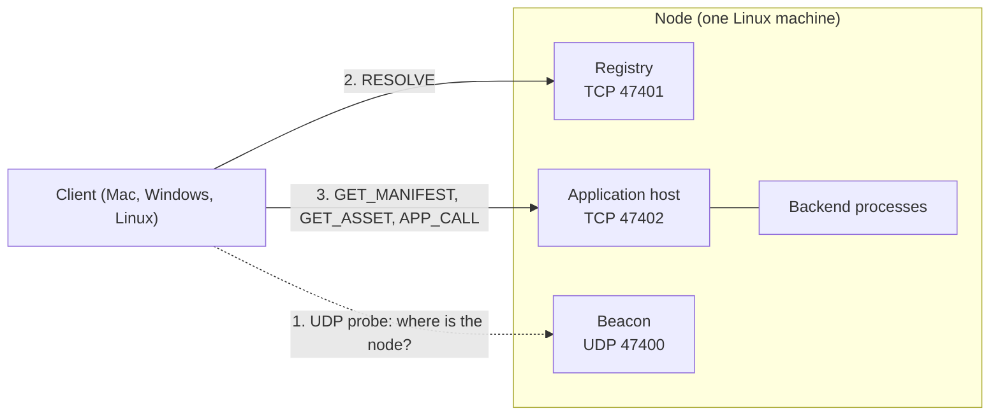
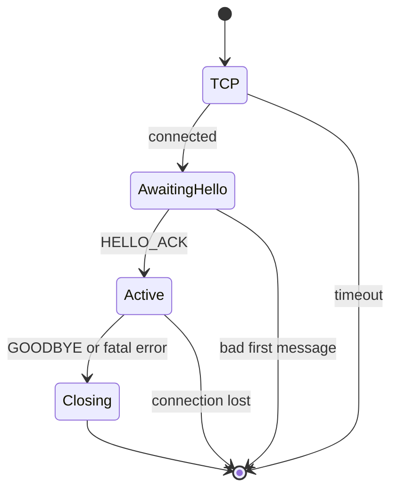
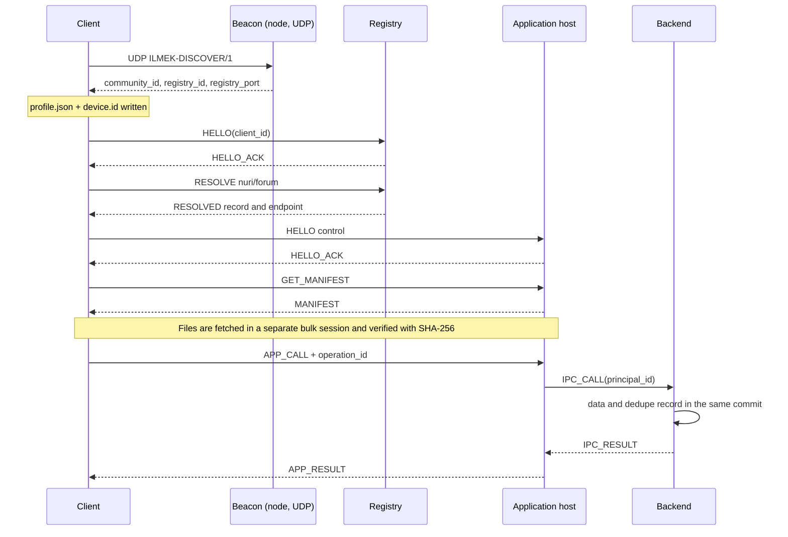
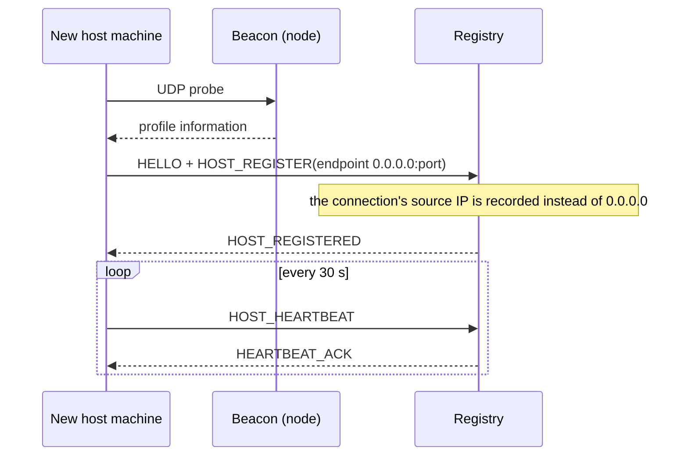

# ILMEK/1 — Application Protocol (simple edition)

**Contract version:** 1.0-simple — no identity proof, plain TCP, automatic joining
**Branch:** `feat/simple-no-security`
**Status:** Describes the actual behavior of this branch. It is not a published internet standard. It is a deliberate simplification of the TLS 1.3 / certificate / signature contract on `main`; see [decision 0005](docs/decisions/0005-simple-no-security.md).
**Product and setup:** [README.md](README.md)
**Naming:** The project is **İlmek**, the English protocol name is **Ilmek Protocol**, the version is `ILMEK/1`, the application URI scheme is `ilmek://`. Technical identifiers are ASCII.

> **This version has no security.** Connections are not encrypted, servers and clients do not prove who they are, packages are not signed. Anyone on the network can join the community, read traffic and publish applications. Use it only on a closed network you trust. Security will be added later as a new version of this contract.

> This document is written so that two independent implementations of ILMEK/1 interpret the same bytes and message behavior. MUST = required; MUST NOT = forbidden; SHOULD = required unless a reason is documented.

## 1. Architecture

**Network (Wi-Fi, Ethernet, any IP link) → IP → TCP → ILMEK/1.**

- ILMEK/1 is an application-layer protocol, at the layer where HTTP lives. It does not replace TCP or IP. Which physical link is used does not matter: two machines on the same IP network are enough. No special hardware (two Wi-Fi cards, an access point) is needed.
- Tunneling over HTTP, HTTPS, WebSocket or gRPC MUST NOT be used.
- This version has no TLS and no ALPN. If security is added later it will be a new version.
- QUIC, CBOR, Protobuf and compression are outside ILMEK/1.0.
- File bodies are raw bytes; metadata is UTF-8 JSON.
- Large files travel on a separate `bulk` connection. File transfer is never added to the control/RPC connection.



## 2. Endpoints and connection modes

| Endpoint | Default | Accepted mode | Purpose |
| --- | --- | --- | --- |
| Registry | TCP 47401 | `control` | names, hosts, application records |
| Host | TCP 47402 | `control`, `bulk` | application packages and backend calls |
| Beacon | UDP 47400 | — | finding the node (section 3) |

Ports are configurable project defaults; no IANA assignment is claimed. Address records carry the real port. A registry and a host can run together in one process (`ilmek node`); a host can also run on a separate machine (`ilmek host start`).

## 3. Identity, joining and discovery

### 3.1 No identity proof

- Each device generates its own UUIDv7 `peer_id` on first use and stores it in its device directory.
- The client **declares** this id in `HELLO.client_id`. Nothing verifies it; a device can claim another device's id. The id only tells devices apart and records ownership (namespaces, applications).
- The server does not change `client_id` during a session; `principal_id = client_id`. The host passes it to the backend as `IPC_CALL.principal_id`; a claim inside a message body cannot override the authoritative id.
- There are no join tokens, certificates, CA, CSRs, revocation lists or roles. Everyone who can connect to the registry is a community member.

### 3.2 Joining (automatic)

A device joins the community without any file or code:

1. The device finds the node in one of three ways; all yield the same information: `community_id`, `registry_id` and the registry address (section 3.3).
   - **UDP beacon:** a UDP probe (16 bytes) is broadcast and the first answer is used. The registry address is the **source IP** of the answer datagram.
   - **TCP scan:** if UDP is blocked, the device tries the registry port (47401) on every address of its own /24 network (at most 64 addresses at a time, 700 ms per address).
   - **Known address:** `ilmek join --registry IP:PORT` connects only to that TCP port (section 3.3, "TCP probe"); UDP is not needed.
   The first two run together; whichever answers first wins.
2. The device writes this information (`profile.json`) and its own id (`device.id`) to its device directory. Later starts do not discover again.

If the network blocks both UDP and the TCP port, the device cannot find the node; open the firewall first.

### 3.3 Discovery datagrams (UDP)

- Probe: ASCII `ILMEK-DISCOVER/1` (16 bytes), sent to `255.255.255.255:47400` and `127.0.0.1:47400`; repeated every 500 ms, 4 s in total.
- Answer: UTF-8 JSON `{"ilmek":1,"community_id":UUID,"registry_id":UUID,"registry_port":U53}`, at most 1024 bytes.
- The responder (the node) listens on the UDP port. If the port is taken, the node keeps running and is only not discoverable by UDP.
- The port can be changed with the environment variable `ILMEK_DISCOVERY_PORT`; all devices on a network must use the same value. The registry port tried by the TCP scan is 47401 by default (`ILMEK_REGISTRY_PORT`).

**TCP probe.** A device that knows the registry address learns the community id without UDP: it sends `HELLO` with a random `community_id`; the registry rejects it with `INVALID_MESSAGE` / `community mismatch` and returns `{community_id, server_id, server_role}` in `ERROR.details` (`server_role` is `"registry"` or `"host"`). If `server_role` is `"registry"` the device joins with this information. This information is not secret in this version (no security). A node that does not return this detail appears as "did not answer like an İlmek registry".

### 3.4 Host address

A host does not need to know its external address. If it sends `HOST_REGISTER.endpoint.ip = "0.0.0.0"`, the registry records the **source IPv4 address** of the connection. A host on the registry's own machine connects over loopback, so `127.0.0.1` is recorded; when the recorded address is loopback and the client's own registry address is not, the client connects to the host **using the registry's address** (the `host_address` rule).

## 4. Basic data types

| Type | Exact form |
| --- | --- |
| `UUID` | Lowercase canonical UUIDv7; `^[0-9a-f]{8}-[0-9a-f]{4}-7[0-9a-f]{3}-[89ab][0-9a-f]{3}-[0-9a-f]{12}$` |
| `U53` | JSON integer, 0..9007199254740991; float/exponent forms and negative values are forbidden |
| `Timestamp` | Unix epoch milliseconds, U53 |
| `Hash` | SHA-256, 64 lowercase hex characters |
| `Token` | Base64url without padding; byte limit per field |
| `Name` | `[a-z0-9](?:[a-z0-9-]{0,46}[a-z0-9])?`; 1..48 characters |
| `Version` | Three numeric components `major.minor.patch`; no needless leading zeros; each 0..2147483647 |
| `Path` | Relative POSIX path inside a package; also the rules of section 15 |
| `Method` | `[a-z][a-z0-9_.]{0,63}` |
| `Cursor` | Opaque base64url string issued by the server, at most 512 characters |

In JSON metadata, duplicate keys, a BOM, invalid UTF-8, NaN/Infinity, parser-dependent number forms and nesting deeper than 16 are forbidden. Strings are limited to 1024 UTF-8 bytes unless stated otherwise. At most 256 object keys and 256 array items are accepted. Metadata and body lengths already bound the total size. (Bodies use a relaxed profile, see [decision 0002](docs/decisions/0002-json-profiles.md).)

The protocol does not depend on JSON field order. For anything that is hashed, the **exact bytes as sent** are used; they are never re-serialized.

Schema notation: `field:Type` is a required field; `field:Type|null` means the field is present and may be null. Unless stated otherwise all fields are required. Undefined metadata/data fields are rejected. The business schema of an application RPC JSON body belongs to the backend.

### 4.1 UUIDv7 generation, storage and reuse

- In this contract `UUID` means **RFC 9562 UUIDv7 only**. Community, peer/server, principal, publisher, app, request, operation, session, subscription, event and snapshot ids are UUIDs. Hashes, revisions, sequences and opaque cursors are not UUIDs and keep their own types.
- Wire form: 36 lowercase ASCII characters with hyphens. The version nibble is 7 and the RFC variant bits are `10`. The nil UUID and other versions are rejected.
- 48 bits of Unix epoch milliseconds; for the 74 bits other than version/variant an RFC-compliant library with cryptographically secure randomness is preferred. Generating a UUID needs no central registry call and no internet.
- V1 promises no strict global or in-process monotonic order. Random UUIDv7 values from the same millisecond may not sort in generation order; clocks may go backwards and differ between devices. Use revision/sequence/cursor for business order.
- The time inside a UUID can reveal approximately when an id was generated. For trustworthy audit time the server keeps its own `created_at`; a client's UUID time is not proof of authority or expiry.
- A UUIDv7 is not a secret token, password or encryption key.
- A request id is new for every request. An operation id is generated when a write is first created and kept unchanged across all its retries; the v7 timestamp is not regenerated to refresh it.
- A persistent app/server/peer id is not regenerated on restart, application version change or IP change. In SQLite a UUID may be stored as canonical text or as a 16-byte network-order BLOB; one representation is chosen per column. The little-endian byte layout of .NET GUIDs is not carried on the wire.
- Appropriate UNIQUE/PRIMARY KEY constraints are still required. If a collision is noticed for a newly created entity id, it is regenerated in a controlled way; an idempotent operation id is never silently changed because of a collision.
- JavaScript `crypto.randomUUID()` MUST NOT be used directly; it does not produce UUIDv7. Use the native shared core or a verified UUIDv7 library. Relabeling a UUIDv4 as v7 by changing the version bits is forbidden.

## 5. Byte-level frame

| Offset | Bytes | Content |
| --- | --- | --- |
| 0 | 4 | ASCII `ILM1`: hex `49 4c 4d 31` |
| 4 | 4 | Metadata length in bytes; unsigned 32-bit big-endian |
| 8 | 4 | Body length in bytes; unsigned 32-bit big-endian |
| 12 | M | Metadata JSON bytes |
| 12+M | B | Raw body bytes |

- `1 ≤ M ≤ 65536`, `0 ≤ B ≤ 262144`.
- Largest frame: `12 + 65536 + 262144 = 327692` bytes.
- Frames are sent over plain TCP (no encryption). The loopback-only local IPC of section 16 uses the same frame codec; it is not a network endpoint.
- A size outside the limits, a bad magic or an incomplete frame closes the connection. Memory is never allocated according to a size an attacker declares.
- A single TCP read is not assumed to be one frame. Partial reads are accumulated; extra bytes in the same read are kept for the next frame.
- If a frame is not complete 30 seconds after its first byte, the connection is closed. Partial progress does not reset this total deadline.
- Several tasks must not write to the same TCP stream without coordination. A single writer queue or an equivalent frame-integrity guarantee is required.

### Common metadata object

```json
{
  "type": "RESOLVE",
  "request_id": "019de1df-a000-7111-8111-111111111111",
  "community_id": "019de1df-a000-7222-8222-222222222222",
  "data": {
    "namespace": "nuri",
    "slug": "forum"
  }
}
```

There are exactly four top-level fields: `type`, `request_id`, `community_id`, `data`. `type` is an uppercase enum of this contract; the ids are UUIDs; `data` is an object. The body format is determined by the message type; there is no HTTP-style content negotiation.

## 6. Connection state machine



1. TCP connect deadline: 5 s.
2. The client sends `HELLO` as its first message within 5 s.
3. The server accepts no other application request before it sends `HELLO_ACK`.
4. After the ACK the connection mode does not change.
5. For an incompatible community/version/mode the server sends `ERROR` if possible, then closes the connection.
6. Normal close is `GOODBYE`/`GOODBYE_ACK`; if it ends before in-flight work finishes, the outcome of writes is unknown to the client.
7. A socket EOF or timeout does not mean the backend transaction was rolled back.

### HELLO — client → server

`data = {version:1, client_id:UUID, mode:"control"|"bulk", client_name:string, client_version:Version}`; empty body. `client_name` is at most 64 UTF-8 bytes. `client_id` is the declared id of section 3.1.

### HELLO_ACK — server → client

`data = {version:1, session_id:UUID, server_id:UUID, server_role:"registry"|"host", mode:enum, max_inflight_requests:U53, max_subscriptions:U53, server_time_ms:Timestamp}`; empty body.

- `control`: max in-flight 1..16; max subscriptions 0..8 on a host, 0 on the registry.
- `bulk`: max in-flight 1; subscriptions 0.
- Frame limits are fixed; there is no negotiation for larger frames.
- `server_id` is informational; the client cannot verify it. `server_time_ms` is for diagnostics; the device clock is never changed silently.
- The client closes the connection if `server_role` is not what it expected.

## 7. Request/response, session and limits

- The client initiates requests. The server only sends responses and permitted subscription events.
- Every new request has a new UUIDv7 `request_id`, never reused on the same connection.
- A normal response carries the same request id. The response type is defined per operation. A response with an unknown or different request id, or for the wrong app id, is a protocol violation; the client closes the connection.
- `ERROR` is the terminal response of a request unless stated otherwise.
- `SUBSCRIBED` and `ASSET_INFO` announce the start of a longer stream; the specific lifecycles below apply.
- Responses on one socket need not follow request order; they are matched by request id.
- To keep in-process dedupe state bounded, a connection accepts at most 100000 new requests, then sends `DRAIN`. The client opens a new connection. The limit counts control/transfer requests and their id records, not EVENT frames. For unfinished writes the same operation id is kept.
- Reference host limit: 128 concurrent connections; an administrator can change it. At the limit new connections are refused instead of queuing without bound.
- Default client deadline for control requests: 15 s. Reads may be retried; writes follow section 12.
- A client that has been idle outbound for 20 s sends `PING`. If no `PONG` arrives within 10 s it treats the connection as unhealthy and closes it. A server may close a session that received no inbound frame for 90 s.
- A small separate control queue is reserved for PING/PONG, CANCEL, EVENT_ACK, UNSUBSCRIBE and GOODBYE; a long transfer cannot block them forever.

`PING data={nonce:Token}` and `PONG data={nonce:Token}`; the nonce is 16 bytes, the body is empty. PONG returns the received nonce unchanged.

`GOODBYE data={reason:"user"|"shutdown"|"reconnect"}` → `GOODBYE_ACK data={}`. The server stops accepting new requests and closes the connection; this is not a commit/rollback answer.

A server may start `DRAIN`; it carries the HELLO request id; `data={reason:"request_limit"|"shutdown", grace_ms:U53}`. Grace is at most 30000 ms. New application requests get `SERVER_DRAINING`. Existing short requests may finish within the grace time; a bulk connection is reopened and the file resumes at its offset.

## 8. Message catalog

All messages share the four common metadata fields. The tables below define only `data` and the body.

### 8.1 Registry control messages

| Request | Data | Body | Success response |
| --- | --- | --- | --- |
| `RESOLVE` | `{namespace:Name, slug:Name}` | empty | `RESOLVED` |
| `LIST_APPS` | `{query:string, limit:U53, cursor:Cursor\|null}` | empty | `APPS_LISTED` |
| `HOST_REGISTER` | `{operation_id:UUID, endpoint:Endpoint, expected_revision:U53}` | empty | `HOST_REGISTERED` |
| `HOST_HEARTBEAT` | `{host_revision:U53}` | empty | `HEARTBEAT_ACK` |
| `REGISTER_APP` | `{operation_id:UUID, namespace:Name, slug:Name, app_id:UUID, server_id:UUID, version:Version, manifest_hash:Hash, name:string, description:string}` | empty | `APP_REGISTERED` |
| `UNREGISTER_APP` | `{operation_id:UUID, app_id:UUID, expected_revision:U53}` | empty | `APP_UNREGISTERED` |
| `UPDATE_APP` | `{operation_id:UUID, app_id:UUID, expected_revision:U53, server_id:UUID, version:Version, manifest_hash:Hash, name:string, description:string}` | empty | `APP_UPDATED` |

`Endpoint={ip:string, port:U53}`; ip is a canonical IPv4 address, port 1..65535. In `HOST_REGISTER`, `ip="0.0.0.0"` lets the registry fill in the source address (section 3.4). If the registry configuration `allowed_endpoints` is not empty, an address outside those networks is rejected with `FORBIDDEN`; if it is empty every address is accepted.

`RESOLVED data={record:AppRecord, cache_ttl_seconds:60}`; empty body.

`APPS_LISTED data={snapshot_id:UUID, next_cursor:Cursor|null}`; the body is UTF-8 JSON `{"records":[AppRecord,...]}`. `limit` is 1..50, query at most 128 bytes. The next page keeps query and limit; the cursor is bound to them. A snapshot is kept for 5 minutes, then `CURSOR_EXPIRED`. A cursor is bound to the `client_id` that obtained it.

`HOST_REGISTERED data={server_id:UUID, revision:U53, heartbeat_interval_seconds:30, lease_seconds:90}`. `server_id` is the `client_id` declared by the host. The first registration uses expected_revision=0; later changes require the current revision.

`HEARTBEAT_ACK data={lease_expires_at_ms:Timestamp}`. A host renews only its own lease. A heartbeat does not prove that the host endpoint is reachable from every client.

`APP_REGISTERED` and `APP_UPDATED data={record:AppRecord}`; empty body. The registration and the operation dedupe result are in the same transaction. Rules:

- The **first device to register** a `namespace` owns it; later registration/update/removal is possible only with the same `client_id`, otherwise `FORBIDDEN`. (Because `client_id` is not verified, this is a rule against accidents, not a security rule.)
- `REGISTER_APP` and `UPDATE_APP` require the target `server_id` to be a registered host, otherwise `INVALID_MESSAGE`. If the host has not registered yet the client waits briefly and retries.

`APP_UNREGISTERED data={app_id:UUID, revision:U53}`; empty body. The registry keeps name ownership and the last revision as a tombstone; LIST_APPS and RESOLVE no longer return the record. Publishing again uses REGISTER_APP with the same owner and the same app_id, carries a new operation id and increases the revision. No other application can take the old name. Removing from the catalog does not delete content already downloaded; the host must be stopped separately to close backend access. Repeating with the same operation id returns the old result.

The registry cannot replace a new application record by assigning another `app_id` to an existing namespace/slug. On update, `app_id` and namespace do not change; the version cannot go backwards and the same version cannot be published with different content (`VERSION_CONFLICT`).

### 8.2 AppRecord

```text
{
 community_id:UUID, namespace:Name, slug:Name, app_id:UUID,
 publisher_id:UUID, server_id:UUID, endpoint:Endpoint,
 version:Version, manifest_hash:Hash, name:string, description:string,
 revision:U53, lease_expires_at_ms:Timestamp,
 availability:"recent_heartbeat"|"stale"|"unknown"
}
```

Name is at most 128 and description at most 2048 UTF-8 bytes; these are explicit exceptions to the general string limit. `publisher_id` is the id declared by the device that registered the application.

The name cache is refreshed after 60 seconds. If the registry is unreachable, a previously resolved record may be used for up to 24 hours, **marked as stale**. A past heartbeat lease is an indicator of reachability. A name that was never cached cannot be resolved while the registry is down.

## 9. Host control messages

| Request | Data | Body | Success response |
| --- | --- | --- | --- |
| `GET_MANIFEST` | `{app_id:UUID, version:Version, manifest_hash:Hash}` | empty | `MANIFEST` |
| `APP_CALL` | `{app_id:UUID, client_app_version:Version, method:Method, operation_id:UUID\|null, payload_hash:Hash}` | UTF-8 JSON object | `APP_RESULT` |
| `SUBSCRIBE` | `{app_id:UUID, client_app_version:Version, topic:Method, cursor:Cursor\|null}` | empty | `SUBSCRIBED`, then `EVENT` |
| `EVENT_ACK` | `{subscription_id:UUID, sequence:U53, cursor:Cursor}` | empty | `EVENT_ACKED` |
| `UNSUBSCRIBE` | `{subscription_id:UUID}` | empty | `UNSUBSCRIBED` |

On every request the host checks that the application exists and is running and that the version the client opened is compatible. There is no access control: any device connected to the community can call any application. An application can separate its data by device id (`principal_id`); the example `notes` application does this.

`MANIFEST data={app_id:UUID, version:Version, manifest_hash:Hash}`; the body is the stored **exact manifest.json bytes**. The manifest body is at most 256 KiB; the client compares its SHA-256 with the `manifest_hash` in the record. For a wrong hash/version the answer is `VERSION_CONFLICT` or `NOT_FOUND`; another version is never returned automatically.

`APP_RESULT data={app_id:UUID, operation_id:UUID|null}`; the body is application-specific UTF-8 JSON object, at most 256 KiB. A business failure is returned as `ERROR`; HTTP status codes such as 200/404 are not used. The client does not accept a response that carries a different app_id or operation id.

On the client, package version, backend version and SDK version must be compatible. An incompatible backend operation returns `APP_VERSION_UNSUPPORTED`. Backend method schemas are versioned with the package; the runtime does not make all versions compatible automatically.

## 10. Event subscriptions

`SUBSCRIBED data={subscription_id:UUID, app_id:UUID, topic:Method, cursor:Cursor, window:16}`; empty body. This ACK releases the short request slot of the SUBSCRIBE request; the subscription counts toward its own limit of 8. Events and subscription errors carry the original SUBSCRIBE request id.

- `cursor=null` is a new subscription: the server first creates a boundary cursor and sends only events after that boundary. The initial screen's history is fetched with a separate `APP_CALL`. To avoid missing data in between, subscribe first, then fetch the list/snapshot and merge by event id/revision.
- If a cursor is given, events **after** that cursor are resent.
- A cursor is bound to community, principal, app and topic; another device's cursor is not accepted.
- The server offers a stream that keeps at least the last 10000 events of that topic. An older cursor gets `CURSOR_EXPIRED`; the client takes a new snapshot. Not every application has the same retention needs; larger retention is a local application decision.
- In the example backends the event record for a data change is written in the same database transaction. What is provided is a durable, re-readable event log, not exactly-once delivery.

`EVENT data={subscription_id:UUID, app_id:UUID, topic:Method, sequence:U53, event_id:UUID, cursor:Cursor}`; the body is a UTF-8 JSON object.

- Sequence is 1 for the first event and increases consecutively over the subscription on the connection. The durable position marker is the cursor; the sequence restarts on reconnect.
- A client may receive the same event id again; it is processed with at-least-once delivery in mind.
- The SDK sends `EVENT_ACK` after it has stored the processed cursor locally. A crash between processing and the local cursor write can still create a duplicate; deduplication is needed.
- An ACK refers to the last **contiguously processed** sequence and its cursor. An ACK for a later or wrong cursor gets `INVALID_MESSAGE`.
- `EVENT_ACKED data={subscription_id:UUID, sequence:U53}`. Empty body.
- The server sends at most 16 events awaiting an ACK. When the window is full it stops reading from the durable log; it does not open an unbounded RAM queue.
- If there is no ACK progress for a pending event for 30 s, the server sends `ERROR/SLOW_CONSUMER` with the original subscription request id and closes only that subscription.
- After `UNSUBSCRIBED data={subscription_id:UUID}` is sent, no new EVENT may be sent for that subscription. Events queued before the ACK may arrive before it.
- Unsubscribing the same subscription id again is safe; the answer is again UNSUBSCRIBED. No information leaks through ids belonging to someone else.
- When the connection closes, all subscriptions close; the client subscribes again with its last durable cursor. There is no automatic unbounded reconnect; exponential backoff and jitter apply.

## 11. File transfer — bulk/host only

### 11.1 Request and responses

`GET_ASSET data={app_id:UUID, version:Version, manifest_hash:Hash, path:Path, asset_hash:Hash, offset:U53}`; empty body.

The host checks that the path is in the verified manifest and that hash and version match. No absolute file-system path supplied by the client is ever opened.

Successful response sequence:

1. `ASSET_INFO data={app_id:UUID, version:Version, path:Path, asset_hash:Hash, total_size:U53, offset:U53, chunk_size:65536}`; empty body.
2. Zero or more `ASSET_CHUNK data={sequence:U53, offset:U53}`; the body is raw file bytes.
3. `ASSET_END data={asset_hash:Hash, total_sent:U53}`; empty body; terminal.

All responses carry the same GET_ASSET request id. Chunk sequence starts at 0 and increases consecutively. Each chunk's offset matches the end of the previous chunk. The body is 1..65536 bytes; the last chunk may be smaller. A new GET_ASSET before the transfer finishes gets `RESOURCE_EXHAUSTED`; there is one active file per bulk connection.

`offset` may be in 0..total_size. For `offset=total_size` and for an empty file, INFO is followed by END and no CHUNK is sent. `total_sent = total_size - start_offset` must hold.

### 11.2 Resume, integrity and cancel

- Files are kept under an immutable application version. A file cannot change within the same version.
- Resuming uses a new bulk connection and a new request id, with the same app/version/manifest hash/asset hash.
- The client keeps the incomplete file in a temporary area. The file does not become active until the SHA-256 of the **whole file**, including the starting prefix, is verified.
- Receiving END does not mean the content hash check passed; the client does the check itself.
- Total package size, extracted file count, disk quota and free space are checked.
- `CANCEL data={target_request_id:UUID}` cancels only a GET_ASSET; empty body.
- On an active transfer the server, after the queued chunks, sends a terminal `ERROR/CANCELLED` for the target request id, then answers the CANCEL request with `CANCEL_ACK data={target_request_id:UUID, result:"cancelled"}`.
- If the transfer's terminal response is already queued the ACK is `already_finished`; if the id is unknown in this session it is `not_found`. END and ERROR are never both sent as terminal responses for one request.
- CANCEL does not roll back an APP_CALL transaction and must not be used for that. Subscriptions are ended with UNSUBSCRIBE.
- The client may close the socket without waiting for the CANCEL ACK; the server then also uses the socket cancellation for resource cleanup.
- A progress bar is based on actually received bytes. "Installed" is not shown before hash verification completes.

## 12. Writes and idempotency

### APP_CALL digest

`payload_hash` is the SHA-256 of this byte sequence:

```text
ASCII("ILMEK-CALL-V1") || 0x00 ||
UTF8(app_id) || 0x00 || UTF8(method) || 0x00 || body_bytes
```

This notation describes concatenation; the `||` characters are not sent. The host recomputes the hash. The JSON body can only be an object; the same semantic input sent with a different byte sequence has a different hash. For write retries the client keeps the bytes of the first body.

- The backend's method table decides whether a method is read-only or a write. A client's `read_only` claim is not trusted.
- For a write `operation_id` MUST be a UUID; for a read it MUST be null.
- Dedupe key: `(community_id, app_id, principal_id, operation_id)`; `principal_id` is the declared `client_id`.
- Method, hash and result are in the dedupe record. The same key with a different method/hash gives `OPERATION_CONFLICT`.
- The business change, the event outbox record and the successful result are stored in the same database transaction.
- Two concurrent requests with the same key produce a single write through a unique constraint/transaction check. The second request may wait for the result; if its deadline expires it may get `OPERATION_PENDING` and is repeated with the same id.
- On a retry the stored result is returned without running the application again; a new request id is used and the operation id is kept.
- A successful APP_RESULT is not sent before a durable commit result exists.
- A transient service error or a rollback before commit creates no success record. The write can be executed again with the same id. After an uncertain timeout the client still does not generate a new id.
- In the V1 example applications dedupe records do not expire automatically. Manual deletion removes the retry guarantee for those ids and is documented as a maintenance action.
- External side effects (e-mail, payments, etc.) are outside this atomicity. The SDK does not offer a general "exactly once" guarantee.

On every retry the application's readiness is checked first, then the dedupe record. When an existing dedupe result is found, revision/version preconditions are not applied again, so a previous success is not turned into a false conflict. For new work the revision check is done inside the transaction.

Registry mutations MUST also use an operation id. Dedupe scope: `(community_id, principal_id, message_type, operation_id)`; the typed data fields other than the operation id are stored and compared for equality. JSON key order does not matter; all values must be equal. The registry record and the result are committed in the same transaction.

**A timeout is not a decision:** show the user "result could not be verified; checking again". Success or failure is not guessed. Repeating with the same operation id is the safe way to learn the result.

## 13. Error contract

`ERROR data={code:enum, message:string, retryable:boolean, retry_after_ms:U53|null, details:object}`; empty body. Message is at most 512 UTF-8 bytes; details at most 2048 bytes. An error for a business message carries the same request id. If the frame is corrupt the request id may be unavailable; then the connection is closed without inventing an ERROR.

| Code | Meaning / behavior |
| --- | --- |
| `UNAUTHORIZED` | Currently produced by no path; reserved for when identity is added |
| `FORBIDDEN` | Namespace/application belongs to another device, or the endpoint is outside the allowed networks |
| `NOT_FOUND` | Target not found |
| `NAME_CONFLICT` | The name is used by another record |
| `REVISION_CONFLICT` | Registry/application optimistic revision mismatch |
| `VERSION_CONFLICT` | Requested application version/hash does not match the offered content |
| `APP_VERSION_UNSUPPORTED` | Client package version is incompatible with the backend contract |
| `UNSUPPORTED_VERSION` | İlmek protocol version not supported; the connection closes |
| `UNSUPPORTED_MESSAGE` | Type not in the contract; request rejected |
| `INVALID_MESSAGE` | Field/format/mode/sequence error |
| `TOO_LARGE` | Valid business request exceeds a content limit |
| `RATE_LIMITED` | Request rate limit; retry_after_ms 0..60000 |
| `RESOURCE_EXHAUSTED` | No queue/connection/work slot or disk resource |
| `APP_UNAVAILABLE` | Backend is not running or not ready |
| `OPERATION_CONFLICT` | The same operation id was used with different content |
| `OPERATION_PENDING` | The same write is still being resolved; repeat with the same id |
| `CURSOR_EXPIRED` | A new list/snapshot/subscription start is required |
| `SLOW_CONSUMER` | The event receiver does not advance its ACK; the subscription is closed |
| `HASH_MISMATCH` | Content/request digest mismatch |
| `CANCELLED` | Transfer cancelled |
| `CANNOT_CANCEL` | The target is not a cancellable transfer |
| `TIMEOUT` | The server's business deadline expired; this alone does not prove the commit outcome |
| `SERVER_DRAINING` | A new connection must be opened |
| `INTERNAL` | Safe generic server error; no stack trace is exposed |

`retryable=true` does not permit a write with a new operation id. The SDK always keeps the first id/body for a write. Retry defaults to at most 5 automatic attempts with jittered upper bounds of 0.5, 1, 2, 4, 8 seconds. After that the status is shown to the user; a queue never grows silently without bound. RATE_LIMITED timing is respected.

On the client, network errors are classified separately: no connection, wrong network, timeout. They are not presented as if a server ERROR frame had been received.

## 14. Authorization and application version

This version has **no** authorization; there are only consistency rules:

| Operation | Rule |
| --- | --- |
| HELLO/PING/GOODBYE | anyone |
| RESOLVE/LIST_APPS | anyone |
| HOST_REGISTER/HEARTBEAT | anyone; the record is kept under `client_id` |
| REGISTER_APP | the `client_id` that first registered the namespace; the target host must be registered |
| UPDATE_APP/UNREGISTER_APP | the `client_id` that registered the application |
| GET_MANIFEST/GET_ASSET | anyone |
| APP_CALL/SUBSCRIBE | anyone; the application's own method/topic rules apply |
| EVENT_ACK/UNSUBSCRIBE | the owner of the subscription in the same session |
| CANCEL | the owner of the transfer on the same connection |

The identity is passed by the host to the backend (`IPC_CALL.principal_id`); a `principal_id` in the JS body can never change this value. Because `client_id` is not verified, this separates devices; it is not authorization.

The mandatory `client_app_version` field in APP_CALL and SUBSCRIBE is the verified package version the client opened. The host lists the versions it accepts in the local backend configuration; by default only the active version. An older incompatible client gets APP_VERSION_UNSUPPORTED and is directed to the new manifest/asset flow. The version is not included separately in the payload hash; operation dedupe is preserved across a version update for the same method/input. If method semantics change incompatibly, the method name or an explicit data schema version is changed.

## 15. Package manifest and paths

Normative manifest object:

```text
{
 schema_version:1, app_id:UUID, publisher_id:UUID,
 namespace:Name, slug:Name, name:string, description:string,
 version:Version, min_runtime_version:Version,
 entrypoint:Path, permissions:[Permission], backend_required:boolean,
 files:[{path:Path, size_bytes:U53, sha256:Hash}],
 total_size_bytes:U53
}
```

`Permission` takes only the values `app.call`, `app.subscribe`, `storage.local`. The permission list has no duplicates. `app.call`/`app.subscribe` allow access only to the application's own backend. The host side checks identity and method permissions separately. An unknown permission is rejected.

- Manifest at most 256 KiB, at most 1024 files; package total 100 MiB by default.
- The package size quota can be raised by a local administrator; frame limits do not change.
- `total_size_bytes` is the overflow-checked sum of the file sizes.
- Files are sorted ascending by the UTF-8 bytes of the path, without duplicates.
- `entrypoint` is in the list and ends with `.html`.
- Path: at most 240 bytes; slash-separated ASCII `[A-Za-z0-9._-]+` segments. Empty segments, `.`/`..`, a leading slash, backslash, colon, NUL, percent-encoding and a trailing dot are forbidden.
- Windows device names (CON/PRN/AUX/NUL/COM1..9/LPT1..9, including with extensions) and paths that collide when case-folded are rejected.
- The manifest itself is not in the file list; files are listed relative to `assets/`. A package cannot escape through symlinks/hardlinks.
- The manifest on disk is stored as bytes and never re-serialized.

**There is no signature.** Integrity is protected by SHA-256: the client compares the `manifest_hash` in the registry record with the digest of the downloaded manifest bytes, then the size and SHA-256 of every file in the manifest with the file on disk. This catches **corruption and partial downloads**; it does not protect against a malicious host (which can change both manifest and record).

Verification order: byte size → manifest hash → schema/path/permission/limits → file sizes/hashes → atomic activation. Invalid content is never run in the application WebView. The package directory contains only `manifest.json` and `assets/`.

## 16. Native SDK bridge and local backend IPC

### Client side

JavaScript does not open arbitrary sockets. The native runtime knows the loaded app context and routes SDK requests only to that app's server. The app id, publisher key or registry endpoint is not changed because the UI sent one. Local storage is scoped to the community/device/app.

### Server side: local IPC contract

Host → backend communication uses only a random port opened on loopback. This **local IPC** is not the ILMEK/1 service port on the network. Binding to an external interface MUST NOT be done. Byte framing is as in section 5. The common metadata fields are again type/request_id/community_id/data; messages with an `IPC_` prefix are rejected on the network endpoint.

- The host starts a local listener and gives the backend at least 32 random bytes of token, the loopback port, community_id and app_id over the inherited stdin pipe. The secret is not put on the command line or in logs.
- The backend opens the connection; the first message is `IPC_HELLO data={token:Token, app_id:UUID}`. The host answers `IPC_READY data={app_id:UUID}`. Bodies are empty. The token is specific to the process instance; with a wrong id or token the socket closes.
- After IPC_READY the **host is the requesting side**, and the backend produces responses/events. This direction is independent of the client/server names in the network protocol.
- `IPC_CALL`: the APP_CALL data with a mandatory `principal_id:UUID` added; the body is the same. The host adds the identity. The backend accepts only its assigned app_id.
- `IPC_RESULT`: the data/body of APP_RESULT. `IPC_ERROR`: the data/body of ERROR. The host checks schema and app scope before returning outward.
- `IPC_SUBSCRIBE`: SUBSCRIBE data with principal_id added. The answer is `IPC_SUBSCRIBED`, then `IPC_EVENT`; data/body and cursor semantics are the same as their network counterparts.
- `IPC_EVENT_ACK`, `IPC_EVENT_ACKED`, `IPC_UNSUBSCRIBE`, `IPC_UNSUBSCRIBED`: the same data/body form as their network counterparts.
- The host maps external session request/subscription ids to unique local ids. Different clients sending the same UUID cannot cause a collision or authority crossover inside the IPC.
- When a network subscription closes, the IPC subscription ends too. If the backend crashes, the affected work becomes APP_UNAVAILABLE; writes with an uncertain commit result are recovered with the same operation id.
- The backend IPC does not allow access to other applications, registry administration, file downloads or arbitrary socket proxying.
- A backend executable run by the host's local administrator is trusted code; being a separate process is not a sandbox.

The Rust SDK implementation of this contract is explained with examples in [docs/BACKEND_IPC.md](docs/BACKEND_IPC.md). The normative fields are above; no different wire form is invented.

## 17. Reference flows

### 17.1 First start and opening an address



### 17.2 A host joining by itself



### 17.3 Committed, reply lost

1. The client sends APP_CALL with operation X.
2. The backend commits the data change and the result in the same transaction.
3. The connection drops while the reply is being sent; the client does not know the result.
4. In a new session the client repeats with a new request id, the **same operation X and the same body**.
5. The backend returns the result from the dedupe record; it does not write a second time.

## 18. Versioning and compatibility

- The protocol notation `ILMEK/1`, the 4-byte frame magic `ILM1` and HELLO version=1 are the identifiers of this version, used together. ALPN is not used in this version.
- The RPC hash domain prefix `ILMEK-CALL-V1` is fixed and followed by a single NUL byte; the preimage is defined in section 12. There is no manifest signature prefix in this version.
- **This version is not wire-compatible with ILMEK/1 on `main`:** `client_id` is required in HELLO; there is no ENROLL/GET_TRUST; `AppRecord`, `REGISTER_APP`, `UPDATE_APP` and `MANIFEST` carry no signature/key fields. Because of the strict schema the two versions reject each other.
- 1.0 is a strict schema: unknown messages/fields are not accepted automatically and their meaning is not guessed.
- Manifest schema_version and application version are separate from the wire version.

## 19. Resource management

- The control queue holds at most 64 pending frames by default, the writer queue at most 2 MiB. At the limit the producer is made to wait or an explicit error occurs; process memory does not grow without bound.
- Concurrent work per backend is 16 by default; the wait queue is 64; an administrator can change both.
- Unbounded response buffers are not accumulated for a client that does not read. If there is no write progress for 30 s the connection closes.
- If a large manifest/catalog response does not fit the frame limit, a smaller page or a suitable error is used.
- Logs may contain request id, error class, duration and size; bodies are not logged.
- **There is no confidentiality:** traffic is not encrypted; anyone on the same network can see the content.

## 20. Conformance checks

The checks below are covered by this branch's automated tests; the mapping is in [docs/TEST_REPORT.md](docs/TEST_REPORT.md).

| ID | Check |
| --- | --- |
| P01 | The 12-byte prefix, big-endian lengths and magic are correct |
| P02 | A frame that arrives in pieces yields the same message |
| P03 | Two frames arriving in one read are split correctly |
| P04 | An oversize frame is rejected before allocation |
| P05 | UUIDv7 form, duplicate JSON key, corrupt UTF-8 and unknown field are rejected |
| P07 | APP_CALL without HELLO is not accepted |
| P08 | Responses out of order are matched correctly by request id |
| P09 | The same operation id in parallel writes produces a single commit |
| P10 | The same id with a different payload produces OPERATION_CONFLICT |
| P13 | Asset offset/sequence deviation and hash mismatch are rejected |
| P14 | Exactly one terminal transfer response exists in a cancel/finish race |
| P15 | When the EVENT window is full the buffer does not grow; ACK resumes |
| P16 | Cursor expiry is explicit; no silent event loss |
| P19 | A failed package/update does not damage the previous active version |
| P20 | GET_ASSET is rejected on a control connection, APP_CALL on bulk |
| P21 | Another device's namespace/application cannot be updated |
| P23 | A large transfer does not use the control connection's writer queue |
| P24 | The native bridge rejects the wrong app context and arbitrary network access |
| P25 | A device finds the node by UDP discovery and joins |
| P26 | A `0.0.0.0` host registration is completed with the source IP |

P06 (TLS/ALPN/IP SAN), P11 (enrollment), P12 (identity-based access), P17/P18 (trust snapshot) and P22 (revocation) do **not exist** in this version: the corresponding features were removed.

`tests/protocol/fixtures/wire_examples.ilmek.json` holds small deterministic byte examples for this version's schema (HELLO `client_id`, unsigned manifest). The root `WIRE_EXAMPLES.json` belongs to the `main` contract and is not used by this branch's tests.

## 21. Open limits

- This file is normative for the wire format, message fields, errors/timeouts and protocol behavior.
- There is no security (see the notice at the top). This document is not a security audit.
- UDP discovery works only within one broadcast domain; for anything beyond a router the registry address is given.
- IPv4 only.
- Unit/integration tests do not replace a trial on a real multi-machine network.

## 22. References

- UUIDv7 normative definition: https://www.rfc-editor.org/rfc/rfc9562.html#section-5.7

ILMEK/1 messages, ports, limits and the role model are design decisions of this project.
