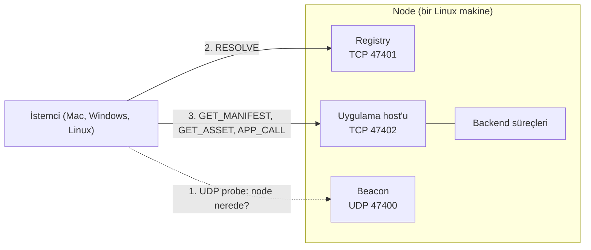
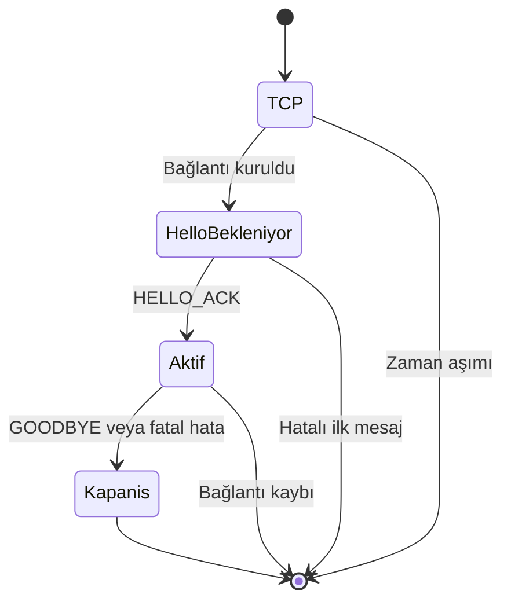
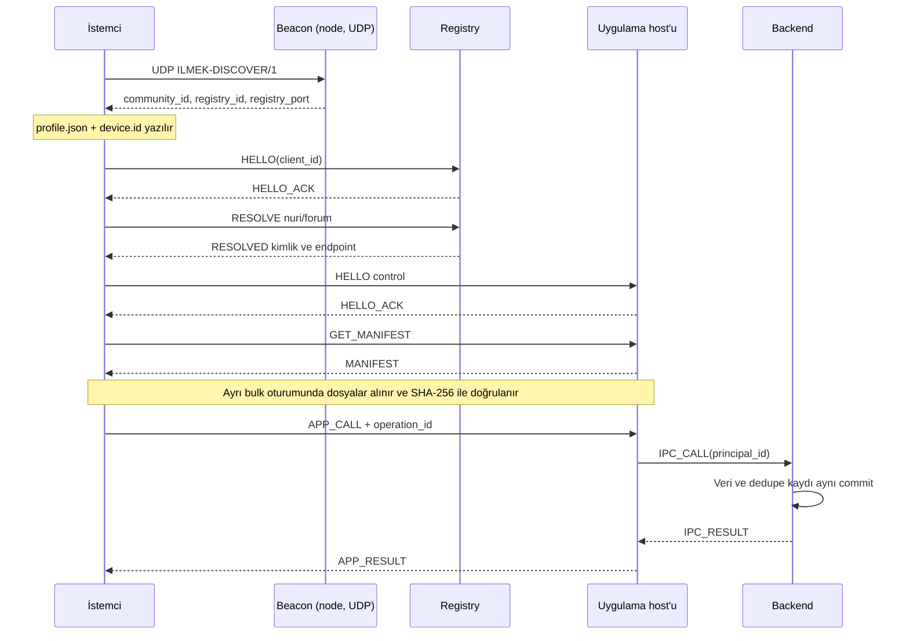
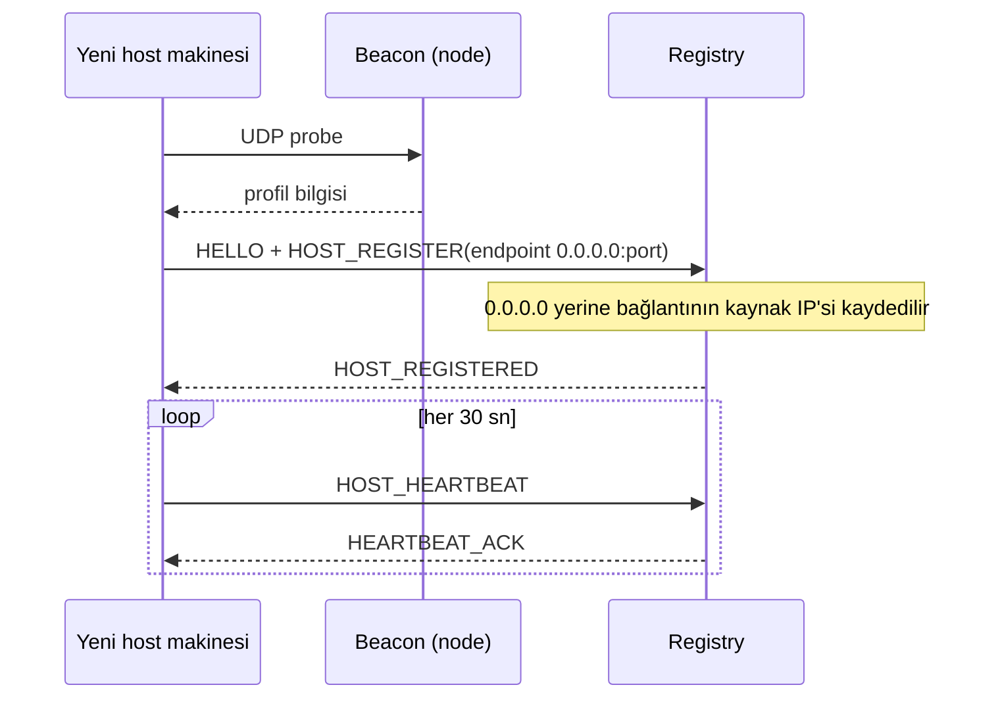

# ILMEK/1 — Uygulama Protokolü Sözleşmesi (basit sürüm)

**Sözleşme sürümü:** 1.0-basit — kimliksiz, düz TCP, otomatik katılım  
**Dal:** `feat/simple-no-security`  
**Durum:** Bu dalın gerçek davranışını anlatır. Yayımlanmış internet standardı değildir. `main` dalındaki TLS 1.3 / sertifika / imza tabanlı sözleşmeden bilinçli olarak sadeleştirilmiştir; bkz. [karar kaydı](docs/decisions/0005-simple-no-security.md).  
**Ürün ve kurulum:** [README.md](README.md)  
**Adlandırma:** Proje **İlmek**, İngilizce protokol adı **Ilmek Protocol**, sürüm `ILMEK/1`, uygulama adres şeması `ilmek://`. Teknik tanımlayıcılar ASCII'dir.

> **Bu sürümde güvenlik yoktur.** Bağlantılar şifrelenmez, sunucular ve istemciler kimlik kanıtlamaz, paketler imzalanmaz. Aynı ağdaki herkes topluluğa katılabilir, trafiği okuyabilir ve uygulama yayınlayabilir. Yalnızca güvendiğiniz, kapalı bir ağda kullanın. Güvenlik daha sonra bu sözleşmenin yeni bir sürümüyle eklenecektir.

> Bu belge ILMEK/1 konuşan iki bağımsız uygulamanın aynı byte dizisini ve mesaj davranışını yorumlaması için yazılmıştır. MUST = zorunlu; MUST NOT = yasak; SHOULD = aksi gerekçelendirilmedikçe uygulanmalı.

## 1. Mimari karar

**Ağ (Wi-Fi, Ethernet, herhangi bir IP bağlantısı) → IP → TCP → ILMEK/1.**

- ILMEK/1, HTTP'nin bulunduğu uygulama katmanındadır. TCP veya IP'nin yerine geçmez. Hangi fiziksel bağlantının kullanıldığı protokolü ilgilendirmez: aynı IP ağındaki iki makine yeterlidir. Özel donanım (iki Wi-Fi kartı, erişim noktası) gerekmez.
- HTTP, HTTPS, WebSocket ve gRPC üzerinden tünelleme MUST NOT kullanılmalı.
- Bu sürümde TLS yoktur; ALPN yoktur. İleride güvenlik eklenirse yeni bir sürüm olur.
- QUIC, CBOR, Protobuf, sıkıştırma ILMEK/1.0 kapsamında değildir.
- Dosya gövdeleri ham byte, metadata UTF-8 JSON'dur.
- Büyük dosyalar ayrı `bulk` bağlantısında taşınır. Kontrol/RPC bağlantısına dosya aktarımı eklenmez.



## 2. Uçlar ve bağlantı türleri

| Uç | Varsayılan | Kabul edilen mod | Not |
| --- | --- | --- | --- |
| Registry | TCP 47401 | `control` | İsimler, host'lar, uygulama kayıtları |
| Host | TCP 47402 | `control`, `bulk` | Uygulama paketleri ve backend çağrıları |
| Beacon | UDP 47400 | — | Node'u bulmak için (bölüm 3) |

Portlar proje içi yapılandırılabilir varsayılandır; IANA tahsisi iddiası yoktur. Adres kayıtları gerçek portu taşır. Bir makinede registry ve host birlikte çalışabilir (`ilmek node`); host ayrı makinede de çalışabilir (`ilmek host start`).

## 3. Kimlik, katılım ve keşif

### 3.1 Kimlik yok

- Her cihaz ilk kullanımda kendi UUIDv7 `peer_id`'sini üretir ve cihaz dizinine yazar.
- İstemci bu kimliği `HELLO.client_id` ile **bildirir**. Hiçbir şey bunu doğrulamaz; bir cihaz başka bir cihazın kimliğini söyleyebilir. Kimlik yalnızca cihazları ayırt etmek ve sahiplik kayıtlarını (isim alanı, uygulama) tutmak içindir.
- Sunucu, `client_id`'yi oturum boyunca değiştirmez; `principal_id = client_id` kabul edilir. Host bu kimliği backend'e `IPC_CALL.principal_id` olarak iletir; mesaj gövdesindeki iddia yetkili kimliği değiştiremez.
- Katılım token'ı, sertifika, CA, CSR, iptal listesi ve rol yoktur. Registry'ye bağlanan herkes topluluk üyesidir.

### 3.2 Katılım (otomatik)

Bir cihaz topluluğa şöyle katılır; hiçbir dosya veya kod gerekmez:

1. Cihaz UDP `16 byte` probe gönderir (bölüm 3.3) ve ilk cevabı alır.
2. Cevaptan `community_id`, `registry_id` ve registry portunu öğrenir. Registry adresi, cevap datagramının **kaynak IP**'sidir; böylece düğüm kendi IP'sini bilmek zorunda değildir.
3. Cihaz bu bilgiyi (`profile.json`) ve kendi kimliğini (`device.id`) cihaz dizinine yazar. Sonraki açılışlarda keşif yapılmaz.

Keşif kullanılamıyorsa (farklı alt ağ, UDP engelli) cihaza registry adresi verilir (`ilmek join --registry IP:PORT`); bu durumda probe doğrudan o IP'ye gider.

### 3.3 Keşif datagramları (UDP)

- Probe: ASCII `ILMEK-DISCOVER/1` (16 byte), `255.255.255.255:47400` ve `127.0.0.1:47400` adreslerine; 500 ms'de bir tekrarlanır, toplam bekleme 4 sn.
- Cevap: UTF-8 JSON `{"ilmek":1,"community_id":UUID,"registry_id":UUID,"registry_port":U53}`, en fazla 1024 byte.
- Cevaplayıcı (node), UDP portunu dinler. Port dolu ise node çalışmaya devam eder; yalnızca bulunabilir olmaz.
- Port `ILMEK_DISCOVERY_PORT` ortam değişkeniyle değiştirilebilir; bir ağdaki bütün cihazlar aynı değeri kullanır.

### 3.4 Host adresi

Host kendi dış adresini bilmek zorunda değildir. `HOST_REGISTER.endpoint.ip = "0.0.0.0"` gönderirse registry, bağlantının **kaynak IPv4 adresini** kaydeder. Registry ile aynı makinedeki host loopback'ten bağlandığı için `127.0.0.1` kaydedilir; istemci, kayıttaki adres loopback ve kendi registry adresi loopback değilse, host'a **registry'nin adresiyle** bağlanır (`host_address` kuralı).

## 4. Temel veri tipleri

| Tip | Kesin biçim |
| --- | --- |
| `UUID` | Küçük harfli kanonik UUIDv7; `^[0-9a-f]{8}-[0-9a-f]{4}-7[0-9a-f]{3}-[89ab][0-9a-f]{3}-[0-9a-f]{12}$` |
| `U53` | JSON integer; 0..9007199254740991; float/exponent biçimi ve negatif değer yasak |
| `Timestamp` | Unix epoch milisaniye, U53 |
| `Hash` | SHA-256, 64 küçük harfli hex karakter |
| `Token` | Base64url, padding yok; alan bazında byte limiti |
| `Name` | `[a-z0-9](?:[a-z0-9-]{0,46}[a-z0-9])?`; 1..48 karakter |
| `Version` | Üç sayısal bileşen: `major.minor.patch`; gereksiz baştaki sıfırlar yasak; bileşen 0..2147483647 |
| `Path` | Paket içi göreli POSIX yol; ayrıca bölüm 15 kuralları |
| `Method` | `[a-z][a-z0-9_.]{0,63}` |
| `Cursor` | Sunucunun verdiği opaque base64url string, en fazla 512 karakter |

JSON metadata'da yinelenen anahtar, BOM, geçersiz UTF-8, NaN/Infinity, parser'a göre değişen sayı ve derinliği 16'yı aşan yapı yasaktır. String limitleri belirtilmediyse 1024 UTF-8 byte'tır. En fazla 256 nesne anahtarı ve bir array'de 256 öğe kabul edilir. Metadata/body uzunlukları zaten toplam büyüklüğü sınırlar.

Bu protokol JSON alanlarının sırasına güvenmez. Kriptografik özeti alınan içerikte ise **gönderilen tam byte dizisi** esas alınır; yeniden serialize edilmez.

Şema gösterimi: `alan:Tip` zorunlu alan; `alan:Tip|null` alanın bulunup null olabileceği anlamına gelir. Aksi yazılmadıkça bütün alanlar zorunludur. Tanımlanmayan metadata/data alanları reddedilir. Uygulama RPC JSON gövdesinin iş şeması ilgili backend'e aittir.

### 4.1 UUIDv7 üretim, saklama ve tekrar kuralları

- `UUID` tipi bu sözleşmede **yalnızca RFC 9562 UUIDv7** anlamına gelir. Community, peer/server, principal, publisher, app, request, operation, session, subscription, event ve snapshot kimlikleri buna dahildir. Hash, revision, sequence ve opaque cursor UUID değildir; kendi tiplerinde kalır.
- Wire biçimi küçük harfli, tireli 36 ASCII karakterdir. Version nibble 7, RFC variant bitleri `10` olmalıdır. Nil UUID ve diğer sürümler reddedilir.
- 48 bit Unix epoch milisaniye alanı; version/variant dışındaki 74 bit için kriptografik güvenli rastgelelik kullanan RFC uyumlu kütüphane tercih edilir. UUID üretmek için merkezi registry çağrısı veya internet gerekmez.
- V1 strict global ya da process-içi monoton sıra vaat etmez. Aynı milisaniyedeki rastgele UUIDv7 değerleri üretim sırasıyla sıralanmayabilir; saat gerilemesi ve cihazlar arası saat farkı olabilir. İş sırası için revision/sequence/cursor, nedensellik için uygulama kuralları kullanılır.
- UUID içindeki zaman, kimlik üretiminin yaklaşık zamanını açığa çıkarabilir. Sunucu güvenilir audit zamanı için kendi `created_at` alanını tutar; istemcinin UUID zamanı yetki veya süre aşımı kanıtı değildir.
- UUIDv7 gizli token, parola veya şifreleme anahtarı yerine geçmez.
- Request kimliği her yeni istekte yenidir. Operation kimliği yazmanın ilk oluşturulduğu anda üretilir ve bütün tekrarlarında aynen korunur; v7 timestamp'i güncellemek için yeniden üretilmez.
- Kalıcı app/server/peer kimliği restart, uygulama sürümü veya IP değişince yeniden üretilmez. SQLite'ta UUID, kanonik metin veya 16-byte network-order BLOB olarak saklanabilir; bir kolon için tek gösterim seçilir. .NET GUID little-endian byte düzeni wire'a taşınmaz.
- Veritabanında uygun UNIQUE/PRIMARY KEY kısıtları yine zorunludur. Yeni oluşturulan entity kimliğinde çakışma fark edilirse kontrollü yeniden üretim yapılır; idempotent operation kimliği çakışma diye sessizce değiştirilmez.
- JavaScript `crypto.randomUUID()` doğrudan kullanılmaz; standart çağrı UUIDv7 üretmez. Native ortak çekirdek veya doğrulanmış UUIDv7 kütüphanesi kullanılır. UUID'nin version bitini değiştirerek UUIDv4'ü UUIDv7 diye etiketleme yasaktır.
- Henüz dağıtılmamış önceki doküman örnekleri UUIDv4 idi; bu revizyon onları geçersiz kılar. Gerçek eski veri varsa anahtarlar yerinde körlemesine değiştirilmez; FK ve referans etkilerini ele alan ayrı migration gerekir.


## 5. Byte düzeyi frame

| Offset | Byte | İçerik |
| --- | --- | --- |
| 0 | 4 | ASCII `ILM1`: hex `49 4c 4d 31` |
| 4 | 4 | Metadata byte uzunluğu; unsigned 32-bit big-endian |
| 8 | 4 | Gövde byte uzunluğu; unsigned 32-bit big-endian |
| 12 | M | Metadata JSON byte'ları |
| 12+M | B | Ham gövde byte'ları |

- `1 ≤ M ≤ 65536`, `0 ≤ B ≤ 262144`.
- En büyük frame: `12 + 65536 + 262144 = 327692` byte.
- Frame'ler düz TCP üzerinde gönderilir (şifreleme yok). Bölüm 16'daki yalnızca loopback yerel IPC aynı frame codec'ini kullanır; ağ endpoint'i değildir.
- Limit dışı boyut, kötü magic veya tamamlanmamış frame halinde bağlantı kapanır. Saldırganın bildirdiği boyut kadar bellek allocate edilmez.
- TCP tek okumasının bir frame olduğu varsayılmaz. Parçalı okumalar biriktirilir, aynı okumadaki fazla byte sonraki frame için saklanır.
- İlk frame byte'ından itibaren 30 saniyede frame tamamlanmazsa bağlantı kapanır. Kısmi ilerleme bu toplam deadline'ı sıfırlamaz.
- Birden fazla task aynı TCP akışına kilitsiz byte yazamaz. Tek writer kuyruğu veya eşdeğer frame bütünlüğü garantisi gerekir.

### Ortak metadata nesnesi

```json
{
  "type": "RESOLVE",
  "request_id": "019de1df-a000-7111-8111-111111111111",
  "community_id": "019de1df-a000-7222-8222-222222222222",
  "data": {
    "namespace": "nuri",
    "slug": "forum"
  }
}
```

Yalnızca dört üst alan vardır: `type`, `request_id`, `community_id`, `data`. `type` bu sözleşmedeki büyük harfli enum; kimlikler UUID; `data` nesnedir. Frame gövdesinin formatı mesaj türünce belirlenir; HTTP content-type pazarlığı yoktur.

## 6. Bağlantı durum makinesi



1. TCP connect deadline 5 sn.
2. İstemci ilk mesaj olarak 5 sn içinde `HELLO` gönderir.
3. Sunucu `HELLO_ACK` göndermeden başka uygulama isteği kabul etmez.
4. ACK'den sonra bağlantı modu değişmez.
5. Uyumsuz topluluk/sürüm/mod için mümkünse `ERROR`, ardından bağlantı kapanır.
6. Normal kapanış `GOODBYE`/`GOODBYE_ACK`; in-flight işler bitirilmeden sonlanırsa yazma sonuçları istemci açısından belirsizdir.
7. Socket EOF veya timeout, backend transaction'ının geri alındığı anlamına gelmez.

### HELLO — istemci → sunucu

`data = {version:1, client_id:UUID, mode:"control"|"bulk", client_name:string, client_version:Version}`; gövde boş. `client_name` en fazla 64 UTF-8 byte. `client_id` bölüm 3.1'deki bildirilen kimliktir.

### HELLO_ACK — sunucu → istemci

`data = {version:1, session_id:UUID, server_id:UUID, server_role:"registry"|"host", mode:enum, max_inflight_requests:U53, max_subscriptions:U53, server_time_ms:Timestamp}`; gövde boş.

- `control`: max inflight 1..16; max subscriptions host'ta 0..8, registry'de 0.
- `bulk`: max inflight 1; subscriptions 0.
- Frame limitleri sabittir; daha büyük frame için pazarlık yoktur.
- `server_id` bilgi amaçlıdır; istemci bunu doğrulayamaz. `server_time_ms` teşhis içindir; cihaz saati sessizce değiştirilmez.
- İstemci, `server_role` beklediğinden farklıysa bağlantıyı kapatır.

## 7. Request/response, oturum ve sınırlar

- İstekleri istemci başlatır. Sunucu sadece cevap ve izinli abonelik event'leri gönderir.
- Her yeni isteğin `request_id`'si yeni UUIDv7'tür; aynı bağlantıda tekrar kullanılmaz.
- Normal cevap aynı request ID'yi taşır. Cevap türü ilgili işlemde tanımlıdır. Bilinmeyen/başka request ID içeren veya yanlış app kimliğine ait cevap protokol ihlalidir; istemci bağlantıyı kapatır.
- `ERROR`, aksi belirtilmedikçe isteğin terminal cevabıdır.
- `SUBSCRIBED` ve `ASSET_INFO` uzun akışın başlangıcını bildirir; aşağıdaki özel yaşam döngüleri geçerlidir.
- Aynı socket'te cevapların istek sırasını takip etmesi gerekmez; request ID ile eşleştirilir.
- Süreç içi dedupe state'in sınırsız büyümemesi için bağlantı en fazla 100000 yeni istek kabul eder; sonra `DRAIN` verilir. İstemci yeni bağlantı açar. Bu sınır kontrol/aktarım istekleri ve onların ID kayıtları içindir; EVENT frame sayısı değildir. Sonuçlanmamış yazma işlemlerinde aynı operation ID korunur.
- Host referans sınırı 128 eşzamanlı bağlantı; yönetici değiştirebilir. Sınırda yeni bağlantı reddi, sınırsız accept kuyruğu yerine açık işletim davranışıdır.
- Kontrol istekleri için istemci varsayılan deadline 15 sn. Okumalar yeniden denenebilir; yazmalar bölüm 12'ye göre denenir.
- 20 sn outbound boşta kalan istemci `PING` gönderir. 10 sn içinde `PONG` yoksa bağlantıyı sağlıksız sayıp kapatır. Sunucu 90 sn hiç inbound frame almamış oturumu kapatabilir.
- PING/PONG, CANCEL, EVENT_ACK, UNSUBSCRIBE ve GOODBYE için küçük ayrı kontrol kuyruğu ayrılır; uzun aktarım bunları sonsuza kadar bloke edemez.

`PING data={nonce:Token}` ve `PONG data={nonce:Token}`; nonce 16 byte, gövde boş. PONG gelen nonce'ı aynen döndürür.

`GOODBYE data={reason:"user"|"shutdown"|"reconnect"}` → `GOODBYE_ACK data={}`. Sunucu yeni istek kabul etmeyi durdurur, bağlantıyı kapatır; bu bir commit/rollback cevabı değildir.

Sunucu tarafından başlatılabilen `DRAIN`, HELLO request ID'sini taşır; `data={reason:"request_limit"|"shutdown", grace_ms:U53}`. Grace en fazla 30000 ms. Yeni uygulama isteği `SERVER_DRAINING` alır. Mevcut kısa istekler süre içinde tamamlanabilir; bulk bağlantısı yeniden açılıp dosya offset'iyle devam edilir.


## 8. Mesaj kataloğu

Bütün mesajlarda ortak dört metadata alanı vardır. Aşağıdaki tabloda yalnızca `data` ve gövde tanımlanır.

### 8.1 Registry kontrol mesajları

| İstek | Data | Gövde | Başarı cevabı |
| --- | --- | --- | --- |
| `RESOLVE` | `{namespace:Name, slug:Name}` | Boş | `RESOLVED` |
| `LIST_APPS` | `{query:string, limit:U53, cursor:Cursor\|null}` | Boş | `APPS_LISTED` |
| `HOST_REGISTER` | `{operation_id:UUID, endpoint:Endpoint, expected_revision:U53}` | Boş | `HOST_REGISTERED` |
| `HOST_HEARTBEAT` | `{host_revision:U53}` | Boş | `HEARTBEAT_ACK` |
| `REGISTER_APP` | `{operation_id:UUID, namespace:Name, slug:Name, app_id:UUID, server_id:UUID, version:Version, manifest_hash:Hash, name:string, description:string}` | Boş | `APP_REGISTERED` |
| `UNREGISTER_APP` | `{operation_id:UUID, app_id:UUID, expected_revision:U53}` | Boş | `APP_UNREGISTERED` |
| `UPDATE_APP` | `{operation_id:UUID, app_id:UUID, expected_revision:U53, server_id:UUID, version:Version, manifest_hash:Hash, name:string, description:string}` | Boş | `APP_UPDATED` |

`Endpoint={ip:string, port:U53}`; ip kanonik IPv4, port 1..65535. `HOST_REGISTER`'da `ip="0.0.0.0"` registry'ye kaynak adresi doldurma izni verir (bölüm 3.4). Registry yapılandırmasında `allowed_endpoints` boş değilse, bu ağlar dışındaki adres `FORBIDDEN` ile reddedilir; boşsa her adres kabul edilir.

`RESOLVED data={record:AppRecord, cache_ttl_seconds:60}`; gövde boş.

`APPS_LISTED data={snapshot_id:UUID, next_cursor:Cursor|null}`; gövde UTF-8 JSON `{"records":[AppRecord,...]}`. `limit` 1..50, query en fazla 128 byte. Sonraki sayfada query ve limit korunur; cursor bunlara bağlıdır. Snapshot 5 dakika tutulur; sonra `CURSOR_EXPIRED`. Cursor, onu üreten `client_id`'ye bağlıdır.

`HOST_REGISTERED data={server_id:UUID, revision:U53, heartbeat_interval_seconds:30, lease_seconds:90}`. `server_id`, host'un bildirdiği `client_id`'dir. İlk kayıt expected_revision=0; sonraki değişiklik mevcut revision ister.

`HEARTBEAT_ACK data={lease_expires_at_ms:Timestamp}`. Host yalnızca kendi lease'ini yeniler. Heartbeat, host endpoint'inin her istemciden erişilebildiğini kanıtlamaz.

`APP_REGISTERED` ve `APP_UPDATED data={record:AppRecord}`; gövde boş. Kayıt işlemi ile operation dedupe sonucu aynı transaction'dadır. Kurallar:

- Bir isim alanını (`namespace`) **ilk kaydeden cihaz** sahiplenir; sonraki kayıt/güncelleme/kaldırma yalnızca aynı `client_id` ile yapılabilir, aksi `FORBIDDEN`. (`client_id` doğrulanmadığı için bu bir kaza önleme kuralıdır, güvenlik değil.)
- `REGISTER_APP` ve `UPDATE_APP` hedef `server_id`'nin kayıtlı bir host olmasını ister; değilse `INVALID_MESSAGE`. Host henüz kaydolmamışsa istemci kısa süre bekleyip yeniden dener.

`APP_UNREGISTERED data={app_id:UUID, revision:U53}`; gövde boş. Registry isim sahipliğini ve son revision'ı tombstone olarak korur; LIST_APPS ve RESOLVE bu kaydı döndürmez. Tekrar yayınlama aynı sahip ve aynı app_id ile REGISTER_APP kullanır, yeni operation ID taşır ve revision artırır. Başka uygulama eski ismi ele geçiremez. Katalogdan kaldırma, önceden indirilen içeriği silmez; backend erişimini kapatmak için host ayrıca durdurulur. Aynı operation ID ile tekrar eski sonucu döndürür.

Registry yeni bir uygulama kaydını, var olan namespace/slug'a başka `app_id` atayarak değiştiremez. Update'te `app_id` ve ad alanı değişmez; sürüm geriye gidemez, aynı sürüm başka içerikle yayınlanamaz (`VERSION_CONFLICT`).

### 8.2 AppRecord

```text
{
 community_id:UUID, namespace:Name, slug:Name, app_id:UUID,
 publisher_id:UUID, server_id:UUID, endpoint:Endpoint,
 version:Version, manifest_hash:Hash, name:string, description:string,
 revision:U53, lease_expires_at_ms:Timestamp,
 availability:"recent_heartbeat"|"stale"|"unknown"
}
```

Name en fazla 128, description en fazla 2048 UTF-8 byte; bunlar genel string limitinin açık istisnasıdır. `publisher_id`, uygulamayı kaydeden cihazın bildirdiği kimliktir.

İsim cache'i 60 saniye sonra yenilenir. Registry erişilemiyorsa daha önce çözülmüş kayıt, en fazla 24 saat boyunca **stale olduğu belirtilerek** kullanılabilir. Geçmiş heartbeat lease'i ulaşılabilirlik göstergesidir. Cache'e hiç alınmamış isim registry yokken çözülemez.


## 9. Host kontrol mesajları

| İstek | Data | Gövde | Başarı cevabı |
| --- | --- | --- | --- |
| `GET_MANIFEST` | `{app_id:UUID, version:Version, manifest_hash:Hash}` | Boş | `MANIFEST` |
| `APP_CALL` | `{app_id:UUID, client_app_version:Version, method:Method, operation_id:UUID\|null, payload_hash:Hash}` | UTF-8 JSON object | `APP_RESULT` |
| `SUBSCRIBE` | `{app_id:UUID, client_app_version:Version, topic:Method, cursor:Cursor\|null}` | Boş | `SUBSCRIBED`, sonra `EVENT` |
| `EVENT_ACK` | `{subscription_id:UUID, sequence:U53, cursor:Cursor}` | Boş | `EVENT_ACKED` |
| `UNSUBSCRIBE` | `{subscription_id:UUID}` | Boş | `UNSUBSCRIBED` |

Her istekte host uygulamanın var ve çalışır olduğunu ve istemcinin açtığı sürümün uyumlu olduğunu doğrular. Erişim denetimi yoktur: community'ye bağlanan her cihaz her uygulamayı çağırabilir. Uygulama kendi verisini cihaz kimliğine (`principal_id`) göre ayırabilir; örnek `notes` uygulaması böyle yapar.

`MANIFEST data={app_id:UUID, version:Version, manifest_hash:Hash}`; gövde saklanan **tam manifest.json byte'ları**. Manifest gövdesi en fazla 256 KiB; istemci SHA-256 özetini kayıttaki `manifest_hash` ile karşılaştırır. Yanlış hash/sürüm için `VERSION_CONFLICT` veya `NOT_FOUND`; otomatik başka sürüm döndürme yok.

`APP_RESULT data={app_id:UUID, operation_id:UUID|null}`; gövde uygulamaya özgü UTF-8 JSON object, en fazla 256 KiB. İş hatası `ERROR` ile döner; 200/404 gibi HTTP status kodları kullanılmaz. İstemci başka bir app_id veya operation ID içeren cevabı kabul etmez.

İstemcide paket sürümü, backend sürümü ve SDK sürümü uyumlu olmalı. Uyumsuz backend operasyonu `APP_VERSION_UNSUPPORTED` döndürür. Backend method şemaları paketle birlikte sürümlenir; runtime bütün sürümleri otomatik uyumlu yapmaz.

## 10. Olay aboneliği

`SUBSCRIBED data={subscription_id:UUID, app_id:UUID, topic:Method, cursor:Cursor, window:16}`; gövde boş. Bu ACK, SUBSCRIBE isteğinin kısa request slot'unu serbest bırakır; subscription kendi 8'lik sınırında sayılır. Event ve abonelik hataları orijinal SUBSCRIBE request ID'sini taşır.

- `cursor=null` yeni aboneliktir: sunucu önce bir sınır cursor'u oluşturur ve sadece bu sınırdan sonraki olayları gönderir. İlk ekran geçmişi ayrı `APP_CALL` ile alınır. Arada veri kaçırmamak için önce subscribe, sonra liste/snapshot alıp event ID/revision ile birleştirme yapılır.
- Cursor verilmişse o cursor'dan **sonraki** olaylar yeniden gönderilir.
- Cursor topluluk, principal, app ve topic'e bağlıdır; başka cihazın cursor'u kabul edilmez.
- Sunucu o topic için en az son 10000 olayı saklayan bir akış sunar. Daha eski cursor için `CURSOR_EXPIRED`; istemci yeniden snapshot alır. Her uygulama aynı event saklama ihtiyacına sahip değildir; daha büyük saklama yerel uygulama kararıdır.
- Veri değişikliğiyle ilgili event kaydı, örnek backend'lerde aynı DB transaction'ında yazılır. Event'in kesin teslimi değil, yeniden okunabilen kalıcı olay günlüğü sağlanır.

`EVENT data={subscription_id:UUID, app_id:UUID, topic:Method, sequence:U53, event_id:UUID, cursor:Cursor}`; gövde UTF-8 JSON object.

- Sequence ilk event'te 1, bağlantıdaki abonelik boyunca ardışık artar. Kalıcı sıra işareti cursor'dur; sequence reconnect'te yeniden başlar.
- İstemci aynı event ID'yi yeniden alabilir; en az bir kez teslim davranışına göre işlenir.
- SDK, işlenen cursor'u yerel sakladıktan sonra `EVENT_ACK` gönderir. Uygulamanın işleme ile yerel cursor kaydı arasındaki çökme yine duplicate oluşturabilir; dedupe gerekir.
- ACK en son **kesintisiz işlenmiş** sequence ve ona ait cursor içindir. İleri/yanlış cursor ACK'si `INVALID_MESSAGE`.
- `EVENT_ACKED data={subscription_id:UUID, sequence:U53}`. Gövde boş.
- Sunucu en fazla 16 ACK bekleyen event gönderir. Pencere dolunca kalıcı logdan okumayı durdurur; sınırsız RAM kuyruğu açmaz.
- Bekleyen event için 30 sn boyunca ACK ilerlemesi yoksa orijinal abonelik request ID'siyle `ERROR/SLOW_CONSUMER` gönderir ve yalnızca aboneliği kapatır.
- `UNSUBSCRIBED data={subscription_id:UUID}` gönderildikten sonra bu aboneliğe yeni EVENT gönderilemez. ACK öncesinde kuyruğa alınmış event'ler ACK'den önce gelebilir.
- Aynı subscription ID'ye tekrar unsubscribe güvenlidir; cevap yine UNSUBSCRIBED. Başka kimliğe ait ID'ler üzerinden bilgi sızdırılmaz.
- Bağlantı kapanınca bütün abonelikler kapanır; istemci son kalıcı cursor ile yeni SUBSCRIBE yapar. Otomatik sınırsız yeniden bağlanma yoktur; exponential backoff ve jitter uygulanır.

## 11. Dosya aktarımı — yalnızca bulk/host

### 11.1 İstek ve cevaplar

`GET_ASSET data={app_id:UUID, version:Version, manifest_hash:Hash, path:Path, asset_hash:Hash, offset:U53}`; gövde boş.

Host, path'in doğrulanmış manifestte bulunduğunu, hash/sürümün eşleştiğini ve aktörün erişimini kontrol eder. İstemcinin verdiği dosya sistemine ait mutlak yol hiçbir zaman açılmaz.

Başarılı cevap sırası:

1. `ASSET_INFO data={app_id:UUID, version:Version, path:Path, asset_hash:Hash, total_size:U53, offset:U53, chunk_size:65536}`; gövde boş.
2. Sıfır veya daha fazla `ASSET_CHUNK data={sequence:U53, offset:U53}`; gövde ham dosya byte'ları.
3. `ASSET_END data={asset_hash:Hash, total_sent:U53}`; gövde boş; terminal.

Bütün cevaplar aynı GET_ASSET request ID'sini taşır. Chunk sequence 0'dan başlar, ardışık artar. Her chunk offset'i önceki chunk'ın sonuyla eşleşir. Gövde 1..65536 byte; son chunk daha küçük olabilir. Transfer bitmeden yeni GET_ASSET `RESOURCE_EXHAUSTED` alır; bulk başına tek aktif dosya vardır.

`offset` 0..total_size aralığında olabilir. `offset=total_size` ve boş dosya durumunda INFO ardından END gelir; CHUNK gönderilmez. `total_sent = total_size - başlangıç_offset` olmalıdır.

### 11.2 Devam, bütünlük ve iptal

- Dosyalar değişmez uygulama sürümü altında tutulur. Aynı sürümde dosya değiştirilemez.
- Devam yeni bulk bağlantısı ve yeni request ID ile yapılır. Aynı app/version/manifest hash/asset hash kullanılır.
- İstemci eksik dosyayı geçici alanda tutar. Başlangıç prefix'i de dahil **tüm dosyanın** SHA-256 özeti doğrulanmadan dosya aktif olmaz.
- END gelmesi, içerik hash doğrulamasının geçtiği anlamına gelmez. İstemci doğrulamayı kendisi yapar.
- Paket toplam boyutu, açılmış dosya sayısı, disk kotası ve boş alan kontrol edilir.
- `CANCEL data={target_request_id:UUID}` yalnızca GET_ASSET'i iptal eder; gövde boş.
- Aktif aktarımda sunucu kuyruğa alınmış chunk'ların ardından hedef request ID için terminal `ERROR/CANCELLED` gönderir, sonra CANCEL isteğine `CANCEL_ACK data={target_request_id:UUID, result:"cancelled"}` döner.
- Aktarımın terminal cevabı zaten kuyruğa alındıysa ACK `already_finished`; ID bu oturumda bilinmiyorsa `not_found` olur. Aynı request için END ve ERROR iki terminal cevap olarak gönderilmez.
- CANCEL, APP_CALL transaction'ını geri almaz ve bu amaçla kullanılamaz. Abonelikler UNSUBSCRIBE ile sonlandırılır.
- İstemci CANCEL ACK'sini beklemeden socket'i kapatabilir; bu durumda sunucu socket iptalini de kaynak temizliği için kullanır.
- İlerleme barı gerçek alınan byte sayısına dayanır. Hash doğrulaması tamamlanmadan “kuruldu” gösterilmez.

## 12. Yazma işlemleri ve idempotency

### APP_CALL özeti

`payload_hash`, aşağıdaki byte dizisinin SHA-256 özetidir:

```text
ASCII("ILMEK-CALL-V1") || 0x00 ||
UTF8(app_id) || 0x00 || UTF8(method) || 0x00 || body_bytes
```

Bu gösterim birleştirme tarifidir; `||` karakterleri gönderilmez. Host hash'i yeniden hesaplar. JSON body yalnızca bir nesne olabilir; aynı semantik input farklı byte dizisiyle tekrar gönderilirse hash farklıdır. İstemci yazma tekrarları için ilk gövde byte'larını saklar.

- Backend method tablosu method'un salt okunur mu yazma mı olduğunu belirler. İstemcinin `read_only` iddiasına güvenilmez.
- Yazmada `operation_id` MUST UUID olmalı; okumada MUST null olmalı.
- Dedupe anahtarı: `(community_id, app_id, principal_id, operation_id)`; `principal_id` bildirilen `client_id`'dir.
- Method, hash ve sonuç dedupe kaydında bulunur. Aynı anahtar farklı method/hash ile gelirse `OPERATION_CONFLICT`.
- İş değişikliği, event outbox kaydı ve başarılı sonuç aynı DB transaction'ında saklanır.
- Aynı anahtarla eşzamanlı iki istek unique constraint/transaction kontrolüyle tek yazma üretir. İkinci istek sonucu bekleyebilir; deadline dolarsa `OPERATION_PENDING` dönebilir ve aynı ID ile tekrar edilir.
- Tekrarda uygulama yeniden çalıştırılmadan saklanmış sonuç döner; yeni request ID kullanılır, operation ID korunur.
- Kalıcı commit sonucu oluşmadan başarılı APP_RESULT gönderilmez.
- Geçici servis hatası veya commit öncesi rollback dedupe başarı kaydı oluşturmaz. Aynı ID ile tekrar yürütülebilir. İstemci buna rağmen belirsiz timeout'ta yeni ID üretmez.
- V1 örnek uygulamalarında dedupe kayıtları otomatik expire edilmez. Manuel silme, o kimlikler için geçmiş tekrar garantisini kaldırır ve bakım işlemi olarak belgelenir.
- Harici yan etkiler (e-posta, ödeme vb.) bu atomiklik kapsamının dışındadır. SDK genel “exactly once” garantisi sunmaz.

Her tekrar isteğinde önce uygulamanın hazır olduğu kontrol edilir; sonra dedupe kaydı incelenir. Mevcut dedupe sonucu bulunduğunda revision/sürüm önkoşulları yeniden uygulanarak önceki başarılı işlem yanlış conflict'e çevrilmez. Yeni işte revision kontrolü transaction içinde yapılır.

Registry mutation'larında da operation ID MUST kullanılır. Dedupe scope `(community_id, principal_id, message_type, operation_id)`; ilgili typed data alanları operation ID hariç saklanıp eşitlikle karşılaştırılır. JSON anahtar sırası önemsizdir; bütün değerler aynı olmalıdır. Registry kaydıyla sonuç aynı transaction'da commit edilir.

**Timeout karar değildir:** kullanıcıya “sonuç doğrulanamadı; yeniden kontrol ediliyor” gösterilir. Başarılı veya başarısız olduğu tahmin edilmez. Aynı operation ID ile tekrar, sonucun güvenli öğrenilme yoludur.

## 13. Hata sözleşmesi

`ERROR data={code:enum, message:string, retryable:boolean, retry_after_ms:U53|null, details:object}`; gövde boş. Message en fazla 512 UTF-8 byte; details en fazla 2048 byte. İş mesajına ait hata aynı request ID'yi taşır. Frame bozuksa request ID elde edilemeyebilir; bu durumda ERROR uydurulmadan bağlantı kapatılır.

| Kod | Anlam / davranış |
| --- | --- |
| `UNAUTHORIZED` | Şu an hiçbir yol üretmez; ileride kimlik eklenirse için ayrılmıştır |
| `FORBIDDEN` | İsim alanı/uygulama başka cihaza ait veya endpoint izinli ağlar dışında |
| `NOT_FOUND` | Hedef bulunamadı |
| `NAME_CONFLICT` | İsim başka kayıt tarafından kullanılıyor |
| `REVISION_CONFLICT` | Registry/uygulama optimistic revision uyuşmuyor |
| `VERSION_CONFLICT` | İstenen uygulama sürümü/hash'i sunulan içerikle uyuşmuyor |
| `APP_VERSION_UNSUPPORTED` | İstemci paket sürümü backend sözleşmesiyle uyumsuz |
| `UNSUPPORTED_VERSION` | İlmek protokol sürümü desteklenmiyor; bağlantı kapanır |
| `UNSUPPORTED_MESSAGE` | Sözleşmede olmayan type; istek reddedilir |
| `INVALID_MESSAGE` | Alan/format/mod/sequence hatası |
| `TOO_LARGE` | Geçerli iş isteği içerik limitini aşıyor |
| `RATE_LIMITED` | İstek hızı sınırı; retry_after_ms 0..60000 |
| `RESOURCE_EXHAUSTED` | Kuyruk/bağlantı/iş slotu veya disk kaynağı yok |
| `APP_UNAVAILABLE` | Backend çalışmıyor veya hazır değil |
| `OPERATION_CONFLICT` | Aynı operation ID farklı içerikle kullanıldı |
| `OPERATION_PENDING` | Aynı yazma hâlen sonuçlanıyor; aynı ID ile tekrar |
| `CURSOR_EXPIRED` | Yeniden liste/snapshot/abonelik başlangıcı gerekli |
| `SLOW_CONSUMER` | Olay alıcısı ACK ilerletmiyor; abonelik kapatılır |
| `HASH_MISMATCH` | İçerik/istek özeti uyuşmuyor |
| `CANCELLED` | Aktarım iptal edildi |
| `CANNOT_CANCEL` | Hedef işlem iptal edilebilir aktarım değil |
| `TIMEOUT` | Sunucunun iş deadline'ı doldu; commit sonucunu tek başına kanıtlamaz |
| `SERVER_DRAINING` | Yeni bağlantı açılmalı |
| `INTERNAL` | Güvenli genel sunucu hatası; stack trace dışarı verilmez |

`retryable=true`, yeni operation ID ile yazma izni değildir. SDK yazmada daima ilk ID/body'yi korur. Retry varsayılan 0.5, 1, 2, 4, 8 saniye üst sınırlarına sahip jitter'lı en fazla 5 otomatik denemedir. Daha sonra kullanıcıya durum sunulur; kuyruk sessizce sonsuza kadar büyümez. RATE_LIMITED zamanını dikkate alır.

İstemci tarafında ağ hataları ayrıca sınıflandırılır: bağlantı yok, yanlış ağ, timeout. Bunlar server ERROR frame'i alınmış gibi gösterilmez.

## 14. Yetki ve uygulama sürümü

Bu sürümde yetkilendirme **yoktur**; yalnızca tutarlılık kuralları vardır:

| İşlem | Kural |
| --- | --- |
| HELLO/PING/GOODBYE | Herkes |
| RESOLVE/LIST_APPS | Herkes |
| HOST_REGISTER/HEARTBEAT | Herkes; kayıt `client_id` altında tutulur |
| REGISTER_APP | Namespace'i ilk kaydeden `client_id`; hedef host kayıtlı olmalı |
| UPDATE_APP/UNREGISTER_APP | Uygulamayı kaydeden `client_id` |
| GET_MANIFEST/GET_ASSET | Herkes |
| APP_CALL/SUBSCRIBE | Herkes; uygulama method/topic kurallarına uyar |
| EVENT_ACK/UNSUBSCRIBE | Aynı oturumdaki abonelik sahibi |
| CANCEL | Aynı bağlantıdaki aktarım sahibi |

Kimlik host tarafından backend'e aktarılır (`IPC_CALL.principal_id`); JS gövdesindeki `principal_id` hiçbir zaman bu değeri değiştiremez. `client_id` doğrulanmadığı için bu, yetki değil ayrım sağlar.

APP_CALL ve SUBSCRIBE tablolarındaki zorunlu `client_app_version` alanı istemcinin açtığı doğrulanmış paket sürümüdür. Host kabul ettiği sürümleri yerel backend config'inde belirtir; varsayılan yalnızca aktif sürümdür. Eski istemci uyumsuzsa APP_VERSION_UNSUPPORTED alır, yeni manifest/asset akışına yönlendirilir. Payload hash'ine sürüm ayrıca dahil edilmez; aynı method/input için operation dedupe sürüm güncellemesinde de korunur. Method semantiği uyumsuz değişiyorsa method adı veya açık veri şeması sürümü değiştirilir.

## 15. Paket manifesti ve yollar

Normatif manifest nesnesi:

```text
{
 schema_version:1, app_id:UUID, publisher_id:UUID,
 namespace:Name, slug:Name, name:string, description:string,
 version:Version, min_runtime_version:Version,
 entrypoint:Path, permissions:[Permission], backend_required:boolean,
 files:[{path:Path, size_bytes:U53, sha256:Hash}],
 total_size_bytes:U53
}
```

`Permission` yalnızca `app.call`, `app.subscribe`, `storage.local` değerlerini alır. İzin listesi tekrarsızdır. `app.call`/`app.subscribe` yalnızca kendi backend'i için izin verir. Host tarafı kimlik ve method izinlerini ayrıca denetler. Bilinmeyen izin reddedilir.

- Manifest en fazla 256 KiB, dosya sayısı en fazla 1024; paket toplamı varsayılan 100 MiB.
- Paket boyutu kotası yerel yönetici kararıyla artırılabilir; frame limitleri değişmez.
- `total_size_bytes`, files boyutlarının taşma kontrollü toplamıdır.
- Files, path'in UTF-8 byte sırasına göre artan sıralı, tekrarsızdır.
- `entrypoint` listede bulunur ve `.html` ile biter.
- Path: en fazla 240 byte; slash ile ayrılmış ASCII `[A-Za-z0-9._-]+` segmentler. Boş segment, `.`/`..`, başlangıç slash, ters slash, kolon, NUL, yüzde encoding ve sondaki nokta yasaktır.
- Windows aygıt isimleri (CON/PRN/AUX/NUL/COM1..9/LPT1..9, uzantılı halleri dahil) ve büyük-küçük harf katlanınca çakışan yollar reddedilir.
- Manifest payload dosya listesine konmaz; dosyalar `assets/` altında göreli listelenir. Symlink/hardlink ile paket dışına çıkılamaz.
- Diskteki manifest, daha sonra tekrar serialize edilmeden byte olarak saklanır.


**İmza yoktur.** Bütünlük SHA-256 ile korunur: istemci, registry kaydındaki `manifest_hash` değerini indirdiği manifest baytlarının özetiyle, sonra manifestteki her dosyanın boyut ve SHA-256'sını diskteki dosyayla karşılaştırır. Bu, **bozulmayı ve yarım indirmeyi** yakalar; kötü niyetli bir host'a (hem manifesti hem kaydı değiştirebilir) karşı koruma sağlamaz.

Doğrulama sırası: byte boyutu → manifest hash → şema/path/izin/limitler → dosya boyut/hash'leri → atomik etkinleştirme. Geçersiz içerik uygulama WebView'unda çalıştırılmaz. Paket dizini yalnızca `manifest.json` ve `assets/` içerir.


## 16. Native SDK köprüsü ve yerel backend IPC

### İstemci tarafı

JavaScript keyfi socket açmaz. Native runtime, yüklenen app bağlamını bilir ve SDK'daki istekleri yalnızca o app'in sunucusuna yönlendirir. UI gönderdi diye app ID, publisher key veya registry endpoint'i değiştirilmez. Local storage aynı community/cihaz/app kapsamına bağlıdır.

### Sunucu tarafı: yerel IPC sözleşmesi

Host → backend iletişimi yalnızca loopback'te açılan rastgele porttadır. Bu **yerel IPC**, ağdaki ILMEK/1 servis portu değildir. Dış arayüze bind MUST NOT yapılmalı. Byte framing bölüm 5 ile aynıdır. Ortak metadata alanları yine type/request_id/community_id/data; mesajların `IPC_` öneki ağ endpoint'inde reddedilir.

- Host yerel dinleyiciyi başlatır; backend'e en az 32 rastgele byte token, loopback portu, community_id ve app_id'yi inherited stdin pipe üzerinden verir. Secret komut satırına veya loga konmaz.
- Backend bağlantıyı açar; ilk mesaj `IPC_HELLO data={token:Token, app_id:UUID}`. Host cevabı `IPC_READY data={app_id:UUID}`. Gövdeler boş. Token, process instance'a özgüdür; yanlış kimlik veya token'da socket kapanır.
- IPC_READY sonrası **host istek başlatan taraftır**, backend cevap/event üretir. Bu yön farkı ağ protokolündeki istemci/sunucu adlarından bağımsızdır.
- `IPC_CALL`: APP_CALL data'sına zorunlu `principal_id:UUID` eklenmiş biçim; body aynı. Kimliği host ekler. Backend'de yalnızca atanmış app_id kabul edilir.
- `IPC_RESULT`: APP_RESULT data/body'si. `IPC_ERROR`: ERROR data/body'si. Host dışarıya dönmeden şema ve app scope'u denetler.
- `IPC_SUBSCRIBE`: SUBSCRIBE data'sına principal_id eklenir. Cevap `IPC_SUBSCRIBED`, ardından `IPC_EVENT`; data/body ve cursor semantiği ağ karşılıklarıyla aynıdır.
- `IPC_EVENT_ACK`, `IPC_EVENT_ACKED`, `IPC_UNSUBSCRIBE`, `IPC_UNSUBSCRIBED`: Ağ karşılıklarının aynı data/body biçimi.
- Host, dış oturum request/subscription kimliklerini yerel unique kimliklere map eder. Farklı istemcilerin aynı UUID'yi göndermesi IPC içinde çakışma veya yetki geçişi yaratmaz.
- Ağ aboneliği kapanınca IPC aboneliği de sonlandırılır. Backend çökerse ilgili işler APP_UNAVAILABLE olur; commit sonucu belirsiz yazmalar aynı operation ID ile toparlanır.
- Backend IPC başka uygulamalara, registry yönetimine, dosya indirme veya keyfi socket proxy işine izin vermez.
- Host'un yerel yöneticisinin çalıştırdığı backend executable güvenilen koddur; ayrı süreç olması sandbox sayılmaz.

Bu sözleşmenin Rust SDK implementasyonu `docs/IPC.md` altında örneklerle açıklanır. Normatif alanlar yukarıdadır; farklı wire biçimi uydurulmaz.

## 17. Referans akışlar

### 17.1 İlk açılış ve adres açma



### 17.2 Bir host'un kendiliğinden katılması



### 17.3 Commit oldu, cevap kayboldu

1. İstemci operation X ile APP_CALL gönderir.
2. Backend veri değişikliği ve sonucu aynı transaction'da commit eder.
3. Cevap gönderilirken bağlantı kopar; istemci sonucu bilmiyor.
4. İstemci yeni oturumda yeni request ID, **aynı operation X ve aynı body** ile tekrar eder.
5. Backend dedupe kaydındaki sonucu döndürür; ikinci yazma yapmaz.

## 18. Sürümleme ve uyumluluk

- Protokol gösterimi `ILMEK/1`, 4-byte frame magic `ILM1` ve HELLO version=1 bu sürümün birlikte kullanılan tanımlayıcılarıdır. ALPN bu sürümde kullanılmaz.
- RPC hash domain öneki `ILMEK-CALL-V1` sabittir ve tek NUL byte izler; preimage bölüm 12'de tanımlıdır. Manifest imza öneki bu sürümde yoktur.
- **Bu sürüm `main` dalındaki ILMEK/1 ile wire uyumlu değildir:** HELLO'da `client_id` zorunludur; ENROLL/GET_TRUST yoktur; `AppRecord`, `REGISTER_APP`, `UPDATE_APP`, `MANIFEST` ve manifest imza/anahtar alanları taşımaz. Katı şema nedeniyle iki sürüm birbirini reddeder.
- 1.0 strict schema'dır: bilinmeyen mesaj/alanı otomatik kabul ederek semantik tahmin edilmez.
- Manifest schema_version ve uygulama version, wire version'dan ayrıdır.

## 19. Kaynak yönetimi

- Kontrol kuyruğu varsayılan en fazla 64 bekleyen frame, writer kuyruğu en fazla 2 MiB. Limitte üretici bekletilir veya açık hata oluşur; süreç belleği sınırsız büyümez.
- Backend başına eşzamanlı iş varsayılan 16; bekleme kuyruğu 64; yönetici değiştirebilir.
- Okumayan istemciye sonsuz cevap buffer'ı biriktirilmez. Yazma ilerlemesi 30 sn yoksa bağlantı kapanır.
- Büyük manifest/katalog cevabı frame sınırına sığmıyorsa daha küçük sayfa/uygun hata.
- Loglarda request ID, hata sınıfı, süre ve boyut bulunabilir; body loglanmaz.
- **Gizlilik yoktur:** trafik şifrelenmez; aynı ağdaki herkes içeriği görebilir.

## 20. Uyumluluk kontrolleri

Aşağıdaki kontroller bu dalın otomatik testleriyle karşılanır; eşleme [docs/TEST_REPORT.md](docs/TEST_REPORT.md) içindedir.

| ID | Kontrol |
| --- | --- |
| P01 | 12-byte prefix, big-endian uzunluk ve magic doğru |
| P02 | Frame parça parça geldiğinde aynı mesaj elde ediliyor |
| P03 | İki frame tek okumada geldiğinde ikisi doğru ayrılıyor |
| P04 | Boyut aşımı allocation öncesi reddediliyor |
| P05 | UUIDv7 formatı, yinelenen JSON anahtarı, bozuk UTF-8 ve bilinmeyen alan reddediliyor |
| P07 | HELLO olmadan APP_CALL kabul edilmiyor |
| P08 | Sırası değişmiş cevaplar request ID ile doğru eşleşiyor |
| P09 | Aynı operation ID paralel yazmada tek commit oluşturuyor |
| P10 | Aynı ID farklı payload'da OPERATION_CONFLICT oluşturuyor |
| P13 | Asset offset/sequence sapması ve hash uyuşmazlığı reddediliyor |
| P14 | Cancel/finish yarışında tek terminal aktarım cevabı var |
| P15 | EVENT penceresi dolunca buffer büyümüyor; ACK ile devam ediyor |
| P16 | Cursor expiry açık; sessiz event kaybı yok |
| P19 | Başarısız paket/güncelleme eski aktif sürümü bozmuyor |
| P20 | GET_ASSET kontrol bağlantısında, APP_CALL bulk'ta reddediliyor |
| P21 | Başkasının namespace'i/uygulaması güncellenemiyor |
| P23 | Büyük aktarım kontrol bağlantısının writer kuyruğunu kullanmıyor |
| P24 | Native bridge yanlış app bağlamı ve keyfi ağ erişimini reddediyor |
| P25 | Bir cihaz UDP keşfiyle node'u buluyor ve katılıyor |
| P26 | `0.0.0.0` host kaydı kaynak IP ile tamamlanıyor |

P06 (TLS/ALPN/IP SAN), P11 (enrollment), P12 (kimlik tabanlı erişim), P17/P18 (trust snapshot), P22 (iptal) bu sürümde **yoktur**: ilgili özellikler kaldırıldı.

`WIRE_EXAMPLES.json` ve `tests/protocol/fixtures/wire_examples.ilmek.json` küçük deterministik byte örnekleridir. Bu dalda `tests/protocol/fixtures/wire_examples.ilmek.json` yeni mesaj şemasına göre güncellenmiştir (HELLO `client_id`, imzasız manifest); kök dizindeki `WIRE_EXAMPLES.json` `main` sözleşmesine aittir ve bu dalın testlerinde kullanılmaz.

## 21. Açık sınırlar

- Wire formatı, mesaj alanı, hata/timeout ve protokol davranışında bu dosya normatiftir.
- Güvenlik yoktur (bölüm başındaki uyarı). Bu belge güvenlik denetimi değildir.
- UDP keşfi yalnızca aynı yayın (broadcast) alanında çalışır; yönlendiricilerin ötesi için registry adresi verilir.
- Yalnızca IPv4.
- Birim/entegrasyon testleri gerçek çok-makineli ağ denemesinin yerine geçmez.

## 22. Referanslar

- UUIDv7 normatif tanımı: https://www.rfc-editor.org/rfc/rfc9562.html#section-5.7

ILMEK/1 mesajları, portları, limitleri ve rol modeli bu projeye ait tasarım kararlarıdır.

