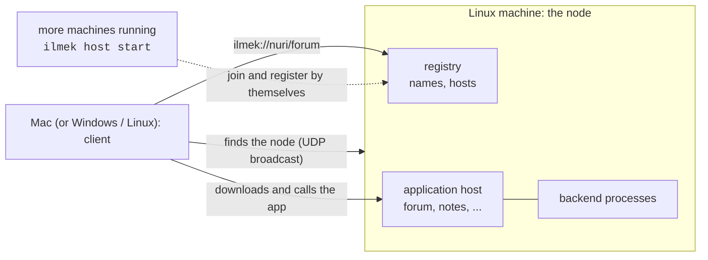

# İlmek

İlmek lets you run your own small "internet" without the internet. One machine is the **node** (a
registry plus an application server); you publish applications on it, and any other computer on
the same network finds the node by itself and opens them at `ilmek://namespace/app`. It speaks its
own protocol, ILMEK/1, directly over TCP: no HTTP, no cloud.



> **This branch (`feat/simple-no-security`) has no security.** Nothing is encrypted, nothing proves
> who a device is, packages are checked for corruption (SHA-256) but not signed, and anyone on the
> network can join and publish. Use it on a closed network you trust ([SECURITY](docs/SECURITY.md),
> [decision 0005](docs/decisions/0005-simple-no-security.md)). The secure design (TLS 1.3,
> certificates, signed packages, two-node Wi-Fi routing) lives on `main`.

> **What has been tested.** Everything runs on one Linux x86_64 machine, with registry, host,
> backends and clients as separate processes over `127.0.0.1`, including UDP discovery and
> automatic joining. **Not tested:** a second physical computer, real LAN broadcast discovery,
> macOS, Windows, Android ([TEST_REPORT](docs/TEST_REPORT.md)).

## Quick start

Needs Rust (`rust-toolchain.toml` pins the version) and two computers on the same network.

**Linux (the node):**

```sh
sudo ufw allow 47400/udp && sudo ufw allow 47401:47402/tcp   # only if a firewall is active
scripts/quickstart.sh     # builds, starts the node, publishes the forum and hello examples
```

Keep the terminal open; Ctrl-C stops everything.

**Another machine (client):**

```sh
cargo build -p ilmek-cli
target/debug/ilmek join                                      # finds the node by itself
target/debug/ilmek call ilmek://nuri/forum forum.topics.list
```

If nothing is found (different subnet, firewall), give only the node's address:
`ilmek join --registry NODE_IP:47401`.

The **desktop client** is İlmek's browser: address bar, catalog, one tab per application, and it
registers itself as the handler of `ilmek://` links. Build it per platform in [INSTALL](docs/INSTALL.md).
Step-by-step, multi-machine setup and troubleshooting: [GETTING_STARTED](docs/GETTING_STARTED.md).

## Commands

| Command | What it does |
| --- | --- |
| `ilmek node` | registry + application host + discovery beacon in one process; the first run creates everything |
| `ilmek host start` | an extra application host that finds the node and joins by itself |
| `ilmek join [--registry IP:PORT]` | join explicitly (other commands join automatically when needed) |
| `ilmek app init \| pack \| install \| update \| rollback \| remove \| start \| stop \| restart \| list \| set-backend \| publish \| unpublish` | build, run and publish applications ([APP_DEVELOPMENT_GUIDE](docs/APP_DEVELOPMENT_GUIDE.md)) |
| `ilmek resolve \| fetch \| call \| diagnose ilmek://ns/app` | use and debug an application |
| `ilmek whoami` | this device's id and registry |
| `ilmek backup registry \| host \| verify \| restore-registry \| restore-host` | back up and restore data ([BACKUP_AND_OPERATIONS](docs/BACKUP_AND_OPERATIONS.md)) |

Data lives in `$ILMEK_HOME` (default `~/.ilmek`). Ports: 47400/udp discovery, 47401/tcp registry,
47402/tcp host. `ilmek --help` and `ilmek <command> --help` list every option.

## Repository layout

| Path | What it is |
| --- | --- |
| `crates/ilmek-protocol` | ILMEK/1 frames, strict JSON, identifiers, manifests |
| `crates/ilmek-core` | framed transport, sessions, UDP discovery, community profile |
| `crates/ilmek-registry` | names, hosts, leases, persistence |
| `crates/ilmek-host` | multi-application host: packages, backend supervision, the ILMEK/1 service |
| `crates/ilmek-client`, `crates/ilmek-runtime` | resolve, download, call; the page bridge with local storage |
| `crates/ilmek-package`, `crates/ilmek-store` | packages with SHA-256 manifests; SQLite with migrations and backups |
| `crates/ilmek-app-sdk` | Rust SDK for application backends |
| `crates/ilmek-cli` | the `ilmek` command |
| `crates/ilmek-testing` | fixtures for integration tests |
| `packages/sdk-js`, `packages/angular-http` | `@ilmek/sdk` (`IlmekAppSDK`); Angular `HttpClient` interceptor |
| `java/ilmek-spring-boot-starter` | Spring Boot backend starter and web adapter |
| `apps/client` | desktop client (Tauri shell; React + TypeScript UI) |
| `examples/` | `forum`, `notes` (Rust backends), `hello-html`, `announcements` (static), `tasks`, `rest-notes` (Spring Boot + Angular), `isolation-probe` |
| `deploy/systemd/` | service units for a node and for an extra host |
| `scripts/` | quickstart, multi-process smoke tests, packaging helpers |
| `tests/protocol/fixtures` | deterministic wire fixtures |

## Documentation

| Document | Contents |
| --- | --- |
| [GETTING_STARTED](docs/GETTING_STARTED.md) | node, join, extra hosts, desktop client, troubleshooting |
| [INSTALL](docs/INSTALL.md) | build and install by platform |
| [NETWORK_AND_DISCOVERY](docs/NETWORK_AND_DISCOVERY.md) | what the network must provide, how devices find the node |
| [APP_DEVELOPMENT_GUIDE](docs/APP_DEVELOPMENT_GUIDE.md) | write, package, publish, update applications; the page SDK |
| [JAVA_ANGULAR](docs/JAVA_ANGULAR.md) | Spring Boot + Angular applications, versions |
| [BACKEND_IPC](docs/BACKEND_IPC.md) | host ↔ backend IPC and the Rust SDK |
| [ARCHITECTURE](docs/ARCHITECTURE.md) | roles, crates, main flows, process boundaries |
| [PROTOCOL](PROTOCOL.md) | normative wire format and behavior |
| [SECURITY](docs/SECURITY.md) | what is and is not protected |
| [BACKUP_AND_OPERATIONS](docs/BACKUP_AND_OPERATIONS.md) | services, backup/restore, upgrades, diagnosis |
| [TEST_REPORT](docs/TEST_REPORT.md) | what was run and what was not |
| [decisions](docs/decisions) | design decision records |
| [OVERVIEW_TR](docs/OVERVIEW_TR.md) | Turkish summary |
| [REQUIREMENTS](docs/REQUIREMENTS.md) | original product specification of the secure design on `main` (archived, Turkish) |

## Build and test

Verified on Linux x86_64 (Rust 1.96.0, Bun 1.3.14, Node 24 for the JS unit tests).

```sh
cargo build -p ilmek-cli                       # target/debug/ilmek
cargo test --workspace                         # 187 tests
cargo clippy --workspace --all-targets         # no warnings
bun install && bun run lint && bun run typecheck && bun run test
scripts/smoke/local-processes.sh               # real processes over loopback
scripts/smoke/multi-app.sh                     # two hosts, several apps, kill and restart
scripts/smoke/backup-restore.sh                # back up live data, destroy it, restore
```

Java and Angular parts have their own test commands in [JAVA_ANGULAR](docs/JAVA_ANGULAR.md).

## Limits

- No security (see above). Use a network you trust.
- Discovery uses UDP broadcast, which stays inside one subnet; give the node's address otherwise.
- IPv4 only.
- Application backends are trusted local processes, not a sandbox. The HTML/JS of an application
  runs in an isolated WebView with a strict content policy (observed on Linux/WebKitGTK only; see [SECURITY](docs/SECURITY.md)).
- The registry is a single writer; there is no failover.
