# İlmek

İlmek lets you run your own small "internet": one machine is the **node** (a registry plus an
application server), you publish applications on it, and any other computer on the same network
finds the node by itself and opens those applications at `ilmek://namespace/app`. It speaks its own
protocol, ILMEK/1, straight over TCP; there is no HTTP, no cloud and no internet needed.

```mermaid
flowchart LR
    subgraph L["Linux machine: the node"]
        direction TB
        R["registry<br/>names, hosts"]
        H["application host<br/>forum, notes, ..."]
        B["backend processes"]
        H --- B
    end
    M["Mac (or Windows / Linux): client"]
    M -- "finds the node (UDP broadcast)" --> L
    M -- "ilmek://nuri/forum" --> R
    M -- "downloads and calls the app" --> H
    L2["more machines running<br/><code>ilmek host start</code>"] -. "join and register by themselves" .-> R
```



> **This branch (`feat/simple-no-security`) has no security.** Nothing is encrypted, nothing proves
> who a device is, packages are checked for corruption (SHA-256) but not signed, and anyone on the
> network can join and publish. It is meant for a trusted, closed network and for getting the whole
> system working first. See [SECURITY](docs/SECURITY.md) and
> [decision 0005](docs/decisions/0005-simple-no-security.md). The secure design (TLS 1.3,
> certificates, signed packages, two-node Wi-Fi routing) lives on `main`.

> **What has been tested.** Everything runs on one Linux x86_64 machine, with the registry, host,
> backends and clients as **separate processes over `127.0.0.1`**, including UDP discovery and
> automatic joining. **Not tested:** a second physical computer, real LAN broadcast discovery,
> macOS, Windows, Android. See [TEST_REPORT](docs/TEST_REPORT.md).

## Nasıl çalıştırılır

Gerekenler: Rust (sürümü `rust-toolchain.toml` seçer), iki makine **aynı ağda**. Güvenlik yok; yalnızca güvendiğin ağda kullan.

**1. Linux (node)** — proje klasöründe:

```sh
sudo ufw allow 47400/udp && sudo ufw allow 47401:47402/tcp   # güvenlik duvarı açıksa
scripts/quickstart.sh                                        # derler, node'u başlatır, forum + merhaba yayınlar
```

Terminal açık kalır; Ctrl-C durdurur. Kodu güncellediysen önce Ctrl-C, sonra betiği yeniden çalıştır.

**2. Mac (CLI)** — proje klasöründe:

```sh
cargo build -p ilmek-cli
target/debug/ilmek join                                      # node'u kendisi bulur
target/debug/ilmek call ilmek://nuri/forum forum.topics.list
```

Bulamazsa yalnızca Linux'un IP'sini ver: `target/debug/ilmek join --registry LINUX_IP:47401`.

**3. Mac (pencere + Chrome'dan `ilmek://`)**

```sh
brew install oven-sh/bun/bun && bun install
cd apps/client && bun run tauri build --bundles app && cd ../..
cp -R "target/release/bundle/macos/İlmek.app" /Applications/ && open "/Applications/İlmek.app"
# pencerede "Bul ve katıl", sonra:
open "ilmek://nuri/forum"                                    # veya Chrome adres çubuğuna yaz
```

Adım adım ve sorun giderme: [FIRST_DEMO](docs/FIRST_DEMO.md).

## The first demo: one Linux node, one Mac

**On the Linux machine** (the node). You need the Rust toolchain (`rust-toolchain.toml` pins it).

```sh
git clone <this repository> && cd project-ilmek
scripts/quickstart.sh          # builds, starts the node, publishes the forum and hello examples
```

`scripts/quickstart.sh` is only a convenience. By hand it is:

```sh
cargo build -p ilmek-cli -p ilmek-example-forum
target/debug/ilmek node                       # registry + application host + discovery beacon
# in a second terminal:
target/debug/ilmek app pack examples/forum/app --out /tmp/forum-pkg
target/debug/ilmek app install /tmp/forum-pkg
target/debug/ilmek app set-backend nuri/forum --exe target/debug/ilmek-forum-backend
target/debug/ilmek app start nuri/forum
target/debug/ilmek app publish nuri/forum
```

Open UDP 47400 and TCP 47401 and 47402 in the Linux machine's firewall if it has one.

**On the Mac** (a client). Nothing to copy from the Linux machine:

```sh
cargo build -p ilmek-cli
target/debug/ilmek join                       # looks for the node on the network and joins it
target/debug/ilmek resolve ilmek://nuri/forum
target/debug/ilmek call ilmek://nuri/forum forum.topics.list
```

`join` looks for the node by a UDP broadcast and by a TCP scan of your own network at the same time,
so it works even where UDP is blocked. If nothing is found (a different subnet, the node's firewall),
give only the node's address, no community id or anything else: `ilmek join --registry
192.168.1.10:47401` (TCP only). Rebuild and restart the node after updating the code, so it answers
like the new clients expect.

The **desktop client is İlmek's browser**: it has an address bar, a catalog, and opens each
application in its own window (`cd apps/client && bun run tauri dev`; its **Find and join** button
does the same discovery). It also registers itself as the handler of `ilmek://` links, so typing
`ilmek://nuri/forum` in Chrome (or `open ilmek://nuri/forum` in a terminal) opens the app in it
([FIRST_DEMO](docs/FIRST_DEMO.md)). On Linux the window, a second start handing a link to the running
instance, `xdg-open ilmek://…`, and the rendering of a static page and of the forum were verified;
**nothing was run on macOS or Windows**, and Chrome itself was not used.

**More machines** that should also host applications run `ilmek host start`: it finds the node,
joins, and registers itself. See [NETWORK_SETUP](docs/NETWORK_SETUP.md).

## Commands

| Command | What it does |
| --- | --- |
| `ilmek node` | registry + application host + discovery beacon in one process; first run creates everything |
| `ilmek host start` | an extra application host that finds the node and joins by itself |
| `ilmek join [--registry IP:PORT]` | join explicitly (every other command also joins automatically when needed) |
| `ilmek app init \| pack \| install \| update \| start \| stop \| list \| publish …` | build, run and publish applications ([APP_DEVELOPMENT](docs/APP_DEVELOPMENT.md)) |
| `ilmek resolve \| fetch \| call \| diagnose ilmek://ns/app` | use and debug an application |
| `ilmek backup …` | back up and restore registry and host data ([OPERATIONS](docs/OPERATIONS.md)) |

Data lives in `$ILMEK_HOME` (default `~/.ilmek`).

## What is in the repository

| Path | What it is |
| --- | --- |
| `crates/ilmek-protocol` | ILMEK/1 frames, strict metadata, identifiers, manifests |
| `crates/ilmek-core` | framed transport, sessions, UDP discovery, community profile |
| `crates/ilmek-registry` | names, hosts, leases, persistence |
| `crates/ilmek-host` | multi-application host: packages, backend supervision, the ILMEK/1 service |
| `crates/ilmek-client`, `crates/ilmek-runtime` | resolve, download, call; the page bridge with local storage |
| `crates/ilmek-package`, `crates/ilmek-store` | packages with SHA-256 manifests; SQLite with migrations and backups |
| `crates/ilmek-app-sdk` | Rust SDK for application backends |
| `crates/ilmek-cli` | the `ilmek` command |
| `packages/sdk-js` | `@ilmek/sdk`, interface `IlmekAppSDK` |
| `apps/client` | desktop client (Tauri shell; React + TypeScript UI) |
| `examples/` | forum and notes (with backends), announcements and hello (static), isolation probe |
| `deploy/systemd/` | service units for a node and for an extra host |
| `scripts/` | quickstart, loopback multi-process smoke tests, backup/restore exercise |

Documentation: [FIRST_DEMO](docs/FIRST_DEMO.md) · [ARCHITECTURE](docs/ARCHITECTURE.md) · [NETWORK_SETUP](docs/NETWORK_SETUP.md) ·
[SECURITY](docs/SECURITY.md) · [APP_DEVELOPMENT](docs/APP_DEVELOPMENT.md) ·
[OPERATIONS](docs/OPERATIONS.md) · [IPC](docs/IPC.md) · [TEST_REPORT](docs/TEST_REPORT.md) ·
[PROTOCOL](PROTOCOL.md) · [REHBER (Türkçe)](docs/REHBER.md) · [decisions](docs/decisions) ·
[PROGRESS](docs/PROGRESS.md)

## Build and test

Toolchain versions are pinned in `rust-toolchain.toml` and `package.json`. Verified on Linux x86_64
(Rust 1.96.0, Bun 1.3; Node 24 is only needed for the JS unit tests, `vitest`).

```sh
cargo build -p ilmek-cli                       # target/debug/ilmek
cargo test --workspace                         # Rust tests (177)
cargo clippy --workspace --all-targets         # no warnings
bun install && bun run lint && bun run typecheck && bun run test
scripts/smoke/local-processes.sh               # real processes over loopback
scripts/smoke/multi-app.sh                     # two hosts, several apps, kill and restart
scripts/smoke/backup-restore.sh                # back up live data, destroy it, restore
```

## Limits to know

- No security (see above). Use a network you trust.
- Discovery uses UDP broadcast, which stays inside one subnet.
- IPv4 only.
- Application backends are trusted local processes, not a sandbox. The HTML/JS of an application
  does run in an isolated WebView with a strict content policy (verified on Linux/WebKitGTK only).
- The registry is a single writer; there is no failover.
