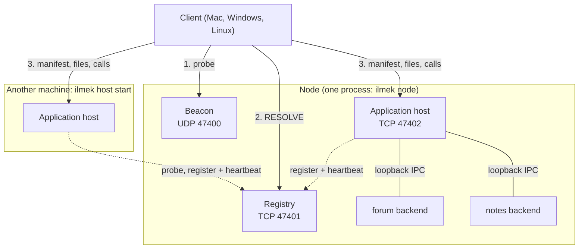
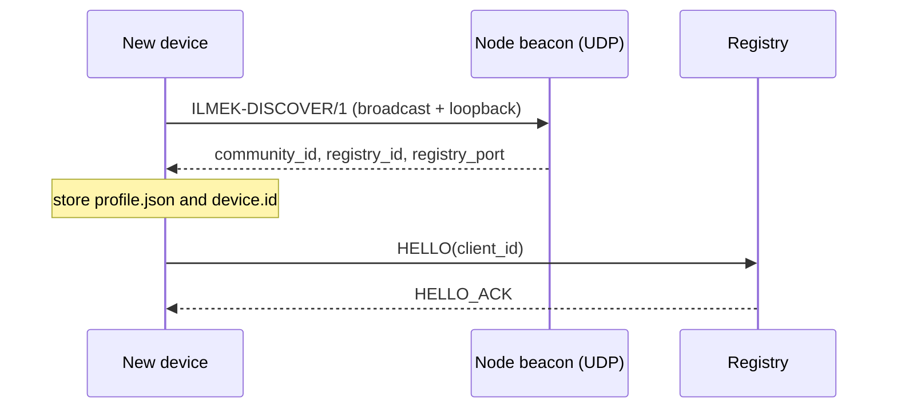
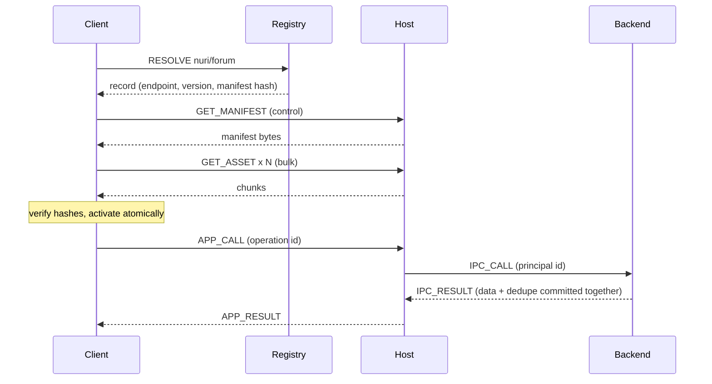
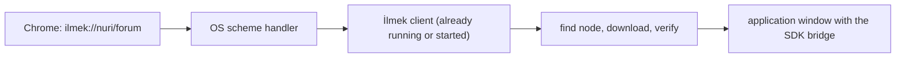

# Architecture

Normative reference for the wire format: [PROTOCOL.md](../PROTOCOL.md). This file describes how the
code is organized. It does not restate the protocol. Everything here describes the
`feat/simple-no-security` branch; the secure design is on `main`
([decision 0005](decisions/0005-simple-no-security.md)).

## Roles

| Role | Runs | Persistent state |
| --- | --- | --- |
| **Node** (`ilmek node`) | a registry, an application host and a UDP discovery beacon in one process | `<home>/registry/`, `<home>/host/`, `<home>/host-device/` |
| **Registry** | names, host leases, application records | `registry.db`, `community.json` |
| **Host** | any number of applications, each with its own `app_id`, data directory and lifecycle | `host.db`, `apps/<app_id>/{versions,data,logs}` |
| **Extra host** (`ilmek host start`) | a host on another machine that joins by itself | its own `<home>` |
| **Client** (CLI or desktop app) | resolves, downloads, verifies and runs applications | `<home>/device/`, package cache, per-app local storage |

The registry is **not** a proxy. It answers "who serves `ilmek://nuri/forum`, which version and
hash"; the client then connects to the host directly. The node concept stays: it is the machine
that holds the registry and, usually, also hosts applications. A host does not have to be on the
node's machine.



Ports (all configurable): UDP 47400 discovery, TCP 47401 registry, TCP 47402 host.

## Layers

`any IP network → TCP → ILMEK/1`. The operating system provides the network; İlmek does not
configure interfaces, routes or radios. Two machines that can reach each other over IP (Wi-Fi,
Ethernet, a phone hotspot) are enough. There is no TLS in this branch.

## Crates

```
ilmek-protocol  frames, strict JSON, ids, manifest types           (pure, no I/O)
ilmek-core      framed transport, sessions, UDP discovery, profile (tokio)
ilmek-package   pack / verify / copy packages (SHA-256 manifests)
ilmek-store     SQLite: migrations, online backup, tree backup/restore
ilmek-registry  names, host leases, application records
ilmek-host      installer, supervisor, ILMEK/1 service, IPC server
ilmek-app-sdk   backend side of the IPC (Rust)
ilmek-client    join, connect, resolve, download, call
ilmek-runtime   page bridge: permissions, storage, subscriptions
ilmek-cli       the `ilmek` binary
ilmek-testing   fixtures for integration tests (never a production dependency)
```

Dependency direction is one way: `protocol` ← `core` ← (`client`, `registry`, `host`) ← `cli`.
`ilmek-store` has no protocol dependency.

## Main flows

**Joining.** A device with no state sends a UDP probe (`ILMEK-DISCOVER/1`) to the local network
and to itself. The node's beacon answers with the community id, registry id and registry port;
the registry's address is the answer's source address. The device stores `profile.json` and a
self-made `device.id` in its device directory. Next time it does not look again. No token, file or
code is exchanged.



**Hosts register themselves.** A host connects to the registry and sends `HOST_REGISTER` with
`0.0.0.0:<port>`; the registry stores the address the connection came from. A host on the
registry's own machine therefore registers `127.0.0.1`, and clients reach it on the registry's
address (`Connector::host_address`). Heartbeats renew a 90-second lease every 30 seconds.

**Publishing.** The publisher packs a project (`app pack`) into a directory with a sorted,
hashed `manifest.json`. The host verifies sizes and hashes and activates the package atomically.
`app publish` registers name, version and manifest hash in the registry. The first device that
registers a namespace owns it.

**Resolving and fetching.** The client asks the registry for the record, connects to the host on a
*control* connection for the manifest and on a separate *bulk* connection for files. It checks the
manifest hash from the registry record, every file's size and SHA-256, and only then moves the
package into place. Interrupted downloads resume from verified bytes.



**Calling.** The page calls `sdk.call(method, input)`; the runtime checks the manifest permission
and sends `APP_CALL`. The host attaches the device id the client declared in HELLO and forwards to
the backend over loopback IPC. Writes carry an operation ID; the backend commits the business
change and its deduplication record in one SQLite transaction, so a retry after a lost reply
returns the original result.

**Opening a link from a browser.** The desktop client is İlmek's browser: address bar, catalog, one
window per application. It registers itself as the operating system's handler of `ilmek://`
(a packaged `.app` on macOS, a `.desktop` file written at start-up on Linux, the registry on Windows).
A link typed or clicked in Chrome therefore starts the client, or, if it already runs, is forwarded to
that instance by the `single-instance` plugin, which opens the application in a new window.
Browsers cannot render `ilmek://` themselves and cannot register the scheme from a web page or
extension; the operating system does it.



## Process boundaries

1. **Network ↔ host/registry:** plain TCP. No encryption, no authentication.
2. **Host ↔ backend:** loopback only, a per-process token, an application ID bound at start-up.
   The backend is a **trusted** local process; being a separate process is not a sandbox.
3. **Page ↔ runtime:** the application's HTML/JS is **untrusted**. It runs in a platform WebView
   with a strict content policy, and its only channel is the SDK bridge, which has no field for a
   host, address or file path. See [SECURITY](SECURITY.md).

## Persistence

SQLite with forward-only migrations and a schema-version check (a database from a newer build is
refused). Registry and host write business data and deduplication results in one transaction;
write transactions start with `BEGIN IMMEDIATE`, so two processes touching the same database wait
for each other instead of failing with "database is locked". Backups use SQLite's online backup API
([OPERATIONS](OPERATIONS.md)). Package versions are immutable directories; user data lives beside
them and is kept on removal unless `--purge-data`.

## Not built

Security (see above), Bluetooth, routing between separate network segments, CRDT or database
merging, registry failover, a route to the public internet.
