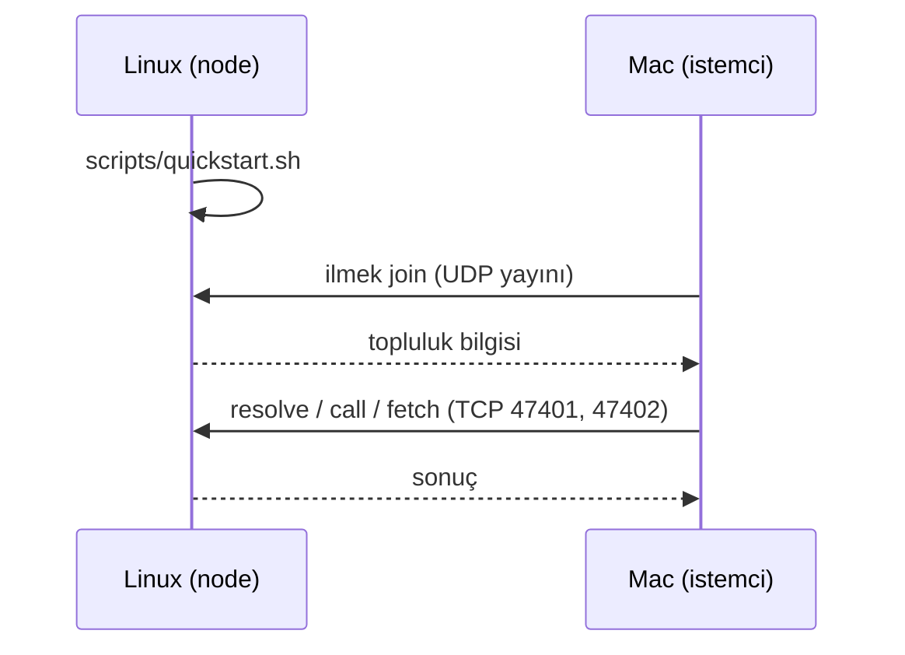

# İlk demo: Linux node + Mac istemci

Amaç: Linux makinede yayınladığın uygulamaya Mac'ten erişmek. Mac, Linux'a hiçbir dosya veya kod
vermeden kendiliğinden katılır.

> **Durum.** Bu akış tek makinede, ayrı süreçler olarak `127.0.0.1` üzerinde çalıştı (UDP keşif ve
> otomatik katılma dahil). **İkinci gerçek bilgisayarda, gerçek ağda UDP yayın keşfi, macOS ve
> masaüstü pencere hiç denenmedi.** Bu belge o ilk gerçek denemenin kılavuzudur. Dalda
> **güvenlik yoktur**; yalnızca güvendiğin bir ağda dene ([SECURITY](SECURITY.md)).

Gerekenler: iki bilgisayar **aynı Wi-Fi/ağda** (aynı alt ağ, router'da "AP isolation" kapalı),
her ikisinde Rust (`rust-toolchain.toml` sürümü kendiliğinden iner), Mac'te Xcode komut satırı araçları.



## 1. Kodu Mac'e al

```sh
git clone -b feat/simple-no-security <depo-adresi> ~/project-ilmek
```

Commit/push yapılmadıysa Linux'tan kopyala (`target` ve `node_modules` hariç):

```sh
rsync -av --exclude target --exclude node_modules --exclude ilmek-demo \
  ~/Desktop/project-ilmek/ KULLANICI@MAC_ADRESI:~/project-ilmek/
```

## 2. Linux (node)

```sh
cd ~/Desktop/project-ilmek
sudo ufw status        # "inactive" ise güvenlik duvarı sorun değil
# aktifse:
sudo ufw allow 47400/udp && sudo ufw allow 47401:47402/tcp

hostname -I            # IP'ni not et (örn. 192.168.1.10); keşif çalışmazsa lazım olur
scripts/quickstart.sh
```

Betik derler, node'u başlatır, `forum` ve `merhaba` örneklerini yayınlar ve `İlmek is running.`
yazar. **Terminal açık kalmalı**; Ctrl-C hepsini durdurur. Veriler `./ilmek-demo` altındadır,
günlük `ilmek-demo/node.log`.

Linux'ta kendi kendine hızlı doğrulama (ikinci terminal):

```sh
export ILMEK_HOME=$PWD/ilmek-demo
target/debug/ilmek resolve ilmek://nuri/forum       # availability RecentHeartbeat görmelisin
```

Elle yapmak istersen betiğin yaptığı iş (ayrıntı: [README](../README.md)):
`ilmek node`, sonra `app pack`, `app install`, `app set-backend`, `app start`, `app publish`.

## 3. Mac (istemci)

Bir kez kurulum:

```sh
xcode-select --install                                         # C derleyicisi (SQLite için)
curl --proto '=https' --tlsv1.2 -sSf https://sh.rustup.rs | sh
cd ~/project-ilmek
cargo build -p ilmek-cli                                       # ilk sefer birkaç dakika
```

Deneme:

```sh
target/debug/ilmek join                                        # node'u arar ve katılır
target/debug/ilmek whoami                                      # registry satırında Linux IP'si olmalı
target/debug/ilmek resolve ilmek://nuri/forum
target/debug/ilmek call ilmek://nuri/forum forum.topics.create --write \
    --body '{"title":"Mac den merhaba","body":"calisiyor"}'
target/debug/ilmek call ilmek://nuri/forum forum.topics.list
target/debug/ilmek fetch ilmek://nuri/merhaba                  # sayfa dosyalarını indirir, hash doğrular
```

**Başarı ölçütü:** Mac'ten açtığın başlık Linux'ta da görünür:

```sh
# Linux'ta
target/debug/ilmek call ilmek://nuri/forum forum.topics.list
```

## 4. `join` "no node found" derse

En olası ilk sorun: UDP yayını gerçek ağda hiç denenmedi. Sırayla:

1. Linux'ta betik hâlâ çalışıyor mu?
2. UDP 47400 açık mı (yukarıdaki `ufw` satırı)?
3. İkisi aynı alt ağda mı, router'da "AP isolation" kapalı mı?
4. Keşfi atla, adresi ver:
   ```sh
   target/debug/ilmek join --registry 192.168.1.10:47401
   ```
   Bu çalışıp `join` çalışmıyorsa sorun yalnızca UDP keşfidir: sonucu bildir, `discover_on`
   (`crates/ilmek-core/src/discovery.rs`) düzeltilecek (bazı sistemler arayüze özel yayın adresi ister).

Bağlantıyı elle sınamak için Mac'ten: `nc -vz 192.168.1.10 47401`.

## 5. İkinci host (isteğe bağlı)

Üçüncü bir makinede (veya Mac'te ayrı klasörle) uygulama sunucusu eklemek için:

```sh
ILMEK_HOME=~/ilmek-host2 target/debug/ilmek host start --port 47412
```

Node'u bulur, katılır, kendini kaydeder. Üzerine uygulama kurmak için aynı `ILMEK_HOME` ile
`ilmek app pack | install | start | publish`.

## 6. Masaüstü pencere (sonra)

`pnpm install && pnpm --filter @ilmek/client tauri dev` (Node 24 ve pnpm gerekir). "Bul ve katıl"
düğmesi `ilmek join` ile aynı keşfi yapar. Pencere bu çalışmada **hiç açılmadı**; ilk denemeyi CLI
ile yapmanı öneririm.

## Hata bildirirken gönder

Çalıştırdığın komut ve çıktısı, Linux'ta `ilmek-demo/node.log`, ve ikisinin IP adresleri
(`hostname -I` / Mac'te `ipconfig getifaddr en0`).
