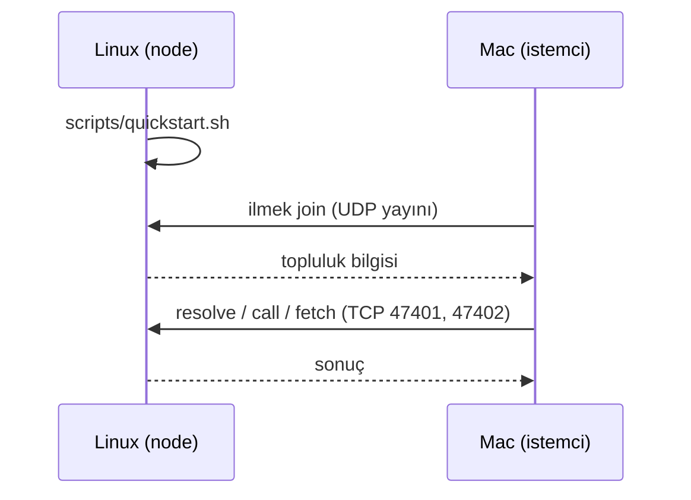

# İlk demo: Linux node + Mac istemci

Amaç: Linux makinede yayınladığın uygulamaya Mac'ten erişmek. Mac, Linux'a hiçbir dosya veya kod
vermeden kendiliğinden katılır.

> **Durum.** Bu akış tek makinede, ayrı süreçler olarak `127.0.0.1` üzerinde çalıştı (UDP keşif ve
> otomatik katılma dahil). **İkinci gerçek bilgisayarda, gerçek ağda UDP yayın keşfi, macOS ve
> masaüstü pencerenin macOS'ta açılması ve Chrome ile `ilmek://` bağlantısı hiç denenmedi.**
> (Linux'ta pencere ve `xdg-open` yolu denendi, bkz. [TEST_REPORT](TEST_REPORT.md).) Bu belge o ilk gerçek denemenin kılavuzudur. Dalda
> **güvenlik yoktur**; yalnızca güvendiğin bir ağda dene ([SECURITY](SECURITY.md)).

Gerekenler: iki bilgisayar **aynı Wi-Fi/ağda** (aynı alt ağ, router'da "AP isolation" kapalı),
her ikisinde Rust (`rust-toolchain.toml` sürümü kendiliğinden iner), Mac'te Xcode komut satırı araçları.

## Özet (çalıştırma)

```sh
# Linux (node), proje klasöründe
sudo ufw allow 47400/udp && sudo ufw allow 47401:47402/tcp   # güvenlik duvarı açıksa
scripts/quickstart.sh                                        # açık kalsın

# Mac, proje klasöründe
cargo build -p ilmek-cli
target/debug/ilmek join                                      # veya: join --registry LINUX_IP:47401
target/debug/ilmek call ilmek://nuri/forum forum.topics.list
```

Pencere ve Chrome için bölüm 6. Ayrıntılar ve sorun giderme aşağıda.



## 1. Kodu Mac'e al

```sh
git clone -b feat/simple-no-security <depo-adresi> ~/project-ilmek
```

Commit/push yapılmadıysa Linux'tan kopyala (`target` ve `node_modules` hariç):

```sh
rsync -av --exclude target --exclude node_modules --exclude ilmek-demo \
  ~/Desktop/project-ilmek/ KULLANICI@MAC_ADRESI:~/project-ilmek/
```

## 2. Linux (node)

```sh
cd ~/Desktop/project-ilmek
sudo ufw status        # "inactive" ise güvenlik duvarı sorun değil
# aktifse:
sudo ufw allow 47400/udp && sudo ufw allow 47401:47402/tcp

hostname -I            # IP'ni not et (örn. 192.168.1.10); keşif çalışmazsa lazım olur
scripts/quickstart.sh
```

Betik derler, node'u başlatır, `forum` ve `merhaba` örneklerini yayınlar ve `İlmek is running.`
yazar. **Terminal açık kalmalı**; Ctrl-C hepsini durdurur. Veriler `./ilmek-demo` altındadır,
günlük `ilmek-demo/node.log`.

Linux'ta kendi kendine hızlı doğrulama (ikinci terminal):

```sh
export ILMEK_HOME=$PWD/ilmek-demo
target/debug/ilmek resolve ilmek://nuri/forum       # availability RecentHeartbeat görmelisin
```

Elle yapmak istersen betiğin yaptığı iş (ayrıntı: [README](../README.md)):
`ilmek node`, sonra `app pack`, `app install`, `app set-backend`, `app start`, `app publish`.

## 3. Mac (istemci)

Bir kez kurulum:

```sh
xcode-select --install                                         # C derleyicisi (SQLite için)
curl --proto '=https' --tlsv1.2 -sSf https://sh.rustup.rs | sh
cd ~/project-ilmek
cargo build -p ilmek-cli                                       # ilk sefer birkaç dakika
```

Deneme:

```sh
target/debug/ilmek join                                        # node'u arar ve katılır
target/debug/ilmek whoami                                      # registry satırında Linux IP'si olmalı
target/debug/ilmek resolve ilmek://nuri/forum
target/debug/ilmek call ilmek://nuri/forum forum.topics.create --write \
    --body '{"title":"Mac den merhaba","body":"calisiyor"}'
target/debug/ilmek call ilmek://nuri/forum forum.topics.list
target/debug/ilmek fetch ilmek://nuri/merhaba                  # sayfa dosyalarını indirir, hash doğrular
```

**Başarı ölçütü:** Mac'ten açtığın başlık Linux'ta da görünür:

```sh
# Linux'ta
target/debug/ilmek call ilmek://nuri/forum forum.topics.list
```

## 4. `join` "no node found" derse

`join` node'u iki yoldan **aynı anda** arar: UDP yayını (47400) ve kendi ağındaki her adresin TCP 47401
portu. İkisi de çalışmıyorsa:

1. Linux'ta betik hâlâ çalışıyor mu? **Kodu güncellediysen node'u yeniden derleyip yeniden başlat**:
   eski bir node, yeni istemciye "registry gibi cevap vermedi" der.
2. Linux güvenlik duvarında `47401-47402/tcp` (ve `47400/udp`) açık mı (yukarıdaki `ufw` satırı)?
3. İkisi aynı alt ağda mı? (Farklı alt ağda tarama bulamaz; adres ver.)
4. Adresi ver. **Topluluk numarası veya başka bir şey yazman gerekmez**, yalnızca Linux'un IP'si:
   ```sh
   target/debug/ilmek join --registry 192.168.1.10:47401
   ```
   Bu yalnızca TCP kullanır (UDP gerekmez). Linux'ta IP için `ip -4 route get 1.1.1.1` çıktısındaki
   `src` adresini al (`hostname -I`'in ilk adresi sanal köprü olabilir, örn. `192.168.122.1`).

Bağlantıyı elle sınamak için Mac'ten: `nc -vz 192.168.1.10 47401`.

## 5. İkinci host (isteğe bağlı)

Üçüncü bir makinede (veya Mac'te ayrı klasörle) uygulama sunucusu eklemek için:

```sh
ILMEK_HOME=~/ilmek-host2 target/debug/ilmek host start --port 47412
```

Node'u bulur, katılır, kendini kaydeder. Üzerine uygulama kurmak için aynı `ILMEK_HOME` ile
`ilmek app pack | install | start | publish`.

## 6. Masaüstü istemci: İlmek'in tarayıcısı

İstemci bir pencere açar: adres çubuğu, katalog, uygulamalar sekmelerde açılır (forum dahil, SDK
köprüsüyle). CLI denemesi çalıştıktan sonra bunu dene.

**Geliştirme modunda (hızlı, bağlantı kaydı yok):**

```sh
brew install oven-sh/bun/bun                       # Bun (Node gerekmez)
bun install
cd apps/client && bun run tauri dev
```

Pencerede **Bul ve katıl**'a bas (veya `ilmek join` zaten yaptıysa gerek yok), adres çubuğuna
`ilmek://nuri/forum` yaz, **Aç**.

**Paket olarak (Chrome'dan `ilmek://` açmak için şart):** macOS şemayı yalnızca kurulu bir `.app`
için kaydeder.

```sh
cd apps/client && bun run tauri build --bundles app && cd ../..
# çıktı: target/release/bundle/macos/Ilmek.app
cp -R "target/release/bundle/macos/Ilmek.app" /Applications/
open "/Applications/Ilmek.app"                       # imzasız: ilk sefer sağ tık > Aç
```

Uygulama bir kez açılıp **Bul ve katıl** ile topluluğa katıldıktan sonra:

```sh
open "ilmek://nuri/forum"                             # Terminal'den: kaydın çalıştığını gösterir
```

Sonra Chrome'un adres çubuğuna `ilmek://nuri/forum` yaz. Chrome "İlmek'i açmak ister misin?" diye bir
kez sorar, **Aç**'a bas. Adres çubuğu bunu arama sanırsa `ilmek://nuri/forum` içeren bir bağlantıya
tıkla, ya da Terminal'deki `open` komutunu kullan. İstemci zaten açıksa yeni sekme aynı
programda açılır (ikinci program başlamaz).

Linux'ta uygulama her açılışta şemayı kullanıcı için kendisi kaydeder
(`~/.local/share/applications/ilmek-client-handler.desktop`); `xdg-open ilmek://nuri/forum` ile
dene. Windows kaydı da programın açılışında yapılır (denenmedi).

Topluluğa katılmadan gelen bir bağlantı yalnızca ana pencereyi (katılma ekranını) gösterir; önce
katıl, sonra bağlantıyı tekrar aç.

## Hata bildirirken gönder

Çalıştırdığın komut ve çıktısı, Linux'ta `ilmek-demo/node.log`, ve ikisinin IP adresleri
(`hostname -I` / Mac'te `ipconfig getifaddr en0`).
