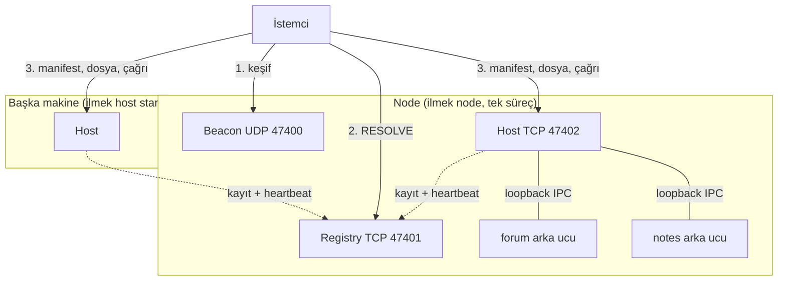
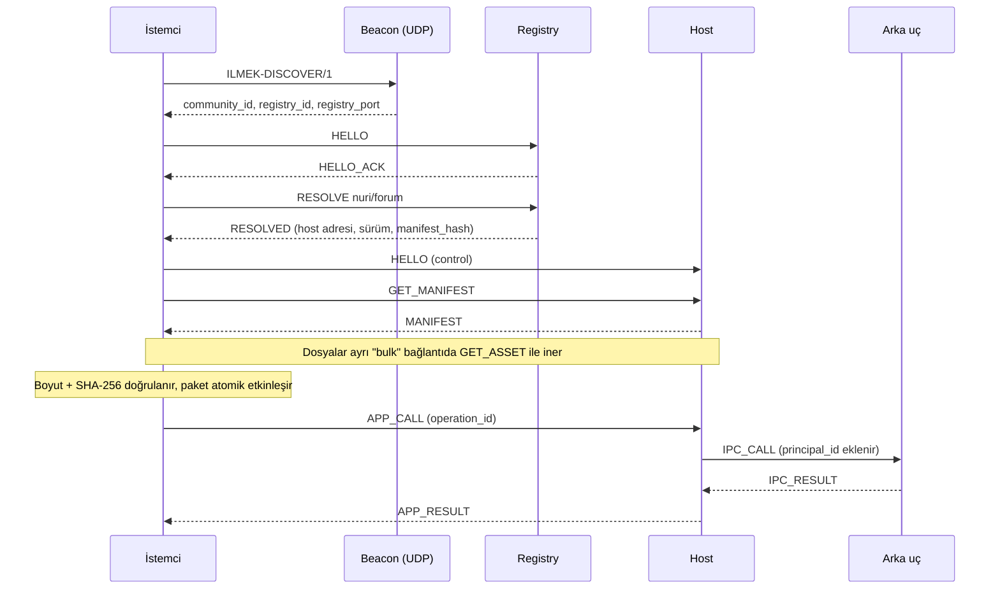
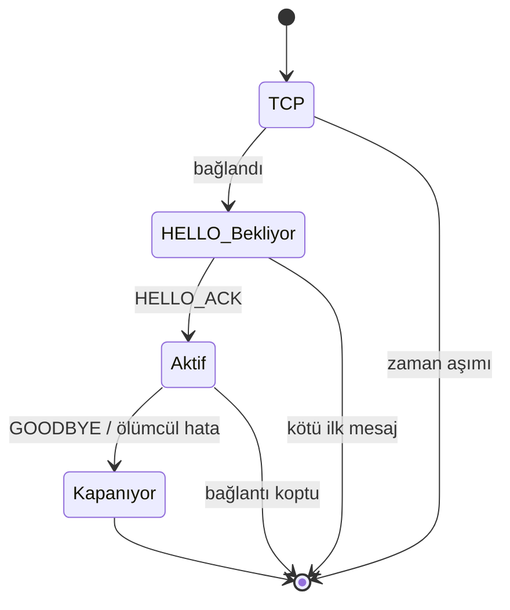
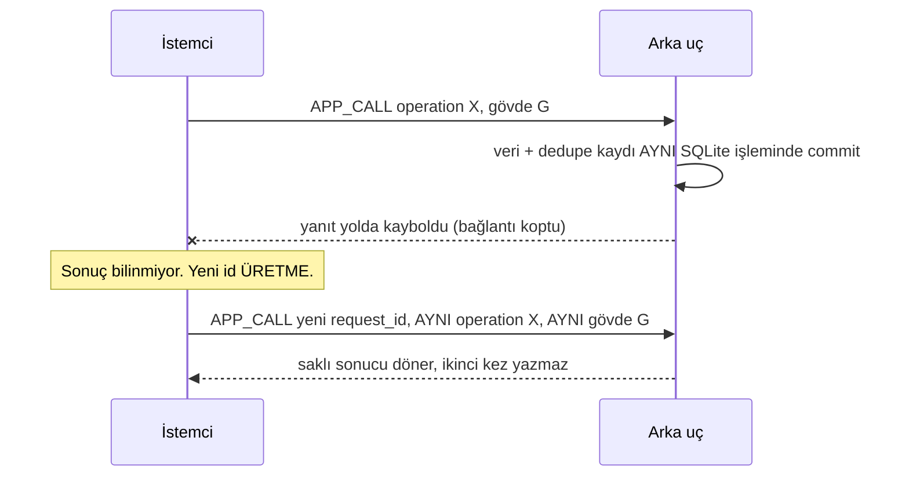
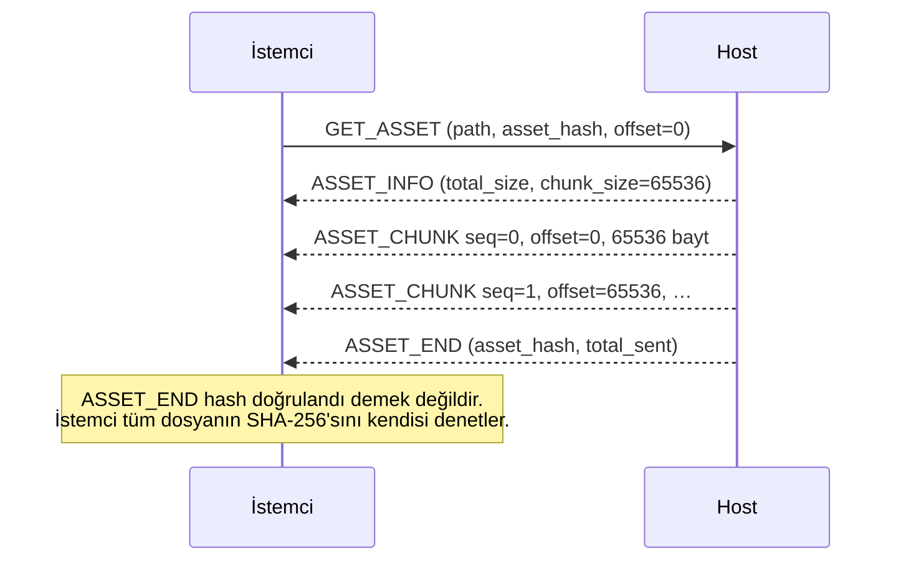

# İlmek Rehberi: Mimari ve ILMEK/1 Protokolü

Bu rehber İlmek'in nasıl çalıştığını, HTTP belgeleri gibi baştan sona anlatır: önce fikir, sonra
mimari, sonra byte düzeyinde protokol, sonra uygulama yazmak. Normatif kaynak
[PROTOCOL.md](../PROTOCOL.md)'dir; çelişki olursa o geçerlidir. Bu dosya yeni bir kural eklemez.

**Etiketler:** `[BELGE]` PROTOCOL.md / docs içinde yazıyor. `[ÇALIŞTIRILDI]` bu rehber yazılırken
komut veya kod gerçekten çalıştırıldı. `[TEST EDİLMEDİ]` çalıştırılmadı.

> **Bu dal (`main`) güvensizdir.** Trafik şifrelenmez, kimse kimliğini kanıtlamaz, paketler
> imzalanmaz. Ağdaki herkes katılıp uygulama yayınlayabilir. Yalnızca güvendiğiniz kapalı bir ağda
> kullanın. `[BELGE]` PROTOCOL.md üst not.

**Test durumu:** her şey tek Linux makinede, ayrı süreçlerle `127.0.0.1` üzerinde denendi. İkinci fiziksel
bilgisayar, gerçek LAN yayın keşfi, macOS, Windows ve Android **denenmedi**. `[BELGE]` GETTING_STARTED.md

---

## 1. Bir bakışta

İlmek, internet olmadan çalışan küçük bir uygulama ağıdır. Aynı IP ağındaki bilgisayarlar
(Wi-Fi, Ethernet, telefon hotspot'u fark etmez) birbirini bulur; biri HTML/CSS/JS uygulaması yayınlar,
diğerleri `ilmek://nuri/forum` gibi bir adresle açar.

HTTP ile karşılaştırma:

| | Web (HTTP) | İlmek (ILMEK/1) |
| --- | --- | --- |
| Adres | `https://site.com/forum` | `ilmek://nuri/forum` |
| Ad çözümleme | DNS | **Registry** (kayıt sunucusu) |
| İçerik nereden | sunucudan | **Host**'tan (registry trafiği taşımaz) |
| Taşıma | TCP (+TLS) | TCP (bu dalda şifresiz) |
| İstek/yanıt | metin başlıkları | `ILM1` çerçevesi + JSON üstveri + ham gövde |
| Durum kodu | 200, 404… | `ERROR` mesajı ve kod adı (`NOT_FOUND`…) |
| Yazma güvenliği | yok (uygulamaya bağlı) | **operation_id** ile tekrar denemede çift yazma yok |

HTTP, WebSocket veya gRPC üstünden tünelleme **yasaktır**. `[BELGE]` PROTOCOL.md §1

---

## 2. Mimari

### 2.1 Roller



| Rol | Ne yapar |
| --- | --- |
| **Registry** | "`nuri/forum` hangi host'ta, hangi sürüm, hangi hash?" sorusunu yanıtlar. İsimleri ve kiraları (lease) tutar. **Uygulama trafiğini taşımaz.** |
| **Host** | Uygulama paketlerini saklar, arka uç süreçlerini çalıştırır, istemci çağrılarını arka uca iletir. Bir host'ta istediğiniz kadar uygulama olabilir; her birinin kendi `app_id`'si, veri klasörü ve yaşam döngüsü vardır. |
| **Node** | Registry + host + keşif işaretçisini (beacon) tek süreçte çalıştıran makine: `ilmek node`. |
| **Ekstra host** | Başka bir makinede `ilmek host start`; kendiliğinden katılır, kendi uygulamalarını sunar. |
| **İstemci** | `ilmek` komutu veya masaüstü uygulaması. Çözer, indirir, doğrular, çalıştırır. |

`[BELGE]` ARCHITECTURE.md "Roles"

### 2.2 Katmanlar

```
Wi-Fi / Ethernet  →  IP  →  TCP  →  ILMEK/1
```

İlmek ağ arayüzü, rota veya radyo ayarlamaz; bunu işletim sistemi yapar. İki makine IP ile birbirine
ulaşabiliyorsa yeter. ILMEK/1, HTTP'nin bulunduğu uygulama katmanında yer alır. `[BELGE]`

### 2.3 Üç güven sınırı

1. **Ağ ↔ host/registry:** düz TCP, şifre yok, kimlik doğrulama yok.
2. **Host ↔ arka uç:** yalnızca loopback, süreç başına rastgele token. Arka uç **güvenilir** yerel
   süreçtir; ayrı süreç olması sandbox demek değildir.
3. **Sayfa ↔ istemci:** indirilen HTML/JS **güvenilmezdir**. Sandbox'lı iframe içinde çalışır ve
   tek kanalı SDK köprüsüdür (host, adres veya dosya yolu alanı yok).

`[BELGE]` ARCHITECTURE.md "Process boundaries"

---

## 3. Bir uygulama açılırken olanlar

`ilmek://nuri/forum` adresine tıklandığında:



Adım adım:

1. **Keşif.** Cihaz ilk kez çalışıyorsa node'u bulur (bölüm 4). Sonuç `profile.json` ve `device.id`
   olarak saklanır; sonraki açılışta aranmaz.
2. **Çözümleme.** `RESOLVE` ile registry'den kayıt alınır: host adresi, sürüm, `manifest_hash`.
3. **İndirme.** Manifest *control* bağlantısında, dosyalar ayrı *bulk* bağlantısında iner. İstemci
   manifest özetini kayıttaki `manifest_hash` ile, her dosyanın boyutunu ve SHA-256'sını manifestle
   karşılaştırır. Ancak bundan sonra paket yerine konur.
4. **Çalıştırma.** Sayfa `sdk.call(...)` çağırır; istemci `APP_CALL` yollar; host arka uca iletir.

---

## 4. Katılım ve keşif

Yeni bir cihaz dosya, kod veya IP yazmadan topluluğa katılır. `[BELGE]` PROTOCOL.md §3

| Yol | Nasıl |
| --- | --- |
| **UDP beacon** | Cihaz `ILMEK-DISCOVER/1` (16 bayt ASCII) metnini `255.255.255.255:47400` adresine yayınlar; 500 ms'de bir, toplam 4 sn. Node `{"ilmek":1,"community_id":…,"registry_id":…,"registry_port":…}` ile yanıt verir. Registry adresi, yanıt datagramının **kaynak IP**'sidir. |
| **TCP tarama** | UDP engelliyse cihaz kendi /24 ağındaki her adreste 47401 portunu dener (aynı anda en çok 64 adres, adres başına 700 ms). |
| **Bilinen adres** | `ilmek join --registry IP:47401`; yalnızca TCP kullanılır. |

İlk ikisi birlikte çalışır, ilk yanıt kazanır. UDP yayını yalnızca **tek yayın alanında** (broadcast
domain) çalışır. Router'ın ötesindeki ağlar için registry adresi elle verilir.

**Kimlik:** her cihaz kendi UUIDv7 `client_id`'sini üretir ve `HELLO` içinde *beyan eder*. Kimse
doğrulamaz; bir cihaz başkasının kimliğini taklit edebilir. Kimlik yalnızca cihazları ayırmak ve
sahipliği (ad alanı, uygulama) kaydetmek içindir.

---

## 5. Protokol: çerçeve (frame)

Her mesaj bir çerçevedir. HTTP'deki "başlık + gövde" ayrımına benzer: üstveri JSON, gövde ham bayt.

| Ofset | Bayt | İçerik |
| --- | --- | --- |
| 0 | 4 | ASCII `ILM1` (`49 4c 4d 31`) |
| 4 | 4 | Üstveri uzunluğu M, işaretsiz 32-bit, **big-endian** |
| 8 | 4 | Gövde uzunluğu B, işaretsiz 32-bit, big-endian |
| 12 | M | Üstveri: UTF-8 JSON |
| 12+M | B | Gövde: ham bayt |

Sınırlar: `1 ≤ M ≤ 65536`, `0 ≤ B ≤ 262144`; en büyük çerçeve 327 692 bayt. Sınır dışı boyut, yanlış
`ILM1` veya yarım çerçeve bağlantıyı kapatır. İlk baytından 30 sn sonra tamamlanmamış çerçeve de
bağlantıyı kapatır. Bellek, saldırganın bildirdiği boyuta göre **ayrılmaz**. TCP okumaları çerçeve
sınırına denk gelmez; alıcı biriktirir ve fazla baytı sonraki çerçeve için saklar. `[BELGE]` §5

### 5.1 Üstveri nesnesi

Her üstverinin **tam dört** alanı vardır:

```json
{
  "type": "RESOLVE",
  "request_id": "019de1df-a000-7111-8111-111111111111",
  "community_id": "019de1df-a000-7222-8222-222222222222",
  "data": { "namespace": "nuri", "slug": "forum" }
}
```

`type` büyük harfli sabit bir isimdir. Kimlikler **UUIDv7**'dir (küçük harf, tireli, sürüm 7).
Tanımsız alan reddedilir; yinelenen JSON anahtarı, BOM, bozuk UTF-8, NaN ve 16'dan derin iç içelik
yasaktır. Hash alınan her şeyde **gönderilen tam baytlar** kullanılır, yeniden serileştirilmez.

### 5.2 Gerçek bir çerçeve

Aşağıdaki `HELLO` çerçevesi Python ile üretildi, uzunlukları ölçüldü. `[ÇALIŞTIRILDI]`
(yalnızca kodlama; bu baytlar bir node'a gönderilmedi)

Üstveri 257 bayt, gövde 0 bayt, toplam 269 bayt. İlk 12 bayt:

```
49 4c 4d 31   00 00 01 01   00 00 00 00
 I  L  M  1    M = 257       B = 0
```

ardından şu JSON gelir:

```json
{"type":"HELLO","request_id":"019de1df-a000-7111-8111-111111111111","community_id":"019de1df-a000-7222-8222-222222222222","data":{"version":1,"client_id":"019de1df-a000-7333-8333-333333333333","mode":"control","client_name":"demo","client_version":"1.0.0"}}
```

Kodlama kodu:

```python
import json, struct

def encode(meta: dict, body: bytes = b"") -> bytes:
    m = json.dumps(meta, separators=(",", ":")).encode()
    return b"ILM1" + struct.pack(">II", len(m), len(body)) + m + body
```

Okuma tarafı için kural: önce 12 bayt oku, `ILM1` ve uzunlukları denetle, **sonra** M+B bayt oku.

---

## 6. Bağlantı yaşam döngüsü



- TCP bağlantısı için süre 5 sn. İstemci ilk mesaj olarak 5 sn içinde `HELLO` yollamalıdır.
- `HELLO_ACK`'tan önce başka istek kabul edilmez. ACK'tan sonra bağlantı kipi değişmez.
- İki **kip** vardır: `control` (RPC, olaylar) ve `bulk` (dosya aktarımı; aynı anda tek istek).
  Dosya aktarımı `control` bağlantısına **asla** eklenmez. Host'ta `GET_ASSET` control'de, `APP_CALL`
  bulk'ta reddedilir.
- 20 sn boyunca bir şey yollamayan istemci `PING` yollar; 10 sn içinde `PONG` gelmezse bağlantı
  sağlıksız sayılır. Sunucu 90 sn sessiz kalan oturumu kapatabilir.
- `GOODBYE` / `GOODBYE_ACK` normal kapanıştır. **Soket kapanması veya zaman aşımı, yazmanın geri
  alındığı anlamına gelmez.**

`HELLO` verisi: `{version:1, client_id, mode, client_name, client_version}`.
`HELLO_ACK` verisi: `{version:1, session_id, server_id, server_role, mode, max_inflight_requests, max_subscriptions, server_time_ms}`.
`[BELGE]` §6

İstekler **eşzamanlı** olabilir (control'de 1–16). Yanıtlar sırayla gelmek zorunda değildir;
`request_id` ile eşleştirilir. Her istek yeni bir UUIDv7 `request_id` taşır. Bir bağlantı en çok
100 000 istek kabul eder, sonra `DRAIN` yollar ve istemci yeni bağlantı açar.

---

## 7. Mesaj kataloğu

Tüm mesajlar aynı dört üstveri alanını taşır; tablolar yalnızca `data` ve gövdeyi tanımlar.
`[BELGE]` §8–§11

### Registry (TCP 47401, `control`)

| İstek | `data` | Başarı yanıtı |
| --- | --- | --- |
| `RESOLVE` | `{namespace, slug}` | `RESOLVED` (kayıt + `cache_ttl_seconds:60`) |
| `LIST_APPS` | `{query, limit, cursor}` | `APPS_LISTED` (gövde: kayıtlar) |
| `HOST_REGISTER` | `{operation_id, endpoint, expected_revision}` | `HOST_REGISTERED` |
| `HOST_HEARTBEAT` | `{host_revision}` | `HEARTBEAT_ACK` |
| `REGISTER_APP` | `{operation_id, namespace, slug, app_id, server_id, version, manifest_hash, name, description}` | `APP_REGISTERED` |
| `UPDATE_APP` | `{operation_id, app_id, expected_revision, server_id, version, manifest_hash, …}` | `APP_UPDATED` |
| `UNREGISTER_APP` | `{operation_id, app_id, expected_revision}` | `APP_UNREGISTERED` |

### Host (TCP 47402)

| İstek | Kip | `data` | Başarı yanıtı |
| --- | --- | --- | --- |
| `GET_MANIFEST` | control | `{app_id, version, manifest_hash}` | `MANIFEST` (gövde: manifest.json'un **tam baytları**) |
| `APP_CALL` | control | `{app_id, client_app_version, method, operation_id\|null, payload_hash}` + JSON gövde | `APP_RESULT` |
| `SUBSCRIBE` | control | `{app_id, client_app_version, topic, cursor\|null}` | `SUBSCRIBED`, sonra `EVENT`'ler |
| `GET_ASSET` | bulk | `{app_id, version, manifest_hash, path, asset_hash, offset}` | `ASSET_INFO` → `ASSET_CHUNK`… → `ASSET_END` |
| `CANCEL` | bulk | `{target_request_id}` | `CANCEL_ACK` |

### Ad kayıt örneği (`RESOLVED` içindeki `AppRecord`)

```text
{ community_id, namespace, slug, app_id, publisher_id, server_id, endpoint:{ip,port},
  version, manifest_hash, name, description, revision, lease_expires_at_ms,
  availability: "recent_heartbeat" | "stale" | "unknown" }
```

- İstemci kaydı 60 sn önbelleğe alır. Registry'ye ulaşılamazsa daha önce çözülmüş kayıt 24 saate
  kadar **"bayat" işaretiyle** kullanılabilir. Hiç çözülmemiş ad, registry kapalıyken çözülemez.
- Ad alanını (`nuri`) **ilk kaydeden cihaz** sahiplenir. Başkası `FORBIDDEN` alır. Kimlik
  doğrulanmadığı için bu kural saldırıya karşı değil, kazaya karşıdır.

### Host adresi

Host kendi dış adresini bilmek zorunda değildir: `HOST_REGISTER.endpoint.ip = "0.0.0.0"` yollarsa
registry bağlantının **kaynak IPv4 adresini** kaydeder. Registry ile aynı makinedeki host `127.0.0.1`
olarak kaydolur; istemci kendi registry adresi loopback değilse host'a **registry'nin adresiyle**
bağlanır.

---

## 8. Güvenli yazma: operation_id

HTTP'de ağ koparsa `POST` isteğinin işlenip işlenmediğini bilemezsiniz. İlmek bu soruyu protokol
seviyesinde çözer. `[BELGE]` §12

**Kural:** yazma çağrısı bir `operation_id` (UUIDv7) taşır. Tekrar denemede **aynı** `operation_id` ve
**aynı gövde baytları** kullanılır; `request_id` ise yenilenir.

`payload_hash`, şu bayt dizisinin SHA-256'sıdır (`||` birleştirme, gönderilmez):

```text
ASCII("ILMEK-CALL-V1") || 0x00 || UTF8(app_id) || 0x00 || UTF8(method) || 0x00 || body_bytes
```

Hesaplanmış örnek `[ÇALIŞTIRILDI]`:

```text
app_id  = 019de1df-a000-7444-8444-444444444444
method  = forum.topics.create
body    = {"title":"Merhaba","body":"calisiyor"}
sha256  = 8adb76293fbd0626d4068d72c1c8562f6234fa4fd8bebfe375855f355ab31f74
```

```python
import hashlib

def payload_hash(app_id: str, method: str, body: bytes) -> str:
    pre = b"ILMEK-CALL-V1\x00" + app_id.encode() + b"\x00" + method.encode() + b"\x00" + body
    return hashlib.sha256(pre).hexdigest()
```

Host hash'i yeniden hesaplar. Aynı anlamlı JSON farklı baytlarla gönderilirse hash farklı çıkar;
bu yüzden tekrar denemede ilk gövde baytları saklanır.

### "Yanıt kayboldu" senaryosu



Dedupe anahtarı `(community_id, app_id, principal_id, operation_id)`'dir.

| Durum | Sonuç |
| --- | --- |
| Aynı anahtar, aynı method ve hash | Kayıtlı sonuç döner (`Replayed`), iş tekrar çalışmaz |
| Aynı anahtar, farklı method veya hash | `OPERATION_CONFLICT` |
| Aynı anahtarla eşzamanlı iki istek | Tek yazma; ikincisi bekler veya `OPERATION_PENDING` alır |
| Commit öncesi hata | Başarı kaydı oluşmaz; aynı id ile yeniden denenebilir |

**Zaman aşımı bir karar değildir.** Arayüz "başarısız" demez, "sonuç doğrulanıyor" der ve aynı id ile
yeniden dener. Dış yan etkiler (e-posta, ödeme) bu atomikliğin dışındadır; SDK genel bir
"tam bir kez" (exactly-once) garantisi vermez.

---

## 9. Olaylar (abonelik)

`SUBSCRIBE` ile bir konuya (`topic`) abone olunur; sunucu `EVENT` yollar. `[BELGE]` §10

- `cursor = null`: yeni abonelik. Sunucu bir sınır imleci üretir, yalnızca sonrasını yollar.
  Başlangıç ekranı için ayrı bir `APP_CALL` gerekir. **Önce abone olun, sonra listeyi çekin,
  event id/revision ile birleştirin.**
- `cursor` verilirse o imleçten **sonraki** olaylar yeniden gönderilir.
- Teslimat **en az bir kez**'dir; aynı olay tekrar gelebilir, istemci tekilleştirir.
- Pencere 16: ACK bekleyen en çok 16 olay vardır; dolunca sunucu durur (sınırsız bellek kuyruğu yok).
  30 sn ACK ilerlemezse yalnızca o abonelik `SLOW_CONSUMER` ile kapanır.
- Konu başına en az son 10 000 olay saklanır; daha eski imleç `CURSOR_EXPIRED` alır (sessiz kayıp yok).
- Bağlantı kapanınca abonelikler kapanır; istemci son kalıcı imleciyle yeniden abone olur.

---

## 10. Dosya aktarımı (bulk)

`GET_ASSET` yanıtı üç aşamalıdır, hepsi aynı `request_id` ile gelir. `[BELGE]` §11



- Parça gövdesi 1–65536 bayt; sıra numarası 0'dan birer artar; her `offset` önceki parçanın bitiş
  noktasıdır.
- **Devam:** kesilen indirme yeni bulk bağlantısında, yeni `request_id` ve doğrulanmış bayttan
  başlayan `offset` ile sürer. Dosya, **tamamının** SHA-256'sı doğrulanana dek etkinleşmez.
- **İptal:** `CANCEL` yalnızca `GET_ASSET`'i iptal eder. Önce hedef istek `ERROR/CANCELLED` ile biter,
  sonra `CANCEL_ACK` gelir. Bir istek için `ASSET_END` ve `ERROR` birlikte gönderilmez. `APP_CALL`
  işlemini geri almak için **kullanılmaz**.
- Sunucu, istemcinin verdiği mutlak dosya yolunu **asla** açmaz; yalnızca doğrulanmış manifestteki
  yolları açar.

---

## 11. Paket ve manifest

Uygulama, statik dosyalar (HTML/CSS/JS/görsel) ve isteğe bağlı bir arka uç yürütülebilirinden oluşur.
Paket klasöründe yalnızca `manifest.json` ve `assets/` bulunur. `[BELGE]` §15

```text
manifest = { schema_version:1, app_id, publisher_id, namespace, slug, name, description,
             version, min_runtime_version, entrypoint, permissions, backend_required,
             files:[{path, size_bytes, sha256}], total_size_bytes }
```

- **İzinler:** yalnızca `app.call`, `app.subscribe`, `storage.local`. Bilinmeyen izin reddedilir.
- Dosyalar yola göre sıralıdır; yol en çok 240 bayt, ASCII `[A-Za-z0-9._-]+` bölümleri; `..`, mutlak
  yol, ters eğik çizgi, `%`, Windows aygıt adları (CON, NUL…) ve büyük/küçük harf çakışması reddedilir.
- Varsayılan üst sınır: 1024 dosya, 100 MiB.
- **İmza yoktur.** Bütünlük SHA-256 ile korunur: bozulmayı ve yarım indirmeyi yakalar, kötü niyetli
  host'u yakalamaz (host hem manifesti hem kaydı değiştirebilir).
- Doğrulama sırası: boyut → manifest hash'i → şema/yol/izin → dosya boyutları ve hash'leri → atomik
  etkinleştirme. Geçersiz içerik hiçbir zaman WebView'de çalıştırılmaz. Başarısız güncelleme önceki
  etkin sürümü bozmaz.

---

## 12. Hatalar

Başarısızlık HTTP durum kodu değil, `ERROR` mesajıdır: `{code, message, retryable, retry_after_ms, details}`.
`[BELGE]` §13

| Kod | Anlamı |
| --- | --- |
| `NOT_FOUND` | Hedef yok |
| `FORBIDDEN` | Ad alanı/uygulama başka cihazın |
| `INVALID_MESSAGE` | Alan, biçim, kip veya sıra hatası |
| `VERSION_CONFLICT` | İstenen sürüm/hash sunulan içerikle uyuşmuyor |
| `APP_UNAVAILABLE` | Arka uç çalışmıyor veya hazır değil |
| `OPERATION_CONFLICT` | Aynı operation_id farklı içerikle kullanıldı |
| `OPERATION_PENDING` | Aynı yazma hâlâ çözülüyor; aynı id ile tekrarla |
| `CURSOR_EXPIRED` | Yeni liste/anlık görüntü gerekli |
| `SLOW_CONSUMER` | Olay alıcısı ACK ilerletmiyor |
| `RATE_LIMITED` | Hız sınırı; `retry_after_ms` kadar bekle |
| `TIMEOUT` | Sunucu süresi doldu; commit sonucunu **kanıtlamaz** |
| `SERVER_DRAINING` | Yeni bağlantı aç |

Tam liste PROTOCOL.md §13'tedir. `retryable=true`, yazmada **yeni** operation_id kullanma izni
vermez. Otomatik yeniden deneme en çok 5 kez, üst sınırları 0.5 / 1 / 2 / 4 / 8 sn (jitter'lı).
Ağ hataları (bağlantı yok, yanlış ağ, zaman aşımı) sunucu `ERROR`'ıymış gibi gösterilmez.

---

## 13. Uygulama yazmak

### 13.1 Sayfa tarafı: `IlmekAppSDK`

İstemci SDK'yı sayfa script'inden önce `window.ilmek` olarak enjekte eder; paketlemezsiniz. TypeScript
tipleri `@ilmek/sdk` paketindedir (`packages/sdk-js`). `[BELGE]` APP_DEVELOPMENT_GUIDE.md

```ts
interface IlmekAppSDK {
  app: { id: string; version: string; path: string }
  connection: { state(): Promise<'connected' | 'disconnected'>; onChange(h): () => void }
  call<T>(method: string, input: unknown,
          options?: { write?: boolean; operationId?: string; timeoutMs?: number }): Promise<T>
  subscribe(topic: string, cursor: string | null, handler: (event: unknown) => void): Promise<() => void>
  storage: { get(key): Promise<unknown>; set(key, value): Promise<void>; remove(key): Promise<void> }
}
```

Okuma:

```js
const sdk = window.ilmek
const { topics } = await sdk.call('forum.topics.list', { limit: 50 })
```

Yazma (SDK `operation_id`'yi üretir ve tekrar denemelerde korur):

```js
try {
  await sdk.call('forum.topics.create',
                 { title: 'Merhaba', body: 'çalışıyor' },
                 { write: true })
} catch (error) {
  if (error.outcomeUnknown) {
    // "Başarısız" DEMEYİN. Sonuç bilinmiyor: aynı input ve error.operationId ile tekrar çağırın.
  } else {
    // error.code: INVALID_MESSAGE, NOT_FOUND, APP_UNAVAILABLE …
  }
}
```

Bu desen `examples/forum/app/assets/app.js` dosyasından alınmıştır. `[BELGE]`

Kurallar: `call` için `app.call`, `subscribe` için `app.subscribe`, `storage` için `storage.local` izni
gerekir; izinsiz çağrı çalışma zamanında reddedilir. Girdi en çok 200 000 bayt, zaman aşımı 1–60 sn,
depolama değeri 256 KiB, uygulama başına 5 MiB. Sayfa host, adres veya başka uygulama seçemez.
Kaynak politikası yalnızca sayfanın kendi dosyalarına izin verir: CDN yok, `fetch` yok, satır içi
script/stil yok, `eval` yok.

### 13.2 Arka uç tarafı (Rust)

Arka uç `ilmek_app_sdk::Backend` uygular: `(method, Read | Write)` tablosu ve bir `call` fonksiyonu.
Tabloda olmayan method `NOT_FOUND` alır. `[BELGE]` BACKEND_IPC.md

```rust
// Forum örneğinden: method tablosu
fn methods(&self) -> &'static [(&'static str, MethodKind)] {
    &[
        ("forum.topics.list",   MethodKind::Read),
        ("forum.topic.get",     MethodKind::Read),
        ("forum.topics.create", MethodKind::Write),
        ("forum.comments.add",  MethodKind::Write),
    ]
}
```

Yazma işleyicisinde iş değişikliği, dedupe kaydı ve olaylar **tek SQLite işleminde** commit edilir:

```rust
let (reply, outcome) = self.runtime.operations.write(&context, move |tx, events| {
    tx.execute("INSERT INTO topics …", params![…])?;               // iş değişikliği
    events.append(tx, "forum.events", br#"{"kind":"topic"}"#)?;    // isteğe bağlı olay
    Ok(reply_bytes)
}).await?;                                                          // Applied | Replayed
```

Yazar kimliğini **her zaman** `context.principal_id`'den alın; gövdedeki bir alan host'un eklediği
değeri değiştiremez. Girdiyi doğrulayın (`deny_unknown_fields`, uzunluk sınırları).
Kod parçaları dokümandan ve forum örneğinden alınmıştır; bu rehber için ayrıca derlenmedi.
`[TEST EDİLMEDİ]`

### 13.3 Host ↔ arka uç IPC (yerel)

Ağ servisi değildir. Yalnızca loopback, rastgele port, ağdakiyle aynı çerçeve kodlaması, `IPC_*`
mesaj türleri (ağ uç noktasında reddedilir). `[BELGE]` PROTOCOL.md §16

1. Host arka ucu başlatır ve stdin'e tek bir JSON yazar: `{token, ipc_port, community_id, app_id, data_dir}`.
   Sır komut satırına veya loga yazılmaz.
2. Arka uç bağlanır, ilk mesaj `IPC_HELLO {token, app_id}`; host `IPC_READY` yanıtlar.
3. Bundan sonra **istekleri host yollar**, arka uç yanıtlar: `IPC_CALL` (= `APP_CALL` alanları +
   host'un eklediği `principal_id`) → `IPC_RESULT` / `IPC_ERROR`.
4. Arka uç çökerse uçuştaki çağrılar `APP_UNAVAILABLE` alır; host arka ucu üstel geri çekilmeyle (en
   çok 30 sn) yeniden başlatır, tekrarlı başarısızlıkta vazgeçer. Diğer uygulamalar etkilenmez.

### 13.4 Yayın akışı

Komutlar docs ve `scripts/quickstart.sh` içinde geçer; bu rehber için yeniden çalıştırılmadı.
`[BELGE]`

```sh
# 1. Node'u başlat (Linux)
sudo ufw allow 47400/udp && sudo ufw allow 47401:47402/tcp   # yalnızca güvenlik duvarı açıksa
scripts/quickstart.sh                  # derler, node'u başlatır, forum + merhaba'yı yayınlar

# 2. Elle, aynı şey
cargo build -p ilmek-cli -p ilmek-example-forum
target/debug/ilmek node
target/debug/ilmek app pack examples/forum/app --out /tmp/forum-pkg
target/debug/ilmek app install /tmp/forum-pkg
target/debug/ilmek app set-backend nuri/forum --exe target/debug/ilmek-forum-backend
target/debug/ilmek app start nuri/forum
target/debug/ilmek app publish nuri/forum

# 3. Başka makinede
target/debug/ilmek join                          # veya: ilmek join --registry NODE_IP:47401
target/debug/ilmek resolve ilmek://nuri/forum
target/debug/ilmek call ilmek://nuri/forum forum.topics.create --write \
    --body '{"title":"Merhaba","body":"çalışıyor"}'
target/debug/ilmek call ilmek://nuri/forum forum.topics.list
target/debug/ilmek fetch ilmek://nuri/merhaba    # indir ve doğrula
```

Yeni uygulama iskeleti: `ilmek app init --namespace nuri --slug merhaba ./merhaba`
(`app.toml` ve `assets/index.html` oluşturur). `app.toml` alanları APP_DEVELOPMENT_GUIDE.md'dedir.

Güncelleme ve geri alma:

```sh
ilmek app update   ./forum-pkg-1.1.0        # sürüm ileri gitmeli
ilmek app rollback nuri/forum --version 1.0.0
ilmek app remove   nuri/forum [--purge-data]
```

Güncelleme hazırlanır, doğrulanır ve atomik geçilir. Eski çalıştırılabilire dönmek, eski veritabanı
şemasına dönmek demek değildir; bunu uygulama belgelemelidir.

### 13.5 Çok uygulama, çok host

Bir host'ta çok uygulama olabilir; `app start|stop|restart nuri/forum` yalnızca o uygulamayı etkiler.
Sabit bir uygulama sayısı sınırı yoktur; kapasite makineye bağlıdır. Başka bir makinede
`ilmek host start --registry NODE_IP:47401` çalıştırarak bağımsız ikinci host kurulur.

| Makine | Çalıştırır | Komut |
| --- | --- | --- |
| A | node: registry + host | `ilmek node` |
| B | ekstra host | `ilmek host start --registry A:47401` |
| C, D… | istemci | `ilmek join --registry A:47401` |

Her `ilmek node` kendi topluluğunu yaratır; mevcut topluluğa makine eklemek için ikinci node değil
`host start` veya `join` kullanılır. Bir topluluk için tek registry vardır, yedekleme (failover) yoktur.

---

## 14. Sınırlar ve dürüst notlar

- **Güvenlik yok:** şifreleme, kimlik doğrulama, imza, yetkilendirme yok. `UNAUTHORIZED` kodu ayrılmış
  ama hiçbir yolda üretilmez.
- **Yalnızca IPv4.** UDP keşfi tek yayın alanında çalışır.
- **Tek registry**, yedekleme yok. Router'lar arası yönlendirme İlmek'in işi değildir.
- **Denenenler:** tek makinede, ayrı süreçlerle, loopback üzerinde. İkinci fiziksel makine, gerçek
  Wi-Fi/Ethernet keşfi, macOS, Windows, Android denenmedi. Ayrıntı: [TEST_REPORT.md](TEST_REPORT.md).
- Bu rehberdeki kod parçaları (Rust, JS, CLI) belgelerden ve örnek uygulamalardan alınmıştır; yalnızca
  çerçeve kodlama ve `payload_hash` Python'la bu rehber için çalıştırıldı.
- Bir `ilmek://` bağlantısı tarayıcıda kendiliğinden açılmaz; masaüstü istemci işletim sisteminde
  `ilmek://` işleyicisi olarak kaydolur.

## 15. Hızlı başvuru

| Şey | Değer |
| --- | --- |
| Keşif | UDP 47400, `ILMEK-DISCOVER/1` |
| Registry | TCP 47401 |
| Host | TCP 47402 |
| Çerçeve sihirli sayısı | `ILM1` |
| Üstveri üst sınırı | 65 536 bayt |
| Gövde üst sınırı | 262 144 bayt |
| Dosya parça boyutu | 65 536 bayt |
| Kira / heartbeat | 90 sn / 30 sn |
| Ad önbelleği | 60 sn (bayat kullanım 24 saate kadar) |
| RPC hash öneki | `ILMEK-CALL-V1` + `0x00` |
| Kimlik türü | UUIDv7 |
