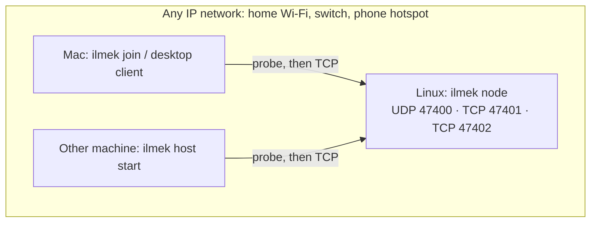

# Network setup

İlmek needs **two or more computers that can reach each other over IP**. That is all. It does not
configure Wi-Fi adapters, routes, DHCP or firewalls, and it does not need two Wi-Fi cards or an
access-point-capable adapter. (The two-radio routing-node tooling of the `security` branch, `ilmek network`, is
not part of this branch.)

> **Status.** Everything in this file about *other machines* is **not tested**: this work was done
> on one computer, with the node, hosts and clients as separate processes over `127.0.0.1`
> (including UDP discovery and automatic joining). Commands for firewalls and hotspots below are
> standard operating-system commands given as a starting point; they were not run here.

## What has to be true

| Need | Why |
| --- | --- |
| The machines share an IP network (same Wi-Fi, same switch, a phone hotspot…) | İlmek is TCP over IP |
| Client machines can open TCP connections to the node on **47401** and **47402** | registry and application host |
| Discovery (any one of): UDP **47400** broadcast reaches the node, **or** TCP 47401 is reachable on the node's address | so a device can find the node without being told. TCP 47401 is needed anyway |
| IPv4 | addresses in the protocol are IPv4 |



## Firewall on the node

If a firewall is active on the node's machine, allow the ports (examples; adapt to your system,
not run here):

```sh
sudo ufw allow 47400/udp && sudo ufw allow 47401:47402/tcp        # Ubuntu / Mint
sudo firewall-cmd --add-port=47400/udp --add-port=47401-47402/tcp # Fedora (add --permanent)
```

A client needs no incoming ports. macOS may ask whether the program may accept incoming
connections only for a node or host running on the Mac. First steps: [GETTING_STARTED](GETTING_STARTED.md).

## How a device finds the node, and when it cannot

A device with no stored state looks for the node in two ways **at the same time** and uses whichever
answers first. The result is stored, so this happens once per device.

1. **UDP beacon.** It sends `ILMEK-DISCOVER/1` to `255.255.255.255:47400` and `127.0.0.1:47400`
   (every 500 ms for up to 4 s). The node answers with the community id and the registry's port;
   the registry address is the answer's source IP.
2. **TCP scan.** It tries TCP 47401 on every address of its own /24 network (up to 64 at a time,
   700 ms each). A registry there tells it which community it serves. This works even when UDP is
   blocked, and needs only the TCP port you have to open anyway.

If you **give the address** (`ilmek join --registry IP:47401`, or the "Node address" box of the
desktop client) only that TCP port is used: no UDP, no scan. The community is learned from the
registry's answer, so you never type a community id.

It does **not** work when:

- the machines are on different subnets and you gave no address (neither broadcast nor the /24 scan
  crosses routers; with an address it does, if TCP is routed);
- TCP 47401 is blocked by the node's firewall (open `47401-47402/tcp`);
- the device and the node run **different builds**: a node started before the TCP-probe change does
  not describe its community in its answer and shows up as "did not answer like an İlmek registry".
  Rebuild and restart the node.

If UDP 47400 is busy on the node, the node still runs but is only found by the scan or by address;
use `--discovery-port` on the node and `ILMEK_DISCOVERY_PORT` on every device to move the beacon.
A network scan only tries the default registry port (`ILMEK_REGISTRY_PORT` changes it); with
another port, give the address.

## Adding another application host

Any other machine can serve applications:

```sh
ilmek host start            # finds the node, joins, registers itself, serves on TCP 47402
```

The host sends `0.0.0.0:47402` as its address and the registry records the address the connection
came from, so the host needs no address setting. Applications are then installed on that machine
with the ordinary `ilmek app …` commands and published with `ilmek app publish` (the same machine
or any joined device can publish).

## Making a Linux machine its own Wi-Fi network (optional, not run)

If there is no shared network at all, a Linux machine with one Wi-Fi adapter that supports access
point mode can create one with NetworkManager (`nmcli device wifi hotspot ssid ILMEK password
<8+ characters>`). The other computers join that Wi-Fi and use İlmek as above. Whether an adapter
supports AP mode is hardware- and driver-dependent (`iw list`, look for `AP` under supported
interface modes); this was not checked on any real hardware. The hotspot's DHCP gives the Linux
machine its address (typically `10.42.0.1`).

## Not covered

Several nodes that route between separate networks, mesh, and any connection to the public
internet are not implemented. The original two-node Wi-Fi design is specified in
[REQUIREMENTS](REQUIREMENTS.md) (archived, Turkish) and implemented on the `security` branch.
