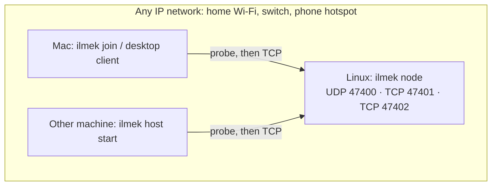

# Network setup

İlmek needs **two or more computers that can reach each other over IP**. That is all. It does not
configure Wi-Fi adapters, routes, DHCP or firewalls, and it does not need two Wi-Fi cards or an
access-point-capable adapter. (The two-radio routing-node tooling of `main`, `ilmek network`, is
not part of this branch.)

> **Status.** Everything in this file about *other machines* is **not tested**: this work was done
> on one computer, with the node, hosts and clients as separate processes over `127.0.0.1`
> (including UDP discovery and automatic joining). Commands for firewalls and hotspots below are
> standard operating-system commands given as a starting point; they were not run here.

## What has to be true

| Need | Why |
| --- | --- |
| The machines share an IP network (same Wi-Fi, same switch, a phone hotspot…) | İlmek is TCP over IP |
| Client machines can open TCP connections to the node on **47401** and **47402** | registry and application host |
| Discovery: UDP **47400** reaches the node (broadcast on the same subnet) | so a device can find the node without being told |
| IPv4 | addresses in the protocol are IPv4 |



## The first demo

1. **Linux machine (node).** Build and run `ilmek node` ([README](../README.md)). It prints
   `node is running: registry 0.0.0.0:47401, application host 0.0.0.0:47402`.
2. **Find its IP** (only needed if discovery does not work): `hostname -I` or `ip -4 addr`.
3. **Firewall on the Linux machine.** If one is active, allow the ports (examples; adapt to your
   system, not run here):

   ```sh
   sudo ufw allow 47400/udp && sudo ufw allow 47401:47402/tcp        # Ubuntu / Mint
   sudo firewall-cmd --add-port=47400/udp --add-port=47401-47402/tcp # Fedora (add --permanent)
   ```

4. **Mac (client).** Install the Rust toolchain, build the CLI, join:

   ```sh
   cargo build -p ilmek-cli
   target/debug/ilmek join                         # UDP discovery
   target/debug/ilmek join --registry 192.168.1.10:47401   # or give the node's address
   target/debug/ilmek resolve ilmek://nuri/forum
   ```

   No other file or code has to be copied. macOS may ask whether the program may accept incoming
   connections only for a *node or host* running on the Mac; a client does not need that.

## How discovery works, and when it does not

A device with no stored state sends the datagram `ILMEK-DISCOVER/1` to `255.255.255.255:47400` and
`127.0.0.1:47400` (every 500 ms for up to 4 s). The node answers with the community id, the
registry's id and port; the registry address is the answer's source IP. The result is stored, so
this happens once per device.

It does **not** work when:

- the machines are on different subnets (broadcast does not cross routers);
- the network blocks client-to-client UDP (some guest Wi-Fi, "AP isolation");
- the node's firewall drops UDP 47400.

In those cases give the address: `ilmek join --registry IP:47401` (any command that needs a device
accepts `--registry` for the first join), or in the desktop client type it in "Node address".
If UDP 47400 is busy on the node, the node still runs but cannot be discovered; use
`--discovery-port` on the node and `ILMEK_DISCOVERY_PORT` on every device.

## Adding another application host

Any other machine can serve applications:

```sh
ilmek host start            # finds the node, joins, registers itself, serves on TCP 47402
```

The host sends `0.0.0.0:47402` as its address and the registry records the address the connection
came from, so the host needs no address setting. Applications are then installed on that machine
with the ordinary `ilmek app …` commands and published with `ilmek app publish` (the same machine
or any joined device can publish).

## Making a Linux machine its own Wi-Fi network (optional, not run)

If there is no shared network at all, a Linux machine with one Wi-Fi adapter that supports access
point mode can create one with NetworkManager (`nmcli device wifi hotspot ssid ILMEK password
<8+ characters>`). The other computers join that Wi-Fi and use İlmek as above. Whether an adapter
supports AP mode is hardware- and driver-dependent (`iw list`, look for `AP` under supported
interface modes); this was not checked on any real hardware. The hotspot's DHCP gives the Linux
machine its address (typically `10.42.0.1`).

## Not covered

Several nodes that route between separate networks, mesh, and any connection to the public
internet are not implemented. The original two-node Wi-Fi design is documented in
[REQUIREMENTS](REQUIREMENTS.md) and implemented on `main`.
