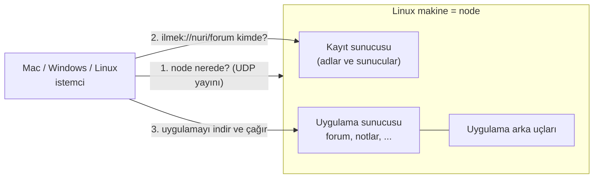

# İlmek — Başlangıçtan Rehber (Türkçe)

Bu rehber, projeyi hiç bilmeyen biri için yazıldı. Her şey bu dalın (`feat/simple-no-security`)
gerçek davranışına göredir. İlk gerçek deneme adımları: [TWO_MACHINE_DEMO](TWO_MACHINE_DEMO.md). Ayrıntılı ve teknik belgeler: [ARCHITECTURE](ARCHITECTURE.md),
[PROTOCOL](../PROTOCOL.md), [NETWORK_AND_DISCOVERY](NETWORK_AND_DISCOVERY.md), [BACKUP_AND_OPERATIONS](BACKUP_AND_OPERATIONS.md).

> **Önemli uyarı.** Bu dalda **güvenlik yoktur**: trafik şifrelenmez, kimse kimliğini kanıtlamaz,
> paketler imzalanmaz, ağa bağlanan herkes katılıp uygulama yayınlayabilir. Yalnızca güvendiğiniz,
> kapalı bir ağda kullanın. Güvenli sürüm `main` dalındadır.

## 1. İlmek ne işe yarar?

Kendi küçük "internetinizi" kurarsınız. Bir makine **node** olur: içinde bir **kayıt sunucusu**
(hangi uygulama nerede?) ve bir **uygulama sunucusu** çalışır. Siz uygulamalarınızı oraya yayınlarsınız.
Aynı ağdaki diğer bilgisayarlar node'u kendiliğinden bulur ve uygulamaları `ilmek://isim/uygulama`
adresiyle açar. İnternet, bulut veya HTTP gerekmez; her şey İlmek'in kendi protokolü (**ILMEK/1**)
ile doğrudan TCP üzerinden konuşur.

## 2. Terimler

| Terim | Anlamı |
| --- | --- |
| **Node** | Kayıt sunucusunu (ve genellikle bir uygulama sunucusunu) çalıştıran makine. `ilmek node` ile başlar |
| **Kayıt sunucusu (registry)** | "nuri/forum şu makinede, şu sürümde" bilgisini tutar. Uygulama trafiğini taşımaz |
| **Uygulama sunucusu (host)** | Uygulama paketlerini ve arka uç süreçlerini çalıştırır. Birden çok uygulama taşır |
| **Arka uç (backend)** | Bir uygulamanın veriyi tuttuğu ayrı süreç (örn. forum). Statik uygulamaların arka ucu olmaz |
| **İstemci** | Uygulamayı açan cihaz: komut satırı (`ilmek`) veya masaüstü penceresi |
| **Ad alanı (namespace)** | Adresteki ilk bölüm: `ilmek://`**`nuri`**`/forum`. İlk yayınlayan cihaz sahiplenir |
| **Cihaz kimliği** | Her cihazın kendi ürettiği rastgele numara. Kanıtlanmaz; cihazları ayırmak içindir |
| **Beacon** | Node'un UDP 47400 portunda "buradayım" diye cevap vermesi |

## 3. İlk demo ve başka host eklemek

Bir Linux node ve bir Mac istemci ile ilk deneme: [TWO_MACHINE_DEMO](TWO_MACHINE_DEMO.md).
Kısa başlatma komutları (node, join, ek host, çok istemci): [RUN_NODES_AND_CLIENTS](RUN_NODES_AND_CLIENTS.md).
Ağ ve keşif ayrıntıları: [NETWORK_AND_DISCOVERY](NETWORK_AND_DISCOVERY.md).

Kısaca: bir makinede `ilmek node`, diğerlerinde `ilmek join`; ek uygulama sunucusu için `ilmek host start`.

## 4. Veriler nerede?

`$ILMEK_HOME` (varsayılan `~/.ilmek`) altında:

| Yol | İçerik |
| --- | --- |
| `registry/` | kayıt veritabanı ve `community.json` |
| `host/` | uygulama paketleri, uygulama verileri (`apps/<id>/data`), günlükler |
| `device/` | bu makinenin istemci olarak kimliği ve topluluk bilgisi |
| `registry.toml`, `host.toml` | ayarlar (ilk çalıştırmada yazılır, sonra elle düzenlenebilir) |

Yedekleme: `ilmek backup registry --out ...`, `ilmek backup host --out ...`
([BACKUP_AND_OPERATIONS](BACKUP_AND_OPERATIONS.md)).

## 5. Bir uygulama nasıl yazılır?

[APP_DEVELOPMENT_GUIDE](APP_DEVELOPMENT_GUIDE.md): HTML/CSS/JavaScript sayfası + (isteğe bağlı) Rust arka ucu.
Sayfa yalnızca `window.ilmek` SDK'sı üzerinden kendi arka ucuna konuşur; başka bir adrese
bağlanamaz. Yazma işlemleri işlem kimliği taşır: yanıt kaybolsa bile tekrar gönderilen işlem iki
kez uygulanmaz.

## 6. Hangi test edildi, hangisi edilmedi?

| Durum | Ne |
| --- | --- |
| Yapıldı | Tek Linux makinede, node/host/arka uç/istemci **ayrı süreçler** olarak `127.0.0.1` üzerinde: UDP keşif, otomatik katılma, yayınlama, indirme, çağırma, yeniden başlatmada veri, ikinci host, yedek/geri yükleme. 170+ Rust testi, 13 arayüz testi, 20 SDK testi |
| **Yapılmadı** | İkinci gerçek bilgisayar, gerçek ağda UDP yayın keşfi, macOS, Windows, Android, masaüstü pencerenin açılması |

Ayrıntı: [TEST_REPORT](TEST_REPORT.md).

## 7. Sık sorulanlar

**`ilmek join` "no node found" diyor.** Node çalışıyor mu? Güvenlik duvarında UDP 47400 açık mı? Aynı
alt ağda mısınız? Değilse `--registry IP:47401` kullanın.

**Neden şifreleme yok?** İlk sürüm en basit biçimde ayağa kalksın diye bilinçli olarak çıkarıldı
([karar 0005](decisions/0005-simple-no-security.md)). Sonradan protokolün yeni bir sürümüyle eklenecek.

**İki Wi-Fi kartı gerekiyor mu?** Hayır. İki makinenin birbirine IP ile ulaşabilmesi yeter (aynı
Wi-Fi, kablo, telefon hotspot'u).

**`main` dalındaki iki-node tasarımı ne oldu?** Orada duruyor (TLS, sertifikalar, imzalı paketler,
iki node arasında Wi-Fi yönlendirmesi). Bu dal onunla **uyumlu değildir**.
