# İlmek — Başlangıçtan Rehber (Türkçe)

Hiçbir şey bilmeden okuyabilirsin. Önce büyük resim, sonra her kavram, sonra parçalar, en sonda
**nasıl denerim**. Takıldığın kelime olursa sondaki [Sözlük](#10-sözlük)'e bak.
Teknik ayrıntı için: [ARCHITECTURE](ARCHITECTURE.md) · [OPERATIONS](OPERATIONS.md) ·
[NETWORK_SETUP](NETWORK_SETUP.md) · [SECURITY](SECURITY.md) · [TEST_REPORT](TEST_REPORT.md).

---

## 1. İlmek ne işe yarar? (büyük resim)

Bir mahalle, okul, atölye, afet bölgesi düşün: **internet yok ya da güvenilmiyor**, ama insanların
telefonları ve bilgisayarları var. İlmek şunu yapar:

> Bir bilgisayarda küçük bir uygulama (forum, not defteri, duyuru panosu…) yayınlarsın.
> Aynı Wi-Fi ağındaki herkes `ilmek://nuri/forum` gibi bir adresle onu açar.
> Hiçbir bulut, hiçbir internet bağlantısı gerekmez.

Yani "internetsiz, yerel bir mini-web": ama web'den farklı olarak herkesin kimliği doğrulanır,
uygulamalar imzalıdır ve veriler uygulamayı barındıran bilgisayarda (host) kalır, buluta gitmez.

**Üç temel rol (bunları aklında tut):**
- **Host:** uygulamayı çalıştıran ve verisini saklayan bilgisayar ("sunucu").
- **Registry:** isim defteri ve kimlik bürosu; hangi uygulama hangi host'ta olduğunu bilir.
- **İstemci:** uygulamayı açan telefon/bilgisayar ("kullanıcı"). Üye, yani katılmış cihaz demektir.

**Gerçek hayat benzetmesi:** Bir apartmanda herkesin kendi dairesi (bilgisayar) var. Bodrumda bir
**kapıcı defteri** (registry) var: "forum kat 2'de, not defteri kat 3'te" yazıyor. Birisi forum'u
açmak ister: önce kapıcıya sorar, sonra doğrudan 2. kata çıkar. Kapıcı kimseyi taşımaz, sadece
adres söyler ve kimlik kartı verir.

**Genel görünüm (kim kiminle konuşur):**

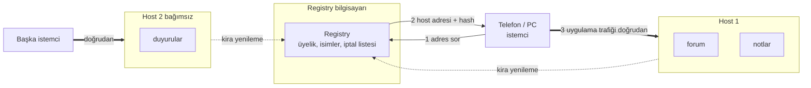

Kalın çizgi = uygulama verisi (registry'den geçmez). Noktalı = "ben hâlâ buradayım" bildirimi.

---

## 2. Önce temel kavramlar (ağ ve güvenlik)

Bunları bilen atlayabilir.

**İlmek'in katmanları** (alttan üste; her katman bir alttakinin üstüne biner):

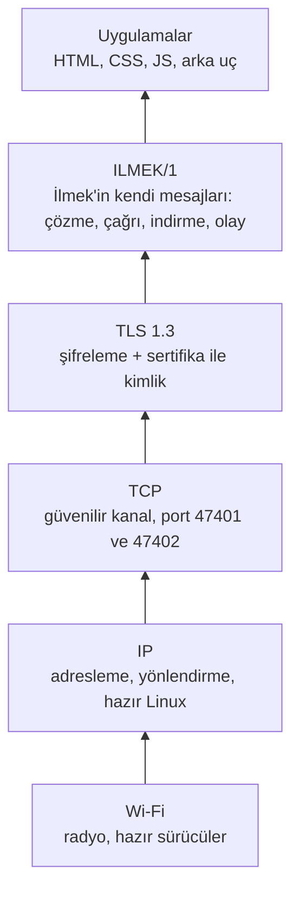

İlmek yalnızca en üstteki iki katmanı yazdı. Wi-Fi, IP, TCP ve TLS hazır, olgun araçlardır.

### Ağ

- **Wi-Fi:** Kablosuz bağlantı. Telefonun "ağa bağlan" dediği şey.
- **IP adresi:** Ağdaki her cihazın numarası, örn. `10.77.10.20`. Posta adresi gibi.
- **Alt ağ (subnet), örn. `10.77.10.0/24`:** Aynı "mahalledeki" adresler. `/24` demek
  "`10.77.10.1`–`10.77.10.254` arası hepsi aynı mahalle". Aynı alt ağdaki cihazlar birbirini
  doğrudan görür; başka alt ağa gitmek için bir **router** lazım.
- **Router / yönlendirici ve gateway (ağ geçidi):** İki mahalle arasında trafiği aktaran cihaz.
  "Gateway" cihazın dışarı çıkarken kullandığı kapı.
- **Rota (route):** "`10.77.20.x` adreslerine gitmek için şu komşuya ver" kuralı.
- **Erişim noktası (AP, access point):** Wi-Fi yayını yapan cihaz; telefonlar ona bağlanır. Evdeki
  modem aynı zamanda bir AP'dir.
- **İstasyon (station):** Wi-Fi'a bağlanan taraf (telefon, laptop). Bir bilgisayar AP de olabilir
  istasyon da; ikisini aynı anda yapmak için genelde **iki ayrı Wi-Fi kartı** gerekir.
- **DHCP:** Ağa yeni giren cihaza otomatik IP adresi veren servis. "Adres dağıtıcı".
- **DHCP rezervasyonu:** "Şu MAC adresli cihaza hep şu IP'yi ver." Sunucuların adresi
  değişmesin diye kullanılır. **MAC adresi** = ağ kartının donanım seri numarası gibi bir kimlik.
- **NAT / masquerade:** Birçok cihazı tek adresmiş gibi internete çıkaran hile. **İlmek bunu
  kullanmaz**, internete çıkış yoktur.
- **Firewall (güvenlik duvarı):** "Şu trafiğe izin ver, şuna verme" kuralları. Linux'ta `nftables`.
- **TCP:** İki bilgisayar arasında "sırayla, eksiksiz" veri taşıyan güvenilir kanal. **Port** = aynı
  bilgisayardaki hangi "kapı numarası"nın kullanıldığı. İlmek 47401 ve 47402'yi kullanır.
- **Loopback (`127.0.0.1`):** Bilgisayarın kendi kendine konuşma adresi. Testlerimizin çoğu böyle
  yapıldı: gerçek ağ süreçleri ama aynı makinede. **Bu, gerçek Wi-Fi testi değildir.**

### Güvenlik

- **TLS:** Trafiği şifreleyen ve karşıdakinin kim olduğunu doğrulayan katman (https'teki "s").
  İlmek yalnızca TLS 1.3 kullanır.
- **Sertifika:** Dijital kimlik kartı. İçinde "ben X'im" yazar ve bir otorite tarafından imzalıdır.
- **CA (sertifika otoritesi):** Kimlik kartlarını basan ve imzalayan merci. İlmek'te **kendi
  topluluğunun CA'sı** registry bilgisayarındadır; dışarıdan hiçbir otorite yoktur.
- **CA parmak izi (fingerprint):** CA sertifikasının kısa özeti (64 harf/rakam). Katılan kişi bunu
  yönetici ile ayrı bir kanaldan alır; böylece sahte bir registry'ye kanmaz.
- **Token (davet kodu):** Yönetici üretir, **tek kullanımlık** ve kısa ömürlüdür (varsayılan 15
  dk). Cihaz bununla "ben katılabilirim" der ve sertifikasını alır.
- **mTLS (karşılıklı TLS):** Sadece sunucu değil istemci de sertifika gösterir. Sunucu "kimsin?"
  sorusunun cevabını **sertifikadan** alır, isteğin içindeki "ben Ali'yim" yazısından değil.
- **Hash (SHA-256):** Bir dosyanın parmak izi. Tek bir bayt değişse hash tamamen değişir.
- **Dijital imza (Ed25519):** "Bu paketi şu yayıncı hazırladı ve sonradan değişmedi" kanıtı.
- **İptal (revocation):** Bir üyenin kimlik kartını geçersiz kılma. Liste registry'den periyodik
  çekilir.

### Yazılım

- **Uygulama (app):** HTML + CSS + JavaScript dosyaları (web sayfası gibi), istenirse bir arka uç.
- **Arka uç (backend):** Uygulamanın sunucu tarafı: veriyi saklar, kuralları uygular.
- **SQLite:** Tek dosyada çalışan küçük veritabanı. Bütün veriler böyle tutulur.
- **WebView:** İşletim sisteminin gömülü tarayıcı motoru. Uygulamaların HTML'i bunun içinde açılır.
- **SDK:** Uygulamanın İlmek ile konuşması için hazır küçük kütüphane (`window.ilmek`).
- **Operation ID (işlem kimliği):** Her yazma isteğine verilen eşsiz numara. Bağlantı kopup istek
  tekrarlansa bile aynı numara taşıdığı için **kayıt iki kez oluşmaz** (ör. yorum çift atılmaz).
- **Manifest:** Paketin içindeki "dosya listesi": her dosya, boyutu ve hash'i. İmza bu listeyi korur.
- **systemd:** Linux'ta programları servis olarak (açılışta, çökünce yeniden) başlatan sistem.

---

## 3. Node nedir? (iki "yönlendirici bilgisayar")

**Node**, İlmek'te eski bir Linux bilgisayarın **ağ cihazı gibi çalışması** demektir. Bu projenin
fiziksel tasarımında iki node var: **NODE-A** ve **NODE-B**. Her biri:

- **İki Wi-Fi kartı** taşır: biri insanlara hizmet eder (kullanıcı ağı), diğeri öteki node ile
  konuşur (transit bağlantı).
- **Router** gibi davranır (IP yönlendirme açık), **DHCP** ile adres dağıtır, kendi **firewall**
  kuralları vardır.
- **Uygulama sunucusu olmak zorunda değildir.** Uygulamalar ayrı bilgisayarlarda (host) durur; node
  sadece yolu açar. (İstersen registry'yi NODE-A'ya koyarsın.)

```
 Telefonlar/PC'ler                                                  Telefonlar/PC'ler
   ~~ Wi-Fi "ILMEK-A" ~~  [ NODE-A ] ~~ Wi-Fi "ILMEK-TRANSIT" ~~ [ NODE-B ]  ~~ Wi-Fi "ILMEK-B" ~~
   10.77.10.0/24          wlan0|wlan1        (köprü)        wlan1|wlan0       10.77.20.0/24
                          10.77.10.1  10.77.254.1   10.77.254.2  10.77.20.1
```

Adımlar: A ağındaki telefon, B ağındaki bir host'ta duran uygulamayı açmak ister →
paket NODE-A'ya gider → NODE-A "10.77.20.x için komşum NODE-B" rotasını bilir → Wi-Fi köprüsünden
NODE-B'ye aktarır → NODE-B kendi ağındaki host'a ulaştırır. Cevap aynı yoldan döner. Aradaki
node'lar içeriği göremez (TLS şifreli), sadece "kim kime, ne kadar" bilgisini görür.

**Neden iki ayrı ağ?** Tek bir Wi-Fi'nin menzili sınırlıdır; iki bölge (iki sınıf, iki bina) ayrı
ağlar olur ve aralarında kablosuz bir köprü kurulur. Menzili ve kapasiteyi bu belirler; elimizde
gerçek donanım olmadığından **bunlar ölçülmedi**.

**`ilmek network …` komutları** bu kurulumu otomatik yapar: `hostapd` (AP), `dnsmasq` (DHCP),
`nftables` (firewall), `ip` (adres/rota) ayarlarını üretir. Güvenlik için: önce `plan` (sadece
gösterir), `apply` ancak `--yes` ve root ile, her değişiklik bir **snapshot**'a yazılır, `rollback`
hepsini geri alır. Dokunmadıkları: internet yolu, NAT, mevcut firewall kuralları, şu an bağlı
olduğun arayüz.

**Bir node'un içinde ne çalışır?** (`ilmek network apply` bunları kurar)

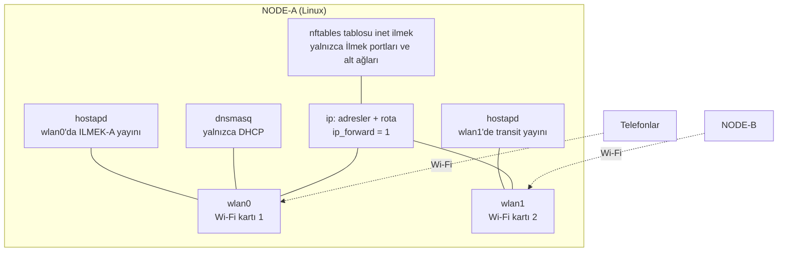

**`apply` nasıl güvenli?** Önce plan görülür, yedek alınır, hata olursa kendiliğinden geri alınır:

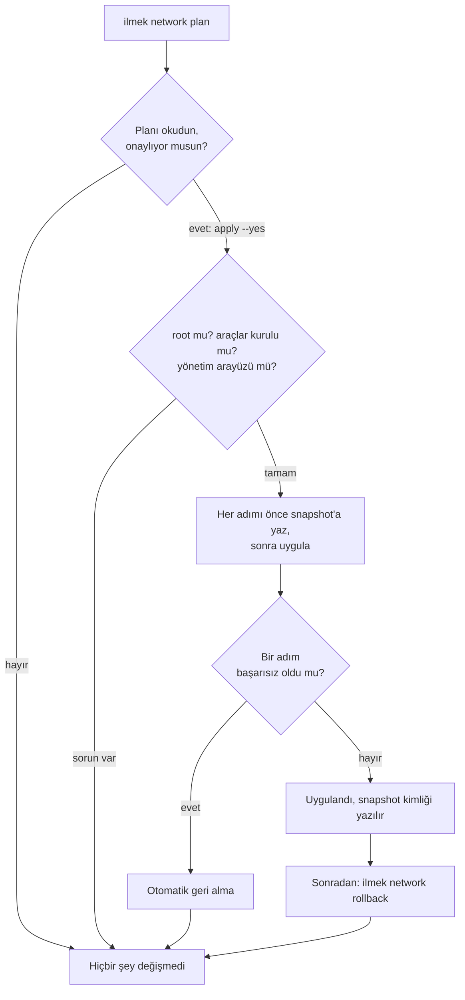

---

## 4. İlmek'in parçaları

| Parça | Ne yapar | Benzetme | Komut / yer |
| --- | --- | --- | --- |
| **Registry** | Üyelik (CA), isim sahipliği, "hangi uygulama hangi host'ta" kaydı, iptal listesi. Uygulama trafiğini **taşımaz**. | Kapıcı defteri + kimlik bürosu | `ilmek registry serve` |
| **Host** | Uygulamaları barındıran bilgisayar. Aynı anda çok uygulama, her birinin ayrı verisi/süreci. | Çok kiracılı bina | `ilmek host serve` |
| **Yayıncı** | Uygulamayı paketleyip imzalayan kişi. Ad alanı (`nuri/…`) sahibi. | Mühürlü paket gönderen | `ilmek app pack/publish` |
| **İstemci** | Adres açar, paketi doğrular, uygulamayı izole pencerede çalıştırır. | Tarayıcı | `apps/client` |
| **Arka uç** | Uygulamanın sunucu kısmı; host onu yerel olarak başlatır. | Dairenin içindeki görevli | `examples/*/backend` |
| **Node** | Ağ yolunu açan Linux bilgisayar (bkz. 3). | Köprü + kapı | `ilmek network …` |
| **CLI (`ilmek`)** | Hepsini yöneten tek komut. | Kumanda | `target/debug/ilmek` |

**Roller kim?** Tek bilgisayar hepsi olabilir (denemede öyle), ama gerçekte: registry bir bilgisayarda
(NODE-A olabilir), her host ayrı bilgisayar, yayıncı kendi laptop'ında, üyeler telefon/PC.

**Bir host'un içi** (her uygulama kendi kutusunda):

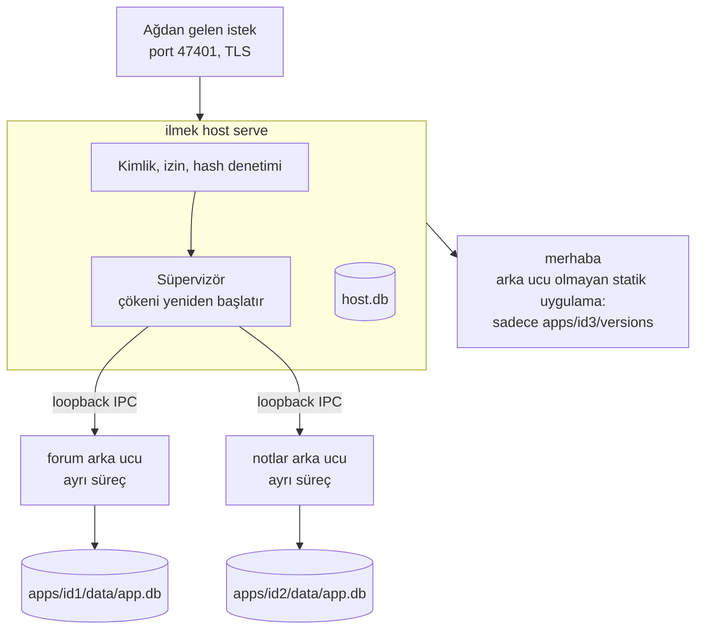

Bir arka uç çökerse yalnızca o uygulama etkilenir; diğerleri çalışmaya devam eder.

**Topluluğa katılma (enrollment):**

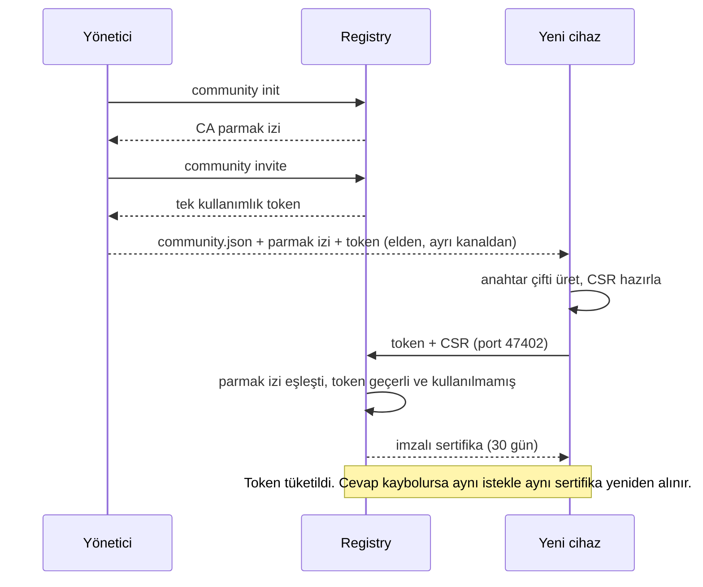

**Uygulama yayınlama:**

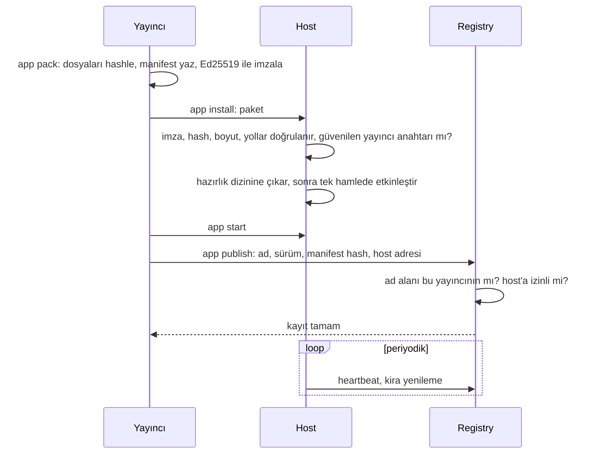

---

## 5. Bir adres açılınca ne olur?

1. **Çözme:** İstemci registry'ye sorar: "`nuri/forum` kimde?" → host adresi, sürüm, hash.
2. **Bağlanma:** İstemci host'a **doğrudan** bağlanır; registry araya girmez. İkisi birbirinin
   sertifikasını kontrol eder (mTLS).
3. **İndirme:** Manifest + imza gelir. İmza yayıncının anahtarıyla, her dosyanın boyutu ve hash'i
   listeyle karşılaştırılır. Biri bile tutmazsa paket **hiç etkinleşmez**.
4. **Çalıştırma:** Sayfa izole bir pencerede açılır. `window.ilmek.call(...)` ile host'a istek gider.
5. **Yazma:** Arka uç iş verisini ve "bu işlem yapıldı" kaydını **aynı SQLite işleminde** yazar.
   Cevap yolda kaybolsa istemci aynı operation ID ile tekrar dener, kopya oluşmaz.

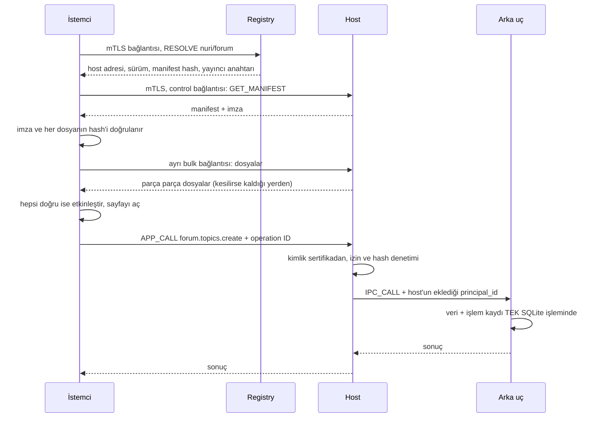

**Cevap kaybolursa ne olur?** (neden kayıt iki kez oluşmaz)

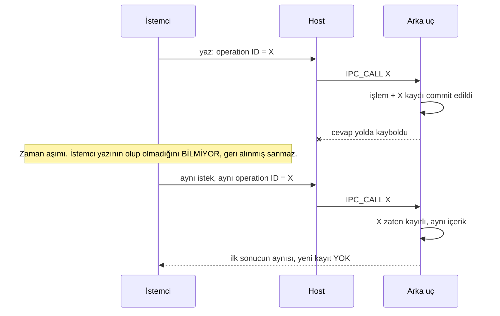

**Paket doğrulama ve güncelleme kararı:**

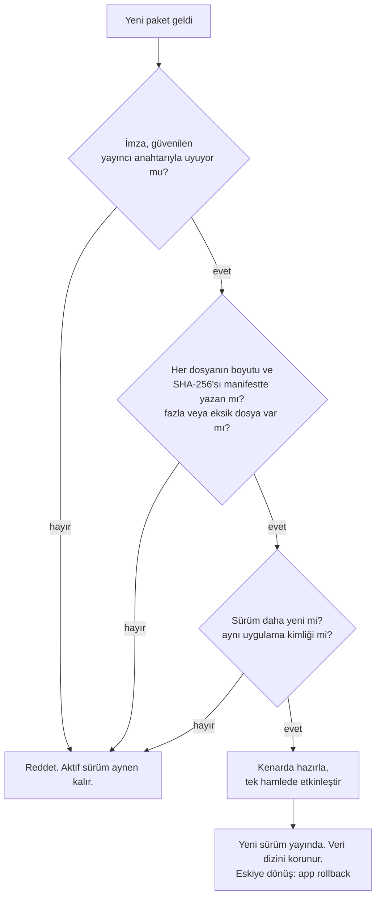

**Güvenlik sınırları** (kim neye güveniyor):

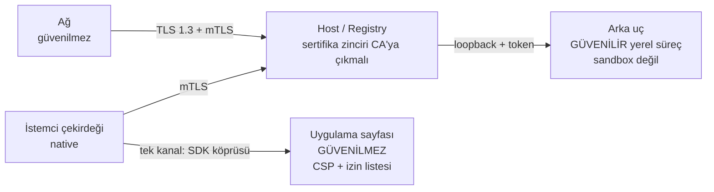

Sayfanın doğrudan ağı yok, dosyası yok, başka uygulamaya yolu yok; yalnızca köprüden
kendi uygulamasına çağrı yapabilir.

**Bir üye iptal edilince ve registry'ye ulaşılamayınca (zaman çizgisi):**

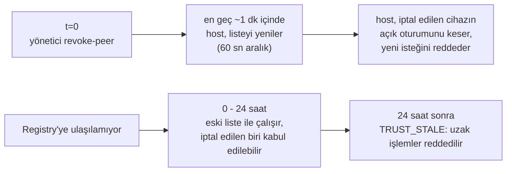

**Güvenlik özeti:** Üyelik sertifikayla; paketler imzayla; sayfa dışarı/başka uygulamaya
erişemez (yalnızca SDK köprüsü); kimlik her zaman sertifikadan okunur; iptal edilen üye, host listeyi yenileyince (en geç ~1 dk) host'ta kesilir (istemciler listeyi
açılışta ve uygulama açarken, liste eskiyse yeniler); registry'ye bir süre ulaşılamazsa en fazla **24 saat** eski bilgiyle devam edilir.

---

## 6. Depoda ne nerede?

`crates/` Rust çekirdeği (protokol, TLS, registry, host, istemci, paketleme, ağ, CLI) ·
`apps/client` masaüstü istemci · `packages/sdk-js` JS SDK · `examples/` forum, notlar, duyurular,
merhaba · `configs/` örnek ayarlar · `deploy/systemd/` servis dosyaları · `scripts/` denemeler ·
`docs/` dokümanlar (`REQUIREMENTS.md` = orijinal şartname, `PROTOCOL.md` = protokolün kendisi).

## 7. Neler test edildi, neler edilmedi?

- **Edildi** (bu bilgisayarda, loopback üzerinde, ayrı süreçlerle): protokol, kimlik, registry, host,
  paketleme, güncelleme, yedek/geri yükleme, çoklu uygulama, çökme izolasyonu, iptal, Linux WebView
  izolasyonu. 230 otomatik test + 4 betik geçti.
- **Masaüstü istemci arayüzü için testler:** 11 bileşen testi var (`apps/client/test/ui.test.tsx`):
  topluluğa katılma (bilgiler sayfada saklanmaz, reddedilen profil anlaşılır anlatılır), katalog ve
  adres açma, gerçek bayt ilerlemesi ve iptal, hata/eski isim uyarısı, ayarlar, Türkçe/İngilizce.
  Bunlar **sahte (mock) bir yerel kabuğa** karşı çalışır. Yerel taraf (köprü, izinler, depolama,
  indirme) ayrıca Rust testleriyle (`ilmek-runtime`) ve gerçek pencereli izolasyon probuyla sınanır.
  **Yok:** gerçek istemci penceresini baştan sona süren otomatik test ("katıl → adres aç → yaz");
  bunu ancak gerçek ağda elle denemek mümkün (aşağıdaki senaryolar).
- **Edilmedi:** gerçek Wi-Fi, iki gerçek node, Android, Windows, macOS. `ilmek network apply`
  hiçbir gerçek makinede çalıştırılmadı. Android istemcisi henüz yok. Tam tablo:
  [TEST_REPORT](TEST_REPORT.md).

**Hangi test neyi kanıtlar?**

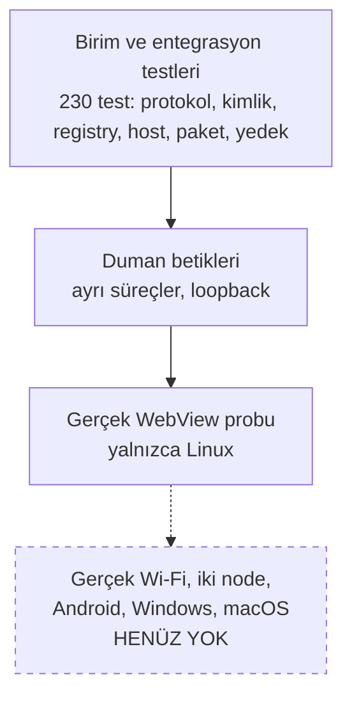

---

## 8. Nasıl denerim?

### A) 2 dakika: hazır betikler (buradan başla)

```sh
cd ~/Desktop/project-ilmek
cargo build -p ilmek-cli -p ilmek-example-forum -p ilmek-example-notes
scripts/smoke/local-processes.sh   # kayıt → yayın → indirme → çağrı → yeniden başlatma → iptal
scripts/smoke/multi-app.sh         # 1 host'ta 3 uygulama + 2. bağımsız host; biri düşünce diğerleri çalışır
scripts/smoke/backup-restore.sh    # canlı yedek → veriyi sil → geri yükle → durum aynı mı?
cargo test --workspace             # tüm otomatik testler
```

Her betik sonunda `ALL STEPS PASSED` yazar. Geçici dizinde çalışır, bitince temizler.
Ne kanıtlıyorlar: `local-processes` = kayıt→yayın→indirme→çağrı→yeniden başlatma→iptal;
`multi-app` = 1 host'ta 3 uygulama + bağımsız 2. host, biri düşünce diğerleri çalışır;
`backup-restore` = canlı yedek→veriyi sil→geri yükle→durum yedek anındaki gibi mi.

### B) 10 dakika: elle, adım adım (tek makine, `127.0.0.1`)

Her satırı sırayla kendi terminaline yapıştır. Yazdığım gibi çalıştırıp doğruladım. Altındaki
yorumlar neyin ne işe yaradığını söyler.

```sh
cd ~/Desktop/project-ilmek && cargo build -p ilmek-cli -p ilmek-example-forum
export PATH=$PWD/target/debug:$PATH ; R=$PWD
mkdir -p /tmp/demo && cd /tmp/demo
cat > registry.toml <<'E'
data_dir = "/tmp/demo/registry"
control_listen = "127.0.0.1:47401"
enroll_listen = "127.0.0.1:47402"
allowed_endpoints = ["127.0.0.0/8"]
E
cat > host.toml <<'E'
data_dir = "/tmp/demo/host"
device_dir = "/tmp/demo/host-device"
listen = "127.0.0.1:47411"
advertised = "127.0.0.1:47411"
E

# 1) Topluluğu kur (CA parmak izi yazdırılır) ve registry'yi başlat
FP=$(ilmek community init --config registry.toml --advertise-ip 127.0.0.1 2>/dev/null)
ilmek registry serve --config registry.toml 2>registry.log &

# 2) Cihazlar: host, yayıncı, alice (her biri tek kullanımlık token ile katılır)
enroll() { # AD ROLLER [ekstra invite argümanları]
  n=$1; r=$2; shift 2
  ilmek community invite --config registry.toml --role "$r" "$@" 2>/dev/null > $n.token
  ilmek identity enroll --profile registry/community.json --fingerprint $FP \
        --device $n-device --name $n --token-file $n.token 2>/dev/null | awk '{print $2}'
}
HOST=$(enroll host member,host --server-ip 127.0.0.1)
PUB=$(enroll publisher member,publisher)
enroll alice member >/dev/null

# 3) Yayıncı kaydı: "nuri" ad alanı, imza anahtarı, host izni
KEY=$(ilmek publisher keygen --out publisher.key 2>/dev/null)
PID=$(ilmek community add-publisher --config registry.toml --name nuri 2>/dev/null)
ilmek community add-publisher-device --config registry.toml --publisher $PID --peer $PUB
ilmek community add-publisher-key    --config registry.toml --publisher $PID --key $KEY >/dev/null
ilmek community grant-namespace      --config registry.toml --publisher $PID --namespace nuri
ilmek community grant-host           --config registry.toml --publisher $PID --host $HOST
ilmek host trust-publisher --config host.toml --key $KEY

# 4) Host'u başlat, forum'u kur ve yayınla
ilmek host serve --config host.toml 2>host.log &
ilmek app pack $R/examples/forum/app --key publisher.key --out forum-pkg --publisher-id $PID >/dev/null
ilmek app install     --config host.toml forum-pkg
ilmek app set-backend --config host.toml nuri/forum --exe $R/target/debug/ilmek-forum-backend
ilmek app start       --config host.toml nuri/forum
ilmek app publish     --config host.toml nuri/forum --device publisher-device

# 5) Kullan
ilmek resolve  ilmek://nuri/forum --device alice-device
ilmek diagnose ilmek://nuri/forum --device alice-device
ilmek call ilmek://nuri/forum forum.topics.create --write \
      --body '{"title":"Merhaba","body":"ilk konu"}' --device alice-device
ilmek call ilmek://nuri/forum forum.topics.list --device alice-device
ilmek app list --config host.toml

# 6) Yedek / geri yükleme denemesi
ilmek backup host --config host.toml --out /tmp/demo/host-backup
ilmek backup verify --dir /tmp/demo/host-backup

# Temizlik
kill %1 %2 ; rm -rf /tmp/demo
```

**Ne yaptık?** (1) topluluğu ve CA'sını kurduk, (2) üç cihazı davet kodu ile üye yaptık,
(3) yayıncıya `nuri` ad alanı ve imza anahtarı verdik, host'a o anahtara güvenmesini söyledik,
(4) forum'u paketleyip host'a kurduk ve registry'de yayınladık, (5) alice olarak adresi çözüp
konu açtık, (6) yedek aldık. `app list` içinde `state=running` görmelisin; host'u kapatıp açarsan
konu yerinde durur.

**Yedek ve geri yükleme neyi nasıl yapar:**

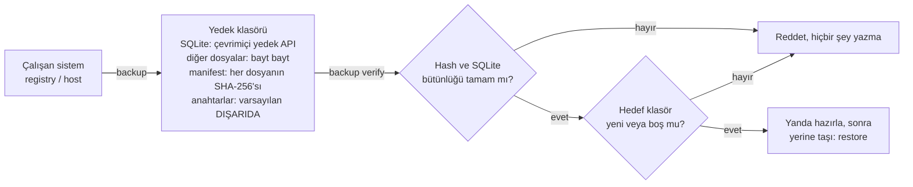

### C) Masaüstü istemci

```sh
cd apps/client && pnpm install && pnpm tauri dev      # geliştirme modu
# veya paket: target/release/bundle/deb/İlmek_0.1.0_amd64.deb  (sudo dpkg -i …)
```

İstemci topluluğa `community.json` + parmak izi + token ile katılır. **Uyarı:** `.deb` kurulup
açılmadı; arayüzü baştan sona elle denemedim, yalnızca otomatik izolasyon probunda pencereyi
sürdüm (`scripts/e2e/isolation-probe.sh`, ekran gerekir).

### D) Gerçek donanım (iki node)

1. Her node'da `sudo apt install iw hostapd dnsmasq nftables`, sonra `ilmek doctor`. `iw list`
   içinde kullanacağın kartların **AP** modunu desteklediğini doğrula (bazı kartlar desteklemez).
2. `configs/node-a.toml.example` ve `node-b.toml.example` dosyalarını kopyala; arayüz adı, kanal,
   `country` (ülke kodu, örn. TR), MAC adreslerini düzenle; Wi-Fi parolalarını
   `/etc/ilmek/secrets/*.pass` içine (mod 600) yaz.
3. `ilmek network plan --config node.toml` → ne yapacağını oku, hiçbir şey değiştirmez.
4. **Konsol (ekran+klavye) erişimi varken** `sudo ilmek network apply --config node.toml --yes`.
5. Bir şey ters giderse `sudo ilmek network rollback`. Doğrulama listesi:
   [NETWORK_SETUP](NETWORK_SETUP.md).
6. Sonra registry'yi NODE-A'da, host'u ayrı bir bilgisayarda B bölümündeki gibi kur (adresleri
   `10.77.x.x` yap, `allowed_endpoints`'e bu ağları yaz).

### E) Android

Henüz yok; sen test edeceksin. Bu bilgisayarda Android SDK/NDK/emülatör var ama Rust Android
hedefleri kurulu değil (`rustup target add aarch64-linux-android …` gerekir).

### Bir şey ters giderse

`ilmek diagnose ilmek://nuri/forum --device alice-device` adım adım nerede koptuğunu yazar
(registry mi, güven bilgisi mi, host mu, paket mi). Loglar: `registry.log`, `host.log`. Hata
tablosu: [OPERATIONS](OPERATIONS.md).

## 9. Senaryolar: hangi kurulumda ne çalışır?

İlmek **node olmadan da çalışır**: ihtiyacı olan tek şey, cihazların birbirinin IP adresine
ulaşabildiği herhangi bir ağdır (ev Wi-Fi'ı, okul ağı, telefon hotspot'u, switch). Node'lar yalnızca
"internetsiz kendi ağını kuran" kolaylıktır. Aşağıdaki her senaryo için: kim ne çalıştırır, neye
dikkat edilir, ne görmelisin, ne kadar denendi.

### Önce: birden fazla bilgisayarda ortak kurallar

1. **Her makinede `ilmek` programı olsun** (`cargo build -p ilmek-cli`, aynı işlemci mimarisinde
   ikili dosya kopyalanabilir). İstemci olarak yalnızca masaüstü uygulaması yeterlidir.
2. **Adresler gerçek IP olmalı.** `127.0.0.1` sadece tek makine denemesi içindir. Registry için
   `--advertise-ip` ve `control_listen/enroll_listen`; host için `listen/advertised`; registry'de
   `allowed_endpoints` içine host'ların ağı yazılır (örn. `["192.168.1.0/24"]`).
3. **Katılacak cihaza şunlar elden verilir:** `community.json` dosyası + CA parmak izi + token
   (USB, `scp`, kâğıt; parmak izini dosyadan ayrı bir yoldan vermek daha güvenli).
4. **Güvenlik duvarında TCP 47401 ve 47402 açık olsun** (Linux'ta `ufw` vb.).
5. **Saatler doğru olmalı.** Sertifikalar zamana bağlıdır ve internetsiz ağda otomatik saat
   eşitleme (NTP) yoktur. Bir cihazın saati yaklaşık 1 dakikadan fazla geri ise kimliği "henüz
   geçerli değil" diye reddedilir. Cihazların saatini elle kontrol et.
6. **Sertifikalar 30 gün sonra biter**; yenileme için bkz. [OPERATIONS](OPERATIONS.md).

### Senaryo 1: Tek bilgisayar (hepsi bir arada)

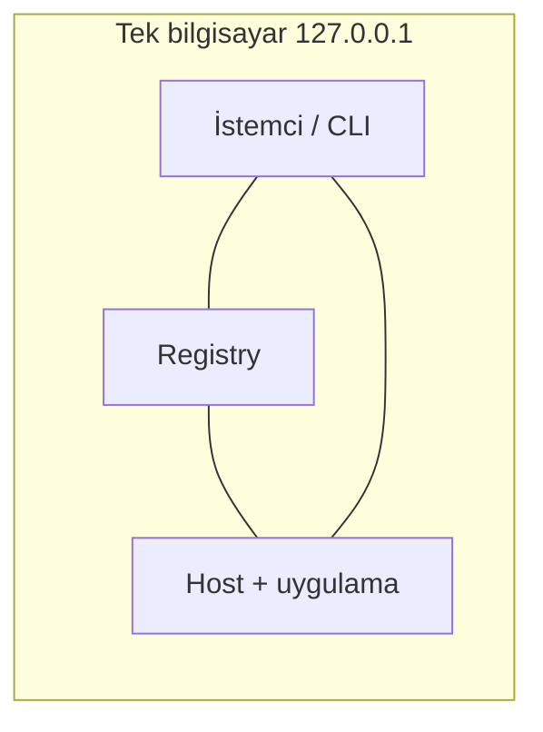

- **Ne için:** öğrenmek, geliştirmek, otomatik test.
- **Nasıl:** bölüm 8-A ve 8-B. Hepsi ayrı süreçtir ama aynı makinede.
- **Görmelisin:** `ALL STEPS PASSED`, `state=running`, konu listesi.
- **Test durumu:** ✅ çalıştırıldı (230 test + betikler). Not: bu gerçek ağ testi değildir.

### Senaryo 2: Node yok, mevcut ağ + 2 bilgisayar

Elinde bir ev Wi-Fi'ı / okul ağı var; internete çıkışı olabilir, İlmek bunu **kullanmaz**.

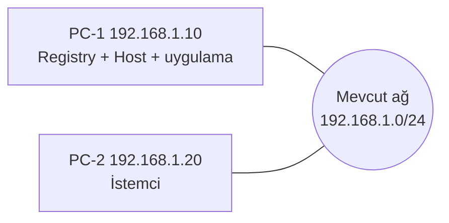

| Makine | Çalıştırır | Önemli ayar |
| --- | --- | --- |
| PC-1 | `ilmek registry serve`, `ilmek host serve`, uygulama kurulumu | registry: `--advertise-ip 192.168.1.10`, `control_listen = "192.168.1.10:47401"`, `enroll_listen = "192.168.1.10:47402"`, `allowed_endpoints = ["192.168.1.0/24"]`; host: `listen`/`advertised = "192.168.1.10:47411"`, host token'ı `--server-ip 192.168.1.10` |
| PC-2 | istemci (masaüstü uygulaması veya `ilmek resolve/call`) | `identity enroll` için `community.json` + parmak izi + token |

Adımlar bölüm 8-B ile aynı; farklar: adresler yukarıdaki gibi, PC-2'de yalnızca `alice` cihazı
kaydı ve çağrı. **Görmelisin:** PC-2'den `ilmek resolve ilmek://nuri/forum --device …` →
`availability RecentHeartbeat`, host `192.168.1.10:47411`; konu açınca PC-1'deki `app.db`'ye yazılır.
Registry ve host ayrı makinelerde de olabilir (host için ayrı `--server-ip`).
**Test durumu:** ⚠️ yazılım ayrı süreçlerle loopback'te denendi; gerçek iki bilgisayarda denenmedi.

### Senaryo 3: 1 node + 2 bilgisayar (node kendi Wi-Fi ağını kurar)

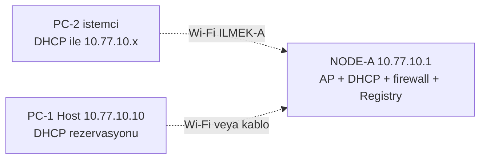

- **Rol dağılımı:** NODE-A ağı kurar ve registry'yi çalıştırır; PC-1 host; PC-2 istemci. Node
  uygulama sunucusu olmak zorunda değildir.
- **Kurulum:** `configs/node-a.toml.example` ile `ilmek network plan/apply` (bölüm 8-D, 1-5), sonra
  registry `10.77.10.1`, host `10.77.10.10` ile (bölüm 8-B, adresler değişir).
- **Dürüst sınır:** `ilmek network` yapılandırması **her zaman ikinci bir arayüz (transit) ister**
  ve iki Wi-Fi kartı varsayar. Tek node'u kullanmak için `[[routes]]` bölümünü sil; ikinci kart
  kullanılmayan bir transit ağı yayınlamaya devam eder (kapatmak için tool henüz seçenek sunmuyor).
  Tek kartlı tek node için hazır ayar yok.
- **Görmelisin:** PC-2 `10.77.10.x` adresi alır (DHCP), PC-1 her zaman `10.77.10.10` olur,
  `ilmek diagnose` tüm adımlar `[ok]`.
- **Test durumu:** ⚠️ plan ve uygulama mantığı sahte makinede test edildi; **gerçek node'da hiç
  uygulanmadı**, bu yüzden en riskli senaryo budur: konsol erişimi ve `rollback` hazır olsun.

### Senaryo 4: İki node (referans topoloji, şartnamedeki hedef)

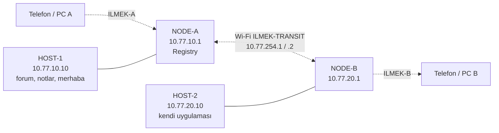

| Makine | Çalıştırır |
| --- | --- |
| NODE-A | `network apply` (node-a), registry (`10.77.10.1:47401/47402`) |
| NODE-B | `network apply` (node-b; transit'te istasyon) |
| HOST-1, HOST-2 | `host serve` ve kendi uygulamaları (bağımsız, ayrı veri) |
| Telefon / PC'ler | istemci |

- **Akış:** B ağındaki bir PC, A ağındaki HOST-1'in forum'unu açar: istek NODE-B → Wi-Fi transit →
  NODE-A → HOST-1 yolunu izler; rotalar ve DHCP node'lar tarafından kurulur, NAT yoktur.
- **Kurulum sırası:** bölüm 8-D. Host'lar `--server-ip` ve `advertised` olarak kendi `10.77.x.10`
  adresini kullanır; registry `allowed_endpoints = ["10.77.10.0/24","10.77.20.0/24"]`.
- **Görmelisin (şartnameden):** iki alt ağda adres alma, iki yönde `ping`, `iw dev wlan1 link` ile
  transit'in gerçekten Wi-Fi olduğu, B'den A'daki uygulamaya erişim ([NETWORK_SETUP](NETWORK_SETUP.md)).
- **Test durumu:** ❌ **gerçek donanımda hiç denenmedi** (A02–A04, A15 BLOCKED). Yazılımın iki
  host'lu kısmı loopback'te denendi (`scripts/smoke/multi-app.sh`).

### Senaryo 5: Bir ağda birden fazla host (çok uygulama)

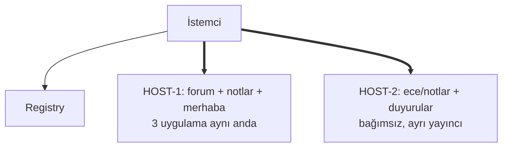

Her host kendi `host.toml`, kendi veri dizini, kendi cihaz kimliği ve kendi yayıncı izniyle
çalışır. Uygulamalar `app_id` ile ayrılır; veriler karışmaz. **Test durumu:** ✅ loopback'te
(`multi-app.sh`: veri izolasyonu, biri düşünce diğerleri çalışır).

### Senaryo 6: Telefon (Android)

Android istemcisi **henüz yok**. Telefon şimdilik yalnızca ağın bir üyesi olabilir, İlmek
uygulaması açamaz. İleride: telefon `ILMEK-A` Wi-Fi'ına bağlanır, uygulamayı kurup topluluğa
parmak izi + token ile katılır. (Siz test edecektiniz.)

### Arıza senaryoları: ne olur?

| Durum | Ne olur | Test |
| --- | --- | --- |
| Bir uygulamanın arka ucu çöker | Host onu bekleyerek yeniden başlatır; çağrılar o sürede `APP_UNAVAILABLE` olur; **diğer uygulamalar etkilenmez**. Sürekli çökerse vazgeçer, `app restart` gerekir. | ✅ |
| Host kapanır | Onun uygulamaları açılmaz; **diğer host'ların uygulamaları çalışır**. Host dönünce veri yerindedir. | ✅ |
| Registry kapanır | Önbellekteki adresler açılır, bilinen host'lara erişim sürer; yeni isim çözme/yayın yapılamaz; 24 saat sonra uzak işler reddedilir. | ✅ |
| Transit Wi-Fi kopar (2 node) | Karşı ağa erişim kesilir; kendi ağındaki uygulamalar çalışır. | ❌ gerçek ağda yok |
| Üye iptal edilir | En geç ~1 dk içinde host'ta oturumu kesilir. | ✅ |
| Paket bozulur / değiştirilir | Reddedilir; çalışan sürüm bozulmaz. | ✅ |
| Sertifika (30 gün) biter | Bağlantı `CertificateExpired` ile reddedilir; yenileme gerekir. | ✅ (yenileme mantığı) |
| Cihaz saati yanlış | Kimlik "henüz geçerli değil / süresi dolmuş" diye reddedilir; saat düzeltilir. | ✅ (TLS testleri) |

---

## 10. Sözlük

Yukarıdaki "Temel kavramlar"a ek, İlmek'e özgü terimler:

| Terim | Anlamı |
| --- | --- |
| **ILMEK/1** | İlmek'in kendi protokolü (TLS'in üstünde, uygulama katmanında). ALPN adı `ilmek/1`. |
| **ALPN** | TLS el sıkışmasında "hangi protokolü konuşacağız" etiketi; yanlışsa bağlantı reddedilir. |
| **Frame** | Protokolün mesaj paketi; başı `ILM1` ile başlar, boyutu sınırlıdır. |
| **UUIDv7** | Zaman sıralı rastgele kimlik numarası; cihaz, uygulama, işlem hepsinin kimliği bu. |
| **Peer** | Ağdaki bir katılımcı cihaz (üye, host, yayıncı cihazı). |
| **Ad alanı (namespace)** | Adresin ilk kısmı (`nuri/…`); bir yayıncıya aittir, başkası kullanamaz. |
| **Lease (kira)** | Host'un "ben hâlâ buradayım" diye registry'de periyodik yenilediği kayıt. Yenilemezse uygulama "stale" görünür. |
| **Control / bulk bağlantı** | Küçük mesajlar için ve büyük dosya indirme için ayrı iki bağlantı; indirme etkileşimi yavaşlatmasın diye. |
| **Trust snapshot** | Registry'nin yayınladığı iptal listesi anlık görüntüsü; son sayfasına kadar geçerli sayılmaz. |
| **TRUST_STALE** | Güven bilgisi 24 saatten eski; uzak işlem reddedilir. |
| **Atomik etkinleştirme** | Paket önce kenarda doğrulanır, sonra tek hamlede devreye girer; yarım kalan güncelleme eskisini bozmaz. |
| **Sandbox** | Kodu hapseden izolasyon. Sayfalar (HTML) sandbox'ta; arka uç **değil** (güvenilir süreç). |
| **CSP** | Sayfanın nereden ne yükleyebileceğini sınırlayan tarayıcı kuralı. |
| **Snapshot / rollback** | Ağ değişikliğinden önce alınan yedek / hepsini geri alma. |
| **Loopback testi** | Aynı makinede, gerçek ağ olmadan yapılan test. Wi-Fi testi yerine geçmez. |
| **PASS / PARTIAL / BLOCKED** | Test raporundaki durumlar: geçti / yazılım kısmı geçti ama fiziksel kısım yok / yapılamıyor. |

---

## 11. Sık sorulan sorular

- **İnternet gerekir mi?** Hayır. Normal çalışma için hiçbir dış servis yok.
- **Registry düşerse?** Daha önce çözülmüş adresler istemci önbelleğinden açılır, mevcut host'lara
  erişim sürer. Yeni isim çözme ve yayınlama çalışmaz. Güven bilgisi en fazla 24 saat eski kalabilir.
  Yedek registry yok.
- **Sertifikalar ne zaman biter?** Cihaz/host: **30 gün**; registry sertifikası varsayılan 30 gün.
  Otomatik yenileme yok, takvime not al. Yenileme: [OPERATIONS](OPERATIONS.md).
- **Bir üyeyi nasıl atarım?** `ilmek community revoke-peer --config registry.toml --peer <id>`;
  host'lar listeyi 60 saniyede bir yenilediği için en geç yaklaşık bir dakikada oturumları kesilir
  (registry'nin kendi uçlarında birkaç saniye).
- **Kaç uygulama çalışır?** Sabit sınır yok; makinenin gücüne bağlı.
- **Uygulamalar birbirinin verisini görür mü?** Hayır: ayrı kimlik, ayrı veri dizini, ayrı süreç
  (denendi). Ama arka uç **güvenilir yerel süreçtir**: yalnızca güvendiğin yayıncıların arka ucunu kur.
- **Kötü niyetli bir HTML uygulaması ne yapabilir?** Dışarı bağlanamaz, dosya okuyamaz, başka
  uygulamaya erişemez (Linux'ta 29 saldırı denemesi engellendi). Windows/macOS/Android'de bu
  henüz doğrulanmadı.
- **Wi-Fi parolasını herkes biliyor, güvenli mi?** Parola sadece radyo bağlantısını korur. Asıl
  üyelik sınırı sertifikadır; parolayı bilen ama sertifikası olmayan kimse uygulamalara giremez.
- **Anahtarlar nerede?** Sahibine özel dosyalar (0600). CA anahtarını kaybeden ya da kaptıran
  topluluğu kaybeder; yedeği `--include-keys` ile alırsan şifreli sakla. Windows'ta dosya izni
  sıkılaştırması yok.
- **Veri nerede?** Registry: `registry.db`; host: `host.db` + `apps/<id>/data/app.db`. Yollar ayarlanabilir.
- **`network apply` bilgisayarımı bozar mı?** Bu geliştirme bilgisayarında çalıştırma: Wi-Fi'ı
  varsayılan rotayı taşıdığı için araç zaten reddeder. Node'larda önce `plan`, konsol erişimi ve
  `rollback` yolu hazırken `apply`.
- **Bluetooth var mı?** Hayır, ilk sürümün dışında.
- **Hız / kapasite?** Ölçülmedi; gerçek ağda ölçülene kadar hiçbir rakam vaat edilmiyor.

## 12. Bilinen eksikler

Android istemcisi yok · Windows/macOS derlenmedi · gerçek Wi-Fi ve iki node denenmedi · AppImage
yok · servis dosyaları gerçek systemd'de çalıştırılmadı · CI yok · hiçbir şey commit edilmedi.
