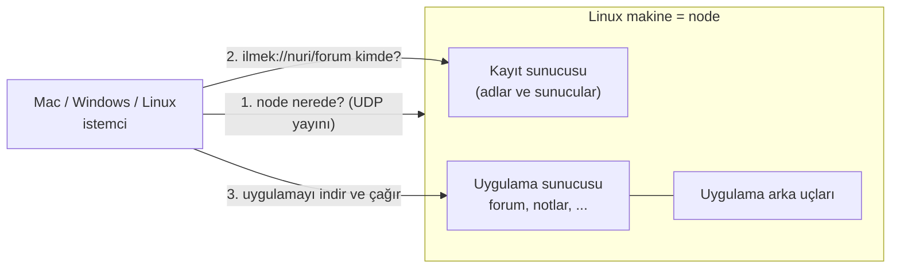
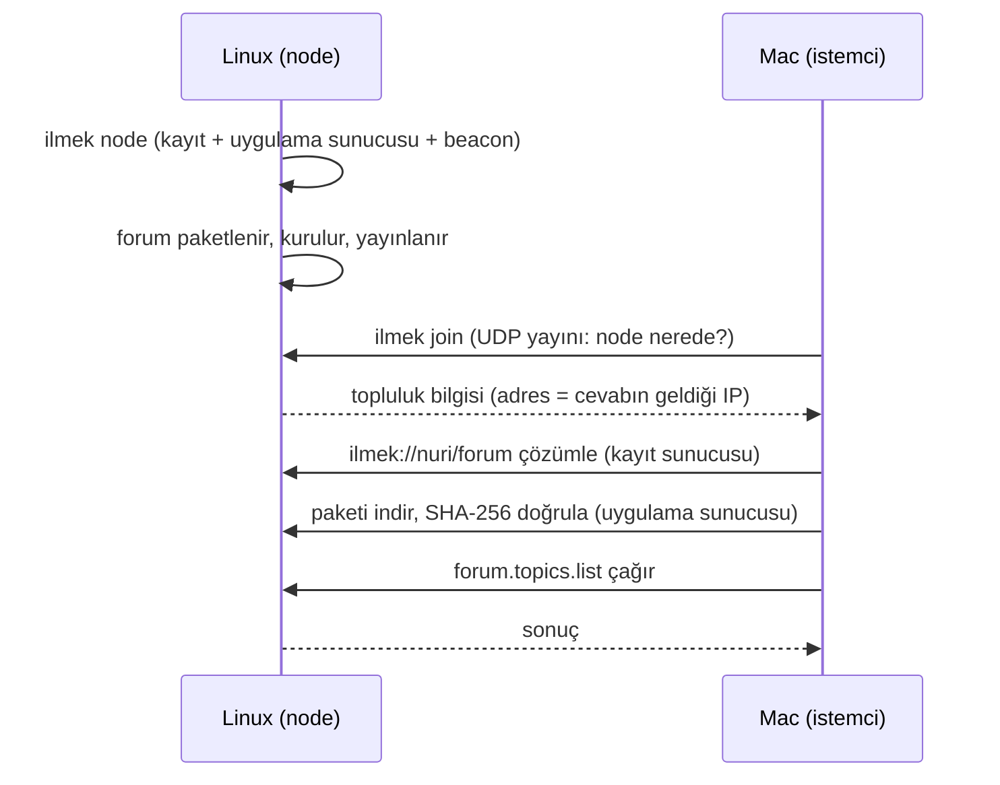

# İlmek — Başlangıçtan Rehber (Türkçe)

Bu rehber, projeyi hiç bilmeyen biri için yazıldı. Her şey bu dalın (`feat/simple-no-security`)
gerçek davranışına göredir. İlk gerçek deneme adımları: [FIRST_DEMO](FIRST_DEMO.md). Ayrıntılı ve teknik belgeler: [ARCHITECTURE](ARCHITECTURE.md),
[PROTOCOL](../PROTOCOL.md), [NETWORK_SETUP](NETWORK_SETUP.md), [OPERATIONS](OPERATIONS.md).

> **Önemli uyarı.** Bu dalda **güvenlik yoktur**: trafik şifrelenmez, kimse kimliğini kanıtlamaz,
> paketler imzalanmaz, ağa bağlanan herkes katılıp uygulama yayınlayabilir. Yalnızca güvendiğiniz,
> kapalı bir ağda kullanın. Güvenli sürüm `main` dalındadır.

## 1. İlmek ne işe yarar?

Kendi küçük "internetinizi" kurarsınız. Bir makine **node** olur: içinde bir **kayıt sunucusu**
(hangi uygulama nerede?) ve bir **uygulama sunucusu** çalışır. Siz uygulamalarınızı oraya yayınlarsınız.
Aynı ağdaki diğer bilgisayarlar node'u kendiliğinden bulur ve uygulamaları `ilmek://isim/uygulama`
adresiyle açar. İnternet, bulut veya HTTP gerekmez; her şey İlmek'in kendi protokolü (**ILMEK/1**)
ile doğrudan TCP üzerinden konuşur.



## 2. Terimler

| Terim | Anlamı |
| --- | --- |
| **Node** | Kayıt sunucusunu (ve genellikle bir uygulama sunucusunu) çalıştıran makine. `ilmek node` ile başlar |
| **Kayıt sunucusu (registry)** | "nuri/forum şu makinede, şu sürümde" bilgisini tutar. Uygulama trafiğini taşımaz |
| **Uygulama sunucusu (host)** | Uygulama paketlerini ve arka uç süreçlerini çalıştırır. Birden çok uygulama taşır |
| **Arka uç (backend)** | Bir uygulamanın veriyi tuttuğu ayrı süreç (örn. forum). Statik uygulamaların arka ucu olmaz |
| **İstemci** | Uygulamayı açan cihaz: komut satırı (`ilmek`) veya masaüstü penceresi |
| **Ad alanı (namespace)** | Adresteki ilk bölüm: `ilmek://`**`nuri`**`/forum`. İlk yayınlayan cihaz sahiplenir |
| **Cihaz kimliği** | Her cihazın kendi ürettiği rastgele numara. Kanıtlanmaz; cihazları ayırmak içindir |
| **Beacon** | Node'un UDP 47400 portunda "buradayım" diye cevap vermesi |

## 3. İlk demo: bir Linux node, bir Mac istemci



### Linux'ta (node)

```sh
git clone <bu depo> && cd project-ilmek
scripts/quickstart.sh
```

Betik derler, node'u başlatır, `forum` ve `merhaba` örneklerini yayınlar ve komutları yazdırır.
Elle yapmak isterseniz:

```sh
cargo build -p ilmek-cli -p ilmek-example-forum
target/debug/ilmek node                          # bu terminal açık kalır
# ikinci terminalde:
target/debug/ilmek app pack examples/forum/app --out /tmp/forum-pkg
target/debug/ilmek app install /tmp/forum-pkg
target/debug/ilmek app set-backend nuri/forum --exe target/debug/ilmek-forum-backend
target/debug/ilmek app start nuri/forum
target/debug/ilmek app publish nuri/forum
```

Linux'ta güvenlik duvarı açıksa: UDP **47400** ve TCP **47401–47402** portlarına izin verin
([NETWORK_SETUP](NETWORK_SETUP.md)).

### Mac'te (istemci)

Rust kurulu olmalı. Linux'tan hiçbir dosya veya kod kopyalamanız gerekmez:

```sh
cargo build -p ilmek-cli
target/debug/ilmek join                          # node'u ağda arar ve katılır
target/debug/ilmek resolve ilmek://nuri/forum
target/debug/ilmek call ilmek://nuri/forum forum.topics.list
```

Node bulunamazsa (farklı alt ağ, UDP engelli) adresi verin:
`ilmek join --registry 192.168.1.10:47401`. Adresi bulmak için Linux'ta `hostname -I`.

Masaüstü penceresi için `cd apps/client && bun run tauri dev` ve "Bul ve katıl" düğmesi.

### Chrome'dan `ilmek://` açmak

Masaüstü istemci İlmek'in kendi tarayıcısıdır: adres çubuğu, katalog ve her uygulama için ayrı
pencere. Kurulunca `ilmek://` bağlantılarının sahibi olarak kaydolur; Chrome'a `ilmek://nuri/forum`
yazınca (Chrome bir kez "açılsın mı?" sorar) uygulama istemcide açılır. İstemci zaten açıksa aynı
programda yeni pencere olur. Adımlar: [FIRST_DEMO](FIRST_DEMO.md) bölüm 6. Linux'ta denendi;
macOS'ta `.app` paketi ve Chrome ile **denenmedi**.

## 4. Başka bir makine de uygulama sunsun

```sh
ilmek host start        # node'u bulur, katılır, kendini kaydeder
```

Kendi adresini bilmesi gerekmez: kayıt sunucusu, bağlantının geldiği adresi kaydeder.

## 5. Veriler nerede?

`$ILMEK_HOME` (varsayılan `~/.ilmek`) altında:

| Yol | İçerik |
| --- | --- |
| `registry/` | kayıt veritabanı ve `community.json` |
| `host/` | uygulama paketleri, uygulama verileri (`apps/<id>/data`), günlükler |
| `device/` | bu makinenin istemci olarak kimliği ve topluluk bilgisi |
| `registry.toml`, `host.toml` | ayarlar (ilk çalıştırmada yazılır, sonra elle düzenlenebilir) |

Yedekleme: `ilmek backup registry --out ...`, `ilmek backup host --out ...`
([OPERATIONS](OPERATIONS.md)).

## 6. Bir uygulama nasıl yazılır?

[APP_DEVELOPMENT](APP_DEVELOPMENT.md): HTML/CSS/JavaScript sayfası + (isteğe bağlı) Rust arka ucu.
Sayfa yalnızca `window.ilmek` SDK'sı üzerinden kendi arka ucuna konuşur; başka bir adrese
bağlanamaz. Yazma işlemleri işlem kimliği taşır: yanıt kaybolsa bile tekrar gönderilen işlem iki
kez uygulanmaz.

## 7. Hangi test edildi, hangisi edilmedi?

| Durum | Ne |
| --- | --- |
| Yapıldı | Tek Linux makinede, node/host/arka uç/istemci **ayrı süreçler** olarak `127.0.0.1` üzerinde: UDP keşif, otomatik katılma, yayınlama, indirme, çağırma, yeniden başlatmada veri, ikinci host, yedek/geri yükleme. 170+ Rust testi, 13 arayüz testi, 20 SDK testi |
| **Yapılmadı** | İkinci gerçek bilgisayar, gerçek ağda UDP yayın keşfi, macOS, Windows, Android, masaüstü pencerenin açılması |

Ayrıntı: [TEST_REPORT](TEST_REPORT.md).

## 8. Sık sorulanlar

**`ilmek join` "no node found" diyor.** Node çalışıyor mu? Güvenlik duvarında UDP 47400 açık mı? Aynı
alt ağda mısınız? Değilse `--registry IP:47401` kullanın.

**Neden şifreleme yok?** İlk sürüm en basit biçimde ayağa kalksın diye bilinçli olarak çıkarıldı
([karar 0005](decisions/0005-simple-no-security.md)). Sonradan protokolün yeni bir sürümüyle eklenecek.

**İki Wi-Fi kartı gerekiyor mu?** Hayır. İki makinenin birbirine IP ile ulaşabilmesi yeter (aynı
Wi-Fi, kablo, telefon hotspot'u).

**`main` dalındaki iki-node tasarımı ne oldu?** Orada duruyor (TLS, sertifikalar, imzalı paketler,
iki node arasında Wi-Fi yönlendirmesi). Bu dal onunla **uyumlu değildir**.
