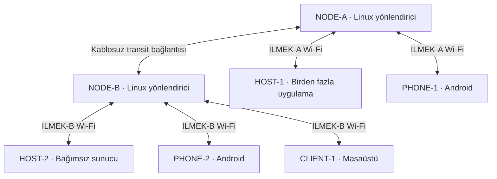

> **Arşiv / archive.** This is the product specification of the secure two-node design that lives on
> `main`. The branch `feat/simple-no-security` deliberately differs from it (no TLS, certificates or
> signatures; no two-Wi-Fi-adapter requirement; automatic joining). For what this branch does see
> [README](../README.md) and [decision 0005](decisions/0005-simple-no-security.md). Nothing below
> was updated for this branch.

# İlmek — İnternetten Bağımsız Kablosuz Uygulama Ağı

**Belge türü:** Codex için ürün, mimari ve gerçek cihazlarda çalışan ilk sürüm geliştirme şartnamesi  
**Belge sürümü:** 2.3 — 22 Ekim 2026  
**Proje adı:** İlmek. Kod, dosya, paket ve adres tanımlayıcılarında ASCII `ilmek` kullanılır. Protokolün İngilizce adı **Ilmek Protocol**, sürüm gösterimi `ILMEK/1` olarak sabitlenmiştir.

> Bu belge önceki tarayıcı simülasyonu README'sinin yerine geçer. İstenen teslimat gerçek Wi-Fi bağlantıları, gerçek sunucular, gerçek veri aktarımı ve kurulabilir istemcilerden oluşur. Tarayıcıda çizilmiş cihazlar, sahte ağ trafiği veya tek tarayıcıdaki profil değiştirme bu görevi karşılamaz.
>
> Bu bir gereksinim ve uygulama sözleşmesidir; ürünün zaten yapıldığı veya donanımların doğrulandığı anlamına gelmez. Kesinlik, gereksinimlerin açık olmasıdır. Donanım bilgisi olmadan yüzde yüz uyumluluk, hız veya kapsama garantisi verilemez.

## Adlandırma sözleşmesi

| Alan | Kesin değer |
| --- | --- |
| Kullanıcıya görünen proje adı | **İlmek** |
| İngilizce protokol adı | **Ilmek Protocol** |
| Protokol major sürümü | `ILMEK/1` |
| TLS ALPN tanımlayıcısı | `ilmek/1` — 7 ASCII byte |
| Uygulama adres şeması | `ilmek://`; örnek `ilmek://nuri/forum` |
| Frame magic | `ILM1` — 4 ASCII byte, hex `49 4c 4d 31` |
| RPC hash öneki | ASCII `ILMEK-CALL-V1`, ardından tek NUL byte |
| Manifest imza öneki | ASCII `ILMEK-MANIFEST-V1`, ardından tek NUL byte |
| CLI / kaynak kod kökü | `ilmek` / `ilmek/` |
| Rust paketleri | `ilmek-core`, `ilmek-protocol`, `ilmek-identity`, `ilmek-registry`, `ilmek-host`, `ilmek-node`, `ilmek-cli`, `ilmek-app-sdk` |
| İstemci bileşeni | `ilmek-client` |
| JavaScript/TypeScript SDK | `@ilmek/sdk`; arayüz `IlmekAppSDK` |
| Örnek kullanıcı Wi-Fi adları | `ILMEK-A`, `ILMEK-B` |

`ILM1`, İlmek'in 4-byte frame işaretidir; protokol adı ve ALPN ile aynı uzunlukta olmak zorunda değildir. Böylece 12-byte frame prefix'i ve bütün offset'ler korunur. İsim değişikliğine bağlı hash, imza ve wire örnekleri birlikte yeniden üretilmiştir. Önceki geçici adlarla üretilmiş paketler ve wire verileri bu sürümle uyumlu kabul edilmez; sessiz eski-ad fallback'i yoktur. UUIDv7 kararı değişmez.

Bunlar proje içi kesin tanımlayıcılardır; IANA tahsisi, paket deposunda ad rezervasyonu veya tescil yapıldığı iddia edilmez. `ilmek://`, İlmek istemcisinin yorumladığı adrestir; normal tarayıcıda kendiliğinden çalıştığı anlamına gelmez.

## Dosyalar ve kesin protokol kararı

**Uygulanacak katmanlar: Wi-Fi → IP → TCP → TLS 1.3 → ILMEK/1.**

| Dosya | Görevi |
| --- | --- |
| [README.md](README.md) | Ürün, topoloji, donanım, platformlar, uygulama hosting ve teslimat sözleşmesi |
| [PROTOCOL.md](PROTOCOL.md) | Normatif byte formatı, tam mesaj alanları, kimlik, durum makineleri ve hata davranışları |
| [WIRE_EXAMPLES.json](WIRE_EXAMPLES.json) | Byte uzunlukları/hex ve hash preimage'leri hesaplanmış test fixture'ları; ZIP içinde |
| [DOCUMENT_CHECKS.md](DOCUMENT_CHECKS.md) | Doküman ve fixture doğrulamasının kapsamı; ZIP içinde |

Wire ayrıntılarında PROTOCOL.md, ürün ve kurulum kapsamındaysa README esas alınır. Çelişki bulunursa iki belge birlikte düzeltilir. Bu dosyalar uygulama geliştirme görevidir; tamamlanmış ürün veya donanım test raporu değildir.

## 1. Proje tek cümlede

**Android telefonlar ile Windows, macOS ve Linux bilgisayarların, mevcut interneti kullanmadan, birbirine kablosuz bağlı node'lar üzerinden bağımsız sunuculardaki HTML destekli uygulamalara kendi uygulama protokolümüzle erişebildiği küçük bir topluluk ağı kuracağız.**

Kullanıcı uygulamasını kendi sunucusunda yayınlayabilir. Bir sunucu donanımı ve iş yükü elverdiği kadar uygulama barındırabilir. Uygulamaların tamamını ortak node'a kurmak zorunlu değildir.

## 2. Belgenin nasıl okunacağı

- **Zorunlu gereksinim:** Kullanıcıyla netleşmiş ürün davranışı; uygulama sırasında sessizce değiştirilemez.
- **V1 tasarım kararı:** Belirsizliği azaltmak için bu belgede seçilmiş ilk sürüm çözümü. Değişiklik gerekiyorsa gerekçesi bir mimari karar kaydında belirtilir; ürün hedefi korunur.
- **Donanım koşulu:** Gerçek cihazdan ölçülmesi veya okunması gereken özellik. Yazılımla varsayılarak geçilemez.
- **Sonraki sürüm:** V1'i bitirmek için zorunlu değildir.

Bu README doğrudan Codex'e verilebilir. Son bölümde yürütme talimatı bulunur. Burada tarif edilen komutlar, henüz var olduğu iddia edilen araçlar değil, geliştirilecek komut sözleşmesidir.

## 3. Netleşmiş gereksinimler

| Konu | Karar |
| --- | --- |
| İnternet bağımlılığı | Normal çalışma ve kabul testi mevcut internet bağlantısı olmadan yapılacak. |
| Kablosuz bağlantı | Kullanıcı erişimi ve iki node arasındaki veri yolu Wi-Fi üzerinden olacak. Bluetooth kullanılmayacak. |
| Fiziksel ekipman | 2 eski bilgisayar node; 2 Android telefon ve 3 bilgisayar uç cihaz olarak kullanılacak. |
| Uç bilgisayarlar | Windows, macOS ve Linux; masaüstü ve laptop karışık. |
| Node yazılımı | Node bilgisayarları için Linux hedeflenecek; kurulum kullanıcı verileri silinerek yapılmayacak. |
| Uygulama protokolü | HTTP, HTTPS veya WebSocket yerine kendi uygulama protokolümüz kullanılacak. |
| Temel ağ standartları | V1, mevcut Wi-Fi ve IP/TCP altyapısını kullanacak; fiziksel radyo veya IP yeniden icat edilmeyecek. |
| Kimlik biçimi | Bütün UUID alanları RFC 9562 uyumlu UUIDv7; UUIDv4 üretilmeyecek veya kabul edilmeyecek. |
| HTML | HTML, CSS ve JavaScript destekli gerçek uygulama arayüzleri açılacak. |
| Sunucu bağımsızlığı | Her yayıncı kendi erişilebilir bilgisayarında uygulama sunucusu çalıştırabilecek. |
| Uygulama sayısı | Sunucu başına bir uygulama veya sabit lisans kotası olmayacak. Kapasite kaynaklara ve iş yüküne bağlı olacak. |
| Çok node | A tarafındaki istemci B tarafındaki sunucuya ve tersi yönde erişebilecek. |
| İsim sistemi | Uygulama adları sunucuların ağ uçlarına çözülecek. Dış internet DNS'ine ihtiyaç olmayacak. |
| İstemciler | Android ve üç masaüstü işletim sistemi için kurulabilir istemci hedeflenecek. |
| Gerçek teslimat | Görsel simülasyon veya yalnızca web sitesi yeterli olmayacak. |

## 4. Ne kuruyoruz, ne kurmuyoruz?

Kurulan şey, internetin temel fikirlerini küçük ölçekte kullanan **bağımsız bir topluluk ağıdır**. Tek bir ortak internet sunucusu yaratmıyoruz. Birbirine ulaşabilen cihazlar, yönlendiriciler, isim kayıtları ve uygulama sunucuları oluşturuyoruz.

IP kullanmak küresel internete bağlı olmak demek değildir. TLS kullanmak HTTPS kullanmak demek değildir. HTML göstermek de HTTP kullanmayı zorunlu kılmaz.

V1'de yeniden yazılmayacak parçalar:

- Wi-Fi sürücüleri ve radyo standardı.
- IP yönlendirme motoru ve TCP'nin güvenilir taşıması.
- TLS ve şifreleme algoritmaları.
- HTML/CSS/JavaScript render motoru.

Bizim geliştireceğimiz parçalar:

- Topluluğa katılım ve kimlik yönetimi.
- Özel uygulama protokolü ve Rust kütüphaneleri.
- İsim/katalog servisi.
- Çok uygulamalı sunucu yöneticisi.
- Paket yayınlama, doğrulama, indirme ve güncelleme.
- Masaüstü ve Android istemcileri.
- JavaScript/TypeScript uygulama SDK'sı.
- Kurulum, teşhis ve gerçek cihaz test araçları.

## 5. Terimler: node ile sunucuyu karıştırma

| Terim | Anlamı |
| --- | --- |
| Node / düğüm | Ağdaki bir katılımcı için genel terim. Tek başına cihazın görevini açıklamaz. |
| Erişim noktası | Telefon ve bilgisayarların Wi-Fi ile bağlandığı cihaz/arayüz. |
| Yönlendirici node | Farklı alt ağlar arasında paket taşır. Uygulama içeriğini işlemesi gerekmez. |
| Omurga bağlantısı | İki yönlendirici node arasındaki taşıma bağlantısı. |
| Uygulama sunucusu | Yayıncının uygulamalarını ve verilerini çalıştıran bilgisayar. |
| İsim/katalog servisi | İsim sahipliğini ve uygulamanın hangi sunucuda bulunduğunu tutar. |
| İstemci | Kullanıcının adres açtığı, paket indirdiği ve uygulamayla etkileştiği program. |
| Yayıncı | Bir veya daha fazla uygulamanın sahibi. |
| Uygulama paketi | Manifest, HTML/CSS/JS ve diğer statik dosyaların imzalı dağıtımı. |
| Backend servisi | Uygulamanın kalıcı verilerini ve iş kurallarını çalıştıran sunucu süreci. |

Bir bilgisayar birkaç rol üstlenebilir. Ancak yazılım modülleri, izinleri ve arıza etkileri ayrı tutulur.

## 6. Eldeki cihazların görev dağılımı

Cihazlar aşağıdaki mantıksal isimlerle tanımlanır. Masaüstü işletim sistemlerinin bu rollere eşleştirilmesi kurulumda gerçek envantere göre yapılır.

| Kimlik | Cihaz | İlk görev |
| --- | --- | --- |
| NODE-A | Eski bilgisayar 1 | Linux yönlendirici, A erişim noktası, V1 isim/katalog servisi |
| NODE-B | Eski bilgisayar 2 | Linux yönlendirici, B erişim noktası |
| HOST-1 | Uç bilgisayar 1 | En az üç uygulamanın aynı anda çalıştığı bağımsız sunucu |
| HOST-2 | Uç bilgisayar 2 | İkinci yayıncı/sunucu; en az bir uygulama |
| CLIENT-1 | Uç bilgisayar 3 | Masaüstü istemcisi ve geliştirme |
| PHONE-1 | Android telefon 1 | A erişim noktasına bağlı istemci |
| PHONE-2 | Android telefon 2 | B erişim noktasına bağlı istemci |

HOST-1 ve HOST-2 üzerinde istemci de çalışabilir. Windows, macOS ve Linux istemcilerinin test edilmesi için aynı fiziksel bilgisayarda sunucu ve istemci rollerinin birlikte çalışması serbesttir.

## 7. İlk gerçek topoloji



İsim/katalog servisi ilk sürümde NODE-A üzerinde çalışır. Şemayı sade tutmak için ayrı cihaz olarak çizilmemiştir. Uygulama sunucuları bu servisten bağımsız süreçlerdir.

Örnek veri yolu:

1. PHONE-2, `ilmek://nuri/forum` adresini açar.
2. İstemci NODE-A'daki isim servisine bağlanıp kaydı alır.
3. Kayıt HOST-1'in adresini, uygulama kimliğini ve güven bilgilerini döndürür.
4. PHONE-2, HOST-1 ile uçtan uca TLS oturumu kurar.
5. Paketler NODE-B ve NODE-A üzerinden taşınır; node'lar uygulama TLS oturumunu sonlandırmaz.
6. HOST-1 isteği kendi içindeki Forum uygulamasına yönlendirir.
7. Sonuç aynı ağ üzerinden telefona ulaşır.

İsim sunucusu her yorum veya dosya aktarımının aracı değildir. Çözümlemeden sonra istemci uygulama sunucusuyla doğrudan konuşur.

## 8. Donanım kapısı: koddan önce kontrol edilecekler

**Elimizde yedi cihaz olması, gerekli bütün radyo yeteneklerinin bulunduğunu kanıtlamaz.** İki node'un da kullanıcı erişimi ve node'lar arası bağlantı sağlayabilmesi gerekir.

### 8.1 Önerilen referans kurulum

Her node için iki ayrı Wi-Fi radyo/adaptörü:

| Node | Kullanıcı arayüzü | Transit arayüzü |
| --- | --- | --- |
| NODE-A | AP modu; `ILMEK-A` yayınlar | AP modu; yalnızca NODE-B'nin bağlandığı transit ağını yayınlar |
| NODE-B | AP modu; `ILMEK-B` yayınlar | STA/managed modu; NODE-A'nın transit ağına bağlanır |

Bu düzen standart AP/STA ile gerçek iki-node bağlantısı kurar. V1 için Wi-Fi Direct, 802.11s veya otomatik mesh zorunlu değildir. Transit bağlantısı ile kullanıcı bağlantıları farklı IP alt ağlarıdır; IP yönlendirmesi kullanılır.

### 8.2 Tek adaptör varsa

- AP+STA veya gereken çoklu arayüz kombinasyonu sürücü tarafından destekleniyorsa alternatif konfigürasyon denenebilir.
- Aynı anda hangi arayüzlerin ve kaç kanalın kullanılabildiği kontrol edilir.
- Destek varsa bile kapasite paylaşımı ve kararlılık ölçülür.
- Destek yoksa uyumlu ek USB Wi-Fi adaptörü gerekir; yazılımla var olmayan radyo yeteneği oluşturulmaz.
- Modele bakmadan “tüm USB adaptörler uygundur” denmez.
- İki-node gereksinimi, donanım eksik diye sessizce tek ağa veya internet tüneline dönüştürülmez.

### 8.3 Envanter

Linux node'da salt okunur teşhis çıktıları toplanır: `uname -a`, `ip -br addr`, `ip route`, `iw dev`, `iw list`, `rfkill list`, `lsusb`, `lspci` ve kullanılan ağ yöneticisinin bilgisi. Araç yoksa kurulum gereksinimi raporlanır.

Rapor şunları içermeli:

- CPU mimarisi, RAM, disk, Linux dağıtımı ve sürümü.
- Her Wi-Fi adaptörünün modeli, sürücüsü, AP/STA desteği ve arayüz kombinasyonları.
- Uç cihazların işletim sistemi sürümü ve işlemci mimarisi.
- Android sürümleri ve mevcut WebView sürümü.
- Node'lar arası mesafe, duvarlar, test konumu ve görülen sinyal koşulları.
- Masaüstü uç cihazların Wi-Fi adaptörüne sahip olup olmadığı.

Ağ konfigürasyonu değiştirmeden önce mevcut yapı yedeklenir. Kullanıcıya işletim sistemi yeniden kurdurmak, diski silmek veya bütün firewall'u kapatmak varsayılan çözüm değildir.

## 9. IP planı ve yönlendirme

Aşağıdaki adresler **V1 için yapılandırılabilir örnek varsayılandır**. VPN veya mevcut ağla çakışırsa bütün plan tutarlı biçimde değiştirilir; IP'ler kaynak koduna gömülmez.

| Segment / rol | Adres |
| --- | --- |
| A kullanıcı ağı | `10.77.10.0/24` |
| NODE-A kullanıcı arayüzü | `10.77.10.1` |
| B kullanıcı ağı | `10.77.20.0/24` |
| NODE-B kullanıcı arayüzü | `10.77.20.1` |
| Transit ağı | `10.77.254.0/30` |
| NODE-A transit | `10.77.254.1` |
| NODE-B transit | `10.77.254.2` |
| HOST-1 rezervasyonu | `10.77.10.10` |
| HOST-2 rezervasyonu | `10.77.20.10` |
| İsim servisi | `10.77.10.1:47401` |
| İlk cihaz katılımı | Registry üzerinde `10.77.10.1:47402`; yalnızca enrollment |
| Uygulama sunucuları | Varsayılan TCP `47401`; yapılandırılabilir |

- NODE-A, `10.77.20.0/24` için next-hop olarak `10.77.254.2` kullanır.
- NODE-B, `10.77.10.0/24` için next-hop olarak `10.77.254.1` kullanır.
- Linux IPv4 forwarding iki node'da etkinleştirilir.
- İstemciler kendi node'larını yerel gateway olarak DHCP üzerinden alır.
- A ve B arasında NAT/masquerade uygulanmaz; doğrudan yönlendirme yapılır.
- DHCP her erişim ağında ayrı çalışır; transit ağında dinamik istemci dağıtımı gerekmez.
- Sunucular için DHCP rezervasyonu veya yönetilen sabit adres kullanılır.
- V1'de VLAN, WDS, katman-2 köprü ve mesh aynı anda zorunlu hale getirilmez.
- Dış internete varsayılan çıkış veya internet tüneli kurulmaz.
- Ağ geçişi firewall kuralları yalnızca gereken subnet, yön ve servisleri açar.
- Sunucu firewall'u uygulama portunu İlmek alt ağlarına açar; yönetim arayüzü uzaktan herkese açılmaz.
- Sistem DNS'i veya captive portal taklidiyle cihazlara sahte “internet var” cevabı verilmez.

IP katmanı hazır Linux araçlarıyla yönetilir. Node programı her IP paketini Rust üzerinden yeniden taşıyan özel bir tünel yazmaz. Üçüncü node ve dinamik yönlendirme sonraki aşamadır.

## 10. İnternetsiz kullanım ve Android davranışı

- Kurulum dosyaları ve bağımlılıklar önceden hazırlanabilir. İlk geliştirme/derleme sırasında internet kullanılması ile ürünün çalışma sırasında internete ihtiyaç duyması farklıdır.
- Kabul testinde WAN bağlantıları yoktur; telefonların mobil verisi kapatılır. Uçak modu ardından Wi-Fi'yi açma kullanılabilir.
- Android “Bu ağda internet yok” uyarısı verebilir. Kullanıcıya Wi-Fi'de kalma adımı açıklanır.
- Normal üründe mobil veri açık olsa da İlmek trafiğinin seçili yerel Wi-Fi ağına yönlenmesi gerekir. Gerekirse Kotlin köprüsüyle Android ağ seçimi/socket binding uygulanır ve test edilir.
- İnternet yeteneği bulunan bir ağ istemek, internetsiz Wi-Fi'yi yanlışlıkla elememeli. Android ağ istekleri bu ayrımı gözetmelidir.
- Android, macOS ve diğer hedeflerde gerekli yerel ağ/bağlantı izinleri gerçek hedef sürümlerine göre uygulanır.
- Android istemcisi V1'de ön planda çalışırken tam işlev sunar. Arka planda kesintisiz servis veya bildirim garantisi verilmez. Uygulama geri açılınca bağlantı ve eksik veri toparlanır.
- Wi-Fi seçimi ilk sürümde işletim sisteminin ayarlarından yapılabilir. İstemcinin bütün platformlarda SSID'ye otomatik bağlanması zorunlu değildir.

## 11. Yazılım bileşenleri

| Bileşen | Sorumluluk | Çalıştığı yer |
| --- | --- | --- |
| `ilmek-core` | Protokol, TLS bağlantıları, kimlik, adres ve paket modelleri | Ortak Rust kütüphanesi |
| `ilmek-node` | Node teşhisi, durum ve konfigürasyon yönetimi | Linux node'lar |
| `ilmek-registry` | İsim sahipliği, sunucu uçları, katalog, katılım kayıtları | V1'de NODE-A |
| `ilmek-host` | Tek sunucuda N uygulama, paket servisi, backend süreçleri | Windows/macOS/Linux |
| `ilmek-client` | Adres çubuğu, katalog, paket indirme, HTML runtime | Windows/macOS/Linux/Android |
| `ilmek` CLI | Başlatma, paketleme, yayınlama, teşhis ve yönetim | Masaüstü / Linux node |
| `@ilmek/sdk` | HTML/JS uygulamasının güvenli runtime API'si | Uygulama arayüzü |
| `ilmek-app-sdk` | Backend servisleri için Rust SDK | Uygulama sunucusu |

Node, registry ve host rolleri ayrı modüller olarak uygulanır. Tek binary içinde alt komutlarla dağıtılması serbesttir; rol bağımsızlığı bozulmaz.

### Teknoloji kararı

- Rust stable, Tokio ve bakımı yapılan TLS kütüphanesi; örneğin rustls.
- Masaüstünde Tauri 2 tabanlı kabuk; TypeScript + React ile yönetim arayüzü.
- Android'de aynı Rust çekirdeğini kullanan Tauri Android hedefi ve gerektiğinde Kotlin platform eklentisi.
- Paylaşılan UI hedefte güvenli render/bridge gereksinimlerini karşılamazsa Android kabuğu Kotlin + WebView olarak ayrılabilir. Bu değişiklik belgelenir; Android teslimatı kaldırılmaz ve protokol değişmez.
- SQLite: registry, yerel istemci durumu ve örnek uygulamaların kalıcı verileri.
- Node ağ kurulumu: Linux'un uygun AP, DHCP, istemci bağlantı ve firewall araçları. Aynı arayüzü birden fazla ağ yöneticisi eşzamanlı yönetmemeli.
- Sürümler uygulama başlangıcında resmi kaynaklardan doğrulanıp lockfile'lara sabitlenir. Eski veya geliştirme sürümü örnekleri körlemesine kullanılmaz.
- V1'de Kubernetes, Kafka, Redis kümesi, merkezi bulut veya ödeme servisi gerekmiyor.

## 12. İsim ve adres sistemi

### Kullanıcı adresi

```text
ilmek://nuri/forum
ilmek://nuri/notlar
ilmek://nuri/dosya
ilmek://ece/duyurular
```

- `ilmek`: istemcinin tanıdığı şema.
- `nuri`: topluluk içinde kayıtlı yayıncı ad alanı.
- `forum`: o yayıncının uygulama slug'ı.
- Sonraki yol parçaları uygulama içi gezinme için ayrılır; işletim sistemi dosya yolu olarak kullanılmaz.
- V1'de ad alanı ve slug küçük ASCII harf, rakam ve tire ile sınırlıdır; uzunluk ve ayrıştırma kuralları test edilir.
- Görünen uygulama adı Türkçe olabilir.
- Aynı ad alanında aynı slug iki farklı uygulamaya verilemez.
- Görünen isim ve IP adresinden ayrı, kalıcı UUIDv7 tabanlı `app_id` ve `server_id` bulunur.
- V1 istemcisi bir seferde bir topluluk profili kullanır. Kimlikler ve önbellekler `community_id` ile ayrılır; farklı topluluklarda aynı adın olması karışıklık yaratmaz.

### İsim kaydı

En az şu alanlar tutulur:

`community_id`, `namespace`, `slug`, `app_id`, `publisher_id`, `server_id`, `endpoint: {ip, port}`, `version`, `manifest_hash`, `revision`, `lease_expires_at_ms`, `publisher_key_id`, `publisher_public_key`, `name`, `description`, `availability`.

Wire alan adları PROTOCOL.md bölüm 8.3'teki `AppRecord` ile aynıdır. Yerel veritabanı kolonlarının adları farklı olabilir; ağ üzerinde ayrı `endpoint_ip`, `current_version` veya `record_revision` alanı gönderilmez.

- Kayıt veya güncelleme için yayıncı sahipliği sunucuda doğrulanır.
- Sunucu adresi değiştiğinde yetkili güncelleme yapılır; isim sahibinin değişmesi gerekmez.
- Kayıtlı adres erişilebilirlik garantisi değildir; sağlık durumu ayrıca ölçülür.
- V1'de bir uygulamanın bir yetkili backend sunucusu vardır. Çoklu aktif backend ve otomatik veri replikasyonu kapsam dışıdır.
- Farklı uygulamalar aynı IP ve portu kullanabilir; istekler `app_id` ile ayrılır.

### Bootstrap

İstemci ilk kurulumda registry adresini ve topluluğun güven kökünü bir QR/profil dosyası veya elle girilen doğrulanmış bilgilerle alır. “Registry'yi bulmak için registry gerekir” döngüsü oluşmamalı.

Yerel multicast keşfi isteğe bağlı kolaylıktır. Alt ağlar arasında otomatik yayılacağı varsayılmaz. A ve B tarafı, bilinen registry adresine yönlendirme üzerinden erişir.

### V1'in açık sınırlaması

NODE-A üzerindeki registry tek yetkili yazardır. NODE-B otomatik ikinci yetkili registry değildir. Geçerli önbellekteki kayıtlarla mevcut sunuculara erişim sürebilir; yeni isim çözme ve yayınlama registry yokken çalışmayabilir. Registry yedekleme ve geri yükleme vardır; otomatik lider seçimi ve yüksek erişilebilirlik sonraki sürümdür.

## 13. Güven ve kimlik modeli

Kapalı bir ilk topluluk için V1'de yönetici onaylı üyelik kullanılır. Bu, gelecekte açık ağ tasarlanamayacağı anlamına gelmez.

- Her cihaz özel anahtarını kendisi üretir; özel anahtar registry'ye gönderilmez.
- Topluluğa özgü özel bir sertifika otoritesi kullanılır; kamuya açık CA veya internet doğrulaması gerekmez.
- Bootstrap profilindeki CA parmak izi güvenilir kanaldan doğrulanır; kaynağı doğrulanmamış QR güven sayılmaz.
- İlk kayıt, pinlenmiş registry'nin ayrı 47402 katılım ucuna sunucu doğrulamalı TLS üzerinden tek kullanımlık süreli katılım token'ı ve sertifika isteğiyle yapılır. Normal 47401 uçları mTLS gerektirir.
- Kayıt sonrasında cihazlar mTLS ile doğrulanır. Sertifikadaki kimlik ile `device_id/server_id` eşleştirmesi doğrulanır; sadece ortak CA imzası hedef sunucuyu tanımlamaya yetmez.
- Wi-Fi parolası ile uygulama kimliği ayrı katmanlardır.
- Yetkiler: topluluk yöneticisi, yayıncı, istemci. Sunucu üzerinde yerel yönetici yetkisi ayrıca gerekir.
- Bir kullanıcı başka yayıncının isim kaydını değiştiremez.
- İptal listesi registry'den yenilenir. Registry'ye erişilemeyince anında iptal garantisi yoktur; V1'de en fazla 24 saatlik önbellekli yetki penceresi kullanılır, sonra uzak erişim yeniden doğrulama gerektirir. Yerel önbellekli içeriğin silinmesi garanti edilmez.
- Paket imzalama anahtarı, TLS sertifikasından ayrı yayıncı anahtarıdır; registry'deki yayıncı kimliğine bağlanır.
- V1'de principal kimliği cihaz kimliğidir. Aynı kişinin farklı cihazlarda ortak hesap kullanması ayrı bir hesap bağlama özelliğidir; görünen ad eşitliği yetki sağlamaz.
- TLS sertifika profili, bootstrap, süre ve iptal detayları PROTOCOL.md bölüm 3'te sabittir.
- Anahtarlar loglara, örnek config'e veya repo'ya yazılmaz. Desteklenen platformda OS güvenli depolaması; aksi durumda kısıtlı izinli dosya ve açık sınırlama raporu kullanılır.
- Sertifika geçerliliği için saatlerin doğru olması gerekir. Saat hatası teşhis edilir; doğrulama sessizce kapatılmaz.
- “Tüm sertifikaları kabul et”, kalıcı `insecure` veya HTTP'ye düşme yolu bulunmaz.

Bu mekanizmalar bot veya AI içeriğini otomatik engellemez. Kullanıcı erişebildiği içeriği dışarı kopyalayabilir; mutlak sızıntı önleme iddiası yoktur.

## 14. ILMEK/1: Kesin protokol özeti

Tam iletişim sözleşmesi [PROTOCOL.md](PROTOCOL.md) dosyasındadır. Codex iki belgeyi birlikte uygulamalıdır; wire alanlarını kendi yorumuyla değiştirmemelidir.

| Karar | V1 değeri |
| --- | --- |
| Taşıma ve güvenlik | TCP + TLS 1.3; ALPN `ilmek/1` |
| Normal uçlar | Registry/host varsayılan TCP 47401, mTLS |
| Katılım ucu | Registry varsayılan TCP 47402, server-auth TLS + tek kullanımlık token |
| Frame | `ILM1` + 4-byte metadata length + 4-byte body length + metadata + body |
| Byte sırası | Length alanlarında unsigned big-endian |
| Metadata | UTF-8 JSON; üst alanlar type, request_id, community_id, data |
| Gövde | Mesaj türüne göre JSON nesne veya ham dosya byte'ları |
| Sabit frame limitleri | Metadata 65536 byte, body 262144 byte |
| İletişim türleri | İstek/cevap, ACK kontrollü olay aboneliği, parçalı dosya aktarımı |
| Bağlantı ayrımı | control: kısa işlemler/olaylar; bulk: dosya; enroll: ilk katılım |
| Kimlikler | community, peer/server, principal, publisher, app, request, operation, session, subscription, event ve snapshot kimliklerinde UUIDv7 |
| Uygulama ayrımı | Tek host/port üzerinde app_id ile N uygulama |
| İşlem tekrarı | Yazmada operation_id + payload_hash; backend transaction'ında kalıcı dedupe |
| Güvenlik | TLS peer kimliği, namespace sahipliği, app/method ACL, imzalı paket |
| V1 dışı | HTTP fallback, QUIC, CBOR/Protobuf, wire sıkıştırma, TLS 0-RTT |

### Akış

1. İstemci TLS ve beklenen peer kimliğini doğrular.
2. HELLO/HELLO_ACK ile protokol sürümü ve bağlantı modu doğrulanır.
3. RESOLVE ile isim kaydı alınır; ardından host'a ayrı uçtan uca bağlantı açılır.
4. GET_MANIFEST ile sürüm/imza; bulk bağlantısındaki GET_ASSET ile dosyalar alınır.
5. HTML, doğrulama ve izolasyon kontrollerinden sonra açılır.
6. SDK, APP_CALL ile aynı uygulamanın backend'ine işlem gönderir; SUBSCRIBE ile olay takip edebilir.
7. Uygulama verileri kendi backend veritabanında tutulur. Registry uygulama trafiğini proxy etmez.

### Hata ve tekrar ilkeleri

- TCP okuması frame sınırı değildir; parser parçalı ve birleşik okumaları destekler.
- Bağlantı kaybı, işlem başarısızlığı veya rollback kanıtı değildir.
- Yazma tekrarında yeni request_id ama **aynı operation_id ve aynı input byte'ları** kullanılır.
- Aynı operation ID farklı input ile gelirse conflict oluşur.
- Büyük dosya ilerlemesi gerçek byte'lardan hesaplanır; tam hash doğrulanmadan dosya aktif olmaz.
- CANCEL yalnızca aktif dosya aktarımı içindir; veritabanı yazmasını geri almaz.
- Olaylarda cursor, ACK penceresi ve tekrar teslim kuralları vardır; genel exactly-once iddiası yoktur.
- Bilinmeyen frame alanları, yetkisiz app ve yanlış bağlantı modu reddedilir.
- Host/registry limitleri dolduğunda sınırsız kuyruk yerine açık hata veya backpressure uygulanır.
- Kesin timeout, hata kodu, dedupe, enrollment, trust cache ve stream davranışları PROTOCOL.md'de tanımlıdır.

### Neden bu taşıma?

İlk iki-node sürümde TCP/TLS; uygulama protokolünü, güvenliğini ve platformları doğrulamak için seçilmiştir. Büyük dosyaların ayrı bağlantıda taşınması etkileşimli işlemleri korur; yine de TCP'deki sıralı akış ve kayıp etkileri ortadan kalkmış olmaz. QUIC ileride ölçümle gerekçelendirilmiş bir taşıma seçeneği olabilir. Mevcut karar, başka protokollerden daha hızlı olduğuna ilişkin ölçülmemiş bir iddia değildir.

## 15. Bir sunucuda N uygulama

**HOST-1 yalnızca bir uygulama barındırmakla sınırlandırılamaz.** Aynı host adresi ve portu üzerinden birden fazla `app_id` servis edilir.

Örnek:

| Sunucu | Adres | Uygulama türü |
| --- | --- | --- |
| HOST-1 | `ilmek://nuri/forum` | HTML arayüz + backend + SQLite |
| HOST-1 | `ilmek://nuri/notlar` | HTML arayüz + kullanıcıya özel backend verisi |
| HOST-1 | `ilmek://nuri/merhaba` | Statik HTML/CSS/JS |
| HOST-2 | `ilmek://ece/duyurular` | Ayrı yayıncıya ait HTML uygulaması |

### 15.1 Uygulama yöneticisi

`ilmek-host` şu işlemleri sunmalı:

- Uygulama ekle, listele, başlat, durdur, yeniden başlat, güncelle ve kaldır.
- Durumlar: `installed`, `starting`, `running`, `stopped`, `failed`, `updating`.
- Her uygulama için ayrı paket dizini, veri dizini, loglar ve sürüm geçmişi.
- Uygulamayı durdurmak başka uygulamaları durdurmamalı.
- Bir backend çökerse host ayakta kalmalı; diğer backend'ler çalışabilmeli.
- Sınırlı ve gecikmeli yeniden başlatma; sürekli çökme döngüsünde açık hata.
- Backend'in hazır olması için sağlık el sıkışması; yalnızca süreç oluşturuldu diye `running` gösterilmemeli.
- Kaldırma, varsayılan olarak kalıcı veriyi silmemeli. Veri silme ayrı ve açık onaylı işlem olmalı.
- Ağ üzerinden sıradan istemci host yönetimi yapamamalı. V1 yönetimi yerel CLI/yerel arayüzle sınırlı olabilir.

### 15.2 Kapasite ve limitler

Sabit “en fazla 3/10/100 uygulama” ürün sınırı yoktur. Sınırsız kapasite iddiası da yoktur. Gerçek sınır CPU, RAM, disk, ağ, dosya tanıtıcıları, süreç sayısı ve iş yüküdür.

Uygulama başına bağlantı/istek kuyruğu, dosya büyüklüğü, host aracılı depolama ve eşzamanlı iş sınırları uygulanır. Host yönetiminde ölçülebilen CPU/RAM/disk kullanımı gösterilir; ölçülemeyen değer sıfırmış gibi sunulmaz.

OS seviyesinde sert CPU/RAM/dosya sistemi izolasyonu platforma göre değişir. V1'de:

- Linux'ta uygun cgroup/systemd sınırları desteklenebilir.
- Windows'ta süreç ağacı/Job Object gibi uygulanabilir sınırlar kullanılabilir.
- macOS'ta desteklenen sınırlar ve yalnızca izleme yapılan alanlar açıkça raporlanır.
- Her platformda eşdeğer sert izolasyon varmış gibi davranılmaz.
- V1 backend'leri sunucu yöneticisinin güvendiği kodlardır. Ayrı süreç, tek başına kötü niyetli kod için güvenli sandbox değildir.

Bir uygulama sayısı yerine ölçülmüş kaynak kullanımına bakılır. Başlatma öncesi temel kaynak kontrolü ve yapılandırılabilir işletim sınırları bulunur.

## 16. Backend çalıştırma modeli

### V1 seçimi

- Statik uygulama için backend süreci gerekmez; `ilmek-host` imzalı dosyaları servis eder.
- Dinamik uygulamanın backend'i ayrı işletim sistemi sürecidir.
- Host ile backend arasında localhost üzerinde aynı frame codec'ini kullanan, yalnızca yerel arayüze bağlı bir IPC bağlantısı bulunur. HTTP kullanılmaz.
- Host backend'i yerel yönetici konfigürasyonunda belirtilen executable ile başlatır; uzaktan manifest içindeki keyfi shell komutunu yürütmez.
- Her süreç için rastgele oturum token'ı oluşturulur; yerel IPC'de doğrulanır, komut satırında veya logda gösterilmez.
- İstemci backend portuna doğrudan bağlanmaz; host istekleri `app_id` üzerinden yönlendirir.
- Rust backend SDK'sı ilk resmi SDK'dır. Diğer diller ileride aynı IPC sözleşmesini uygulayabilir.
- V1 için Docker veya sanal makine zorunlu değildir.

Backend binary'si hedef işletim sistemi ve mimari için derlenir. Aynı HTML paketi farklı istemcilerde çalışabilir; Linux executable'ının Windows'ta doğrudan çalışacağı iddia edilmez. Her backend'in kalıcı veritabanı ve migration sorumluluğu uygulamaya aittir.

## 17. Uygulama paketi, manifest ve yayınlama

### 17.1 Paket yapısı

Bir uygulama sürümü şu mantıksal parçalardan oluşur:

- `manifest.json`: metadata ve dosya hash listesi.
- `manifest.sig`: yayıncı imzası.
- `assets/`: HTML, CSS, JavaScript ve yerel görseller.
- Backend varsa yerel kurulum konfigürasyonu ve hedefe uygun backend artifact'ı. Backend çalıştırma izni host yöneticisinde kalır; istemci paket yükleyerek executable çalıştırmaz.

V1 paketi dizin tabanlı olabilir. Arşiv biçimi eklenirse path traversal, symlink ve açılmış toplam boyut denetlenir.

### 17.2 Manifest alanları

| Alan | Anlamı |
| --- | --- |
| `schema_version` | Manifest şeması |
| `app_id` | Değişmeyen uygulama kimliği |
| `publisher_id` | Yetkili yayıncı |
| `namespace`, `slug` | Kullanıcı adresi |
| `name`, `description` | Görünen bilgiler |
| `version` | V1'de PROTOCOL.md'deki `major.minor.patch` sayısal sürüm |
| `min_runtime_version` | Gerekli runtime sürümü |
| `entrypoint` | Paket içindeki HTML giriş dosyası |
| `permissions` | SDK'da gerçekten uygulanacak izinler |
| `backend_required` | Uzak backend gerekip gerekmediği |
| `files` | Her dosyanın normalize yol, byte boyutu ve SHA-256 özeti |
| `total_size_bytes` | Doğrulanmış dosya büyüklükleri toplamı |
| `publisher_key_id` | İmza anahtarı kimliği |

Manifest alanları, izin enum'ları, dosya sayısı/boyutu ve tam yol grameri PROTOCOL.md bölüm 15'te normatiftir. Dosya yolları göreli ve paket kökü içinde olmalıdır. `..`, mutlak yol, sürücü harfi, NUL, symlink kaçışı ve Windows/macOS/Linux arasında belirsiz yol çakışmaları reddedilir. Dosyalar metadata'da bildirilen boyutu aşamaz. Varsayılan toplam paket limiti 100 MiB; yönetici tarafından ayarlanabilir. Bilinmeyen zorunlu izin veya şema sürümü sessizce kabul edilmez.

### 17.3 Gerçek imza ve bütünlük

V1 için Ed25519 ve SHA-256, bakımı yapılan kütüphanelerle kullanılır. Kendi kriptografik algoritmamız yazılmaz.

İmzalanan veri, ASCII `ILMEK-MANIFEST-V1` ardından tek NUL byte ve `manifest.json` dosyasının **saklanan tam byte dizisinin** SHA-256 özetidir. JSON yeniden serialize edilip farklı byte dizisi imza doğrulamasına sokulmaz. Manifest imzası doğrulandıktan sonra her dosyanın boyutu ve hash'i ayrıca doğrulanır. Yayıncı anahtarı registry'deki yetkili kayıttan doğrulanır; paketin kendi getirdiği anahtar tek başına güven kaynağı değildir.

### 17.4 Yayınlama akışı

1. Geliştirici uygulamayı oluşturur ve yerel test eder.
2. Paketleyici manifesti doğrular, hash'leri üretir ve paketi imzalar.
3. Paket kendi `ilmek-host` sunucusuna yerel CLI ile kurulur.
4. Backend gerekiyorsa yönetici hedef executable'ı seçer ve başlatır.
5. Host yerel sağlığı kontrol eder; ardından yetkili yayıncı registry kaydı oluşturur.
6. Başka cihaz katalogdan veya `ilmek://` adresinden sunucuyu bulur.
7. İstemci paketi ağ üzerinden alır, imzayı ve dosyaları doğrular, sonra açar.

Paket indirme ilerlemesi gerçek alınan byte sayısından hesaplanır. İptal ve yeniden deneme çalışır. Devam ederken aynı sürüm ve hash doğrulanır; değişmiş dosyanın ortasına eski offset ile devam edilmez.

### 17.5 Güncelleme ve geri dönüş

Yeni sürüm ayrı bir staging dizinine alınır. Doğrulama başarısızsa mevcut sürüm değiştirilmez. Başarılı sürüm geçişi atomik bir active-version kaydıyla yapılır.

Backend ve arayüz uyumu kontrol edilir. V1'de kontrollü kısa duruş kabul edilebilir; sıfır kesinti iddiası zorunlu değildir. Veritabanı migration'ından önce uygulamaya uygun yedek alınır. Eski executable'a dönmek her zaman eski veri şemasına dönmek değildir; geri dönüş uyumluluğu uygulama tarafından açıkça belirtilir.

## 18. HTML runtime ve uygulama SDK'sı

### 18.1 Kullanıcı arayüzünün açılması

İstemcinin native Rust katmanı ILMEK/1 üzerinden içerik alır. İndirilen ve doğrulanan içerik işletim sisteminin WebView motoruna yerel kaynak olarak verilir.

- Native istemci içine gömülü WebView, tarayıcı simülasyonu demek değildir; ağ iletişimi gerçek Rust protokol katmanındadır.
- V1 uygulama varlıkları yereldir; CDN, Google Fonts, uzak JavaScript veya internet API'si zorunlu bağımlılık olamaz.
- Standart bir sitenin HTTP API çağrılarını hiç değiştirmeden burada çalışacağı iddia edilmez. HTML/CSS çoğunlukla taşınabilir; backend çağrıları İlmek SDK'sına uyarlanır.
- Kullanıcının yazdığı `ilmek://` adresi istemci içinde ayrıştırılır. OS seviyesinde şema ilişkilendirmesi eklenebilir; ilk kullanım için şart değildir.
- Bir işletim sisteminin WebView'u yerel varlıklar için sanal HTTP benzeri origin kullanırsa bunun socket açmayan dahili kaynak eşlemesi olduğu belgelenir. Ağ üzerinde HTTP sunucusu açarak ILMEK/1 atlanmaz.
- Geliştirme sırasında UI hot reload sunucusu kullanılabilir. Dağıtılan istemci Vite/dev server'a bağlı çalışamaz.

### 18.2 Güvenlik sınırı

Uygulama içeriği ile istemcinin yönetim arayüzü farklı güven seviyeleridir.

- İndirilen uygulama doğrudan Tauri komutlarına, genel native bridge'e, dosya sistemine, shell'e veya soketlere erişemez.
- Her uygulama ayrı WebView veya yeterli izolasyonu doğrulanmış sandbox bağlamında açılır. Uygulamalar aynı yetkili origin/storage alanını paylaşmaz.
- Dış gezinme, popup, keyfi `file://`, HTTP(S), WebSocket ve diğer ağ kanalları varsayılan kapalıdır. CSP ile birlikte native navigation/resource denetimi uygulanır; yalnızca CSP'ye güvenilmez.
- Paket dosyası yükleyici yalnızca o uygulamanın doğrulanmış dosyalarını okuyabilir.
- Kamera, mikrofon, konum ve clipboard erişimi ilk sürümde verilmez; daha sonra ayrı izin tasarımı gerektirir.
- Bridge her çağrıda oturum bağlamını, `app_id`, izinleri ve mesaj şemasını doğrular. Uygulamanın gönderdiği app kimliği tek başına güvenilmez.
- `postMessage` kullanılırsa kaynak pencere ve oturum bağlamı doğrulanır; opaque origin'lerde yalnızca origin eşitliği yeterli sayılmaz.
- Başka uygulamanın verisini okuma veya yönetici komutu çalıştırma testleri reddedilmelidir.
- Güvenli izolasyon bir platformda sağlanamıyorsa o platform “tamamlandı” işaretlenmez; açık kısıt ve çözüm raporlanır.

### 18.3 İlk SDK

```ts
interface IlmekAppSDK {
  app: { id: string; version: string };
  connection: {
    state(): Promise<'connected' | 'disconnected'>;
    onChange(handler: (state: string) => void): () => void;
  };
  call<T>(method: string, input: unknown, options?: {
    operationId?: string;
    timeoutMs?: number;
  }): Promise<T>;
  subscribe(topic: string, cursor: string | null,
    handler: (event: unknown) => void): Promise<() => void>;
  storage: {
    get(key: string): Promise<unknown>;
    set(key: string, value: unknown): Promise<void>;
    remove(key: string): Promise<void>;
  };
}
```

Bu SDK taslak imzasıdır; final tipler uygulanıp dokümante edilir. `call` yalnızca çalışan uygulamanın yetkili backend'ine erişir. Keyfi IP, başka uygulama veya yönetici servisi çağırma API'si sunulmaz. Yerel storage `community_id + user/device identity + app_id` ile ayrılır. SDK, backend'deki yetki kontrolünün yerine geçmez.

## 19. İstemci ve yönetim ekranları

Görsel tasarım sade, Türkçe, okunabilir ve masaüstü/telefon için uyarlanmış olmalı. Landing page değil gerçek ürün arayüzü yapılır. Yalnızca gerçekten ölçülen durumlar gösterilir.

### Kullanıcı istemcisi

1. **Topluluğa katılım:** Profil/QR içe alma, CA parmak izi, katılım token'ı, görünen cihaz adı.
2. **Bağlantı durumu:** Seçili topluluk, registry erişimi, bağlı uygulama sunucusu; gerçek hata ve yeniden bağlanma.
3. **Adres çubuğu:** `ilmek://` açma, geçmiş, yer imleri, anlaşılır bulunamadı/erişilemiyor ayrımı.
4. **Katalog:** Uygulama adı, yayıncı, sürüm, gerçek paket boyutu, kurulum/önbellek durumu; arama ve sayfalama.
5. **Uygulama ayrıntısı:** İzinler, yayıncı, paket doğrulama sonucu, sürüm ve güncelleme.
6. **Aktarımlar:** Gerçek ilerleme, iptal, devam ve hata.
7. **Uygulama görünümü:** HTML runtime; geri/ileri gezinme; bağlantı kaybını belirtme.
8. **Yerel yönetim:** Önbellek silme, uygulamayı kaldırma, depolama kullanımı, hassas veri içermeyen teşhis dışa aktarma.

### Sunucu yönetimi

- Aynı bilgisayarda bütün uygulamaların listesi.
- Uygulama başlat/durdur/güncelle ve bağımsız loglar.
- Uygulama adresi, kayıt durumu, sürüm, backend sağlığı.
- Ölçülebilen kaynak kullanımı ve limitler.
- Yayınlama, isim çakışması ve erişilebilirlik teşhisi.

İlk sürümde bu yönetim CLI üzerinden eksiksiz olabilir; GUI sonradan eklenebilir. Uç kullanıcı uygulamaları ise yalnızca CLI ile bırakılmaz.

### Node yönetimi

- Arayüzler, IP'ler, transit komşu, rotalar ve link durumu.
- DHCP ve forwarding durumu.
- Yerel registry sağlığı ve loglar.
- Gerçek bağlı istemci bilgisi mevcut değilse tahmini sayı gösterilmez.
- İnternete çıkış olmadığını teşhis eden kontrol.

## 20. Referans uygulamalar ve gerçek işlevler

En az şu uygulamalar teslim edilir:

### A. Forum — HOST-1

- Konu listele/oluştur/aç, yorum ekle.
- Metin uzunluğu ve boş içerik doğrulama.
- SQLite kalıcılığı; yeniden başlatmada veri korunması.
- Sunucu tarafında kullanıcı kimliği ve yetki kontrolü.
- Tekrarlanan yazmada idempotency.
- PHONE-2'den gönderilen yorum PHONE-1 ve masaüstünde görünür.

### B. Notlar — HOST-1

- Not oluştur/düzenle/sil/listele.
- V1 cihaz/principal kimliğine özel kayıtlar; başka kimliğin notuna erişim reddi. Aynı kişinin farklı cihazları otomatik aynı hesap sayılmaz.
- Optimistic revision kontrolü; iki güncellemenin sessizce birbirini ezmemesi.
- Yerel taslak saklama; çevrimdışı taslak sunucuya kaydedilmiş gibi gösterilmez.

### C. Merhaba HTML — HOST-1

- Yerel CSS ve JavaScript ile etkileşimli statik sayfa.
- İndirilip doğrulandıktan sonra ağ yokken açılabilir.
- Rastgele internet kaynağına bağımlı değildir.

### D. Duyurular — HOST-2

- İkinci yayıncı, ayrı isim ve ayrı sunucu.
- Basit HTML yayın yeterlidir; HOST-1 kapalıyken çalışmayı sürdürür.

Bu örnekler aynı uygulamayı farklı adlarla gösteren kartlar değil, gerçekten ayrı `app_id`, paket ve verileri olan uygulamalardır. HOST-1'de üç uygulamanın aynı anda servis edilmesi çoklu uygulama gereksiniminin minimum kanıtıdır; ürünün üst sınırı üç değildir.

## 21. Arıza ve çevrimdışı davranışları

| Olay | Beklenen davranış |
| --- | --- |
| HOST-1 kapanır | HOST-1 backend'leri erişilemez; HOST-2 uygulamaları çalışmaya devam eder. |
| Bir backend çöker | Diğer uygulamalar ve host çalışır; ilgili uygulama için hata ve sınırlı restart. |
| İki node bağlantısı kopar | Her alt ağ içindeki erişim sürebilir; karşı alt ağa canlı erişim kesilir. |
| NODE-A kapanır | A erişimi ve V1 registry kaybolur; B tarafındaki önbellekli isimlerle B içi erişim güven süresi içinde sürebilir. |
| Registry kapanır | Yeni isim çözme/yayınlama başarısız olabilir; geçerli önbellekli uçlarla mevcut erişim sürebilir. |
| İndirme yarım kalır | Bozuk paket aktif olmaz; aynı sürüm/hash için kontrollü devam veya yeniden indirme. |
| Yazma cevabı gelmez | Aynı operation ID ile sorgulama/yeniden deneme; başarılı diye tahmin edilmez. |
| Telefon uygulaması kapanır | Yerel taslak ve tamamlanmış paketler korunur; geri açılınca yeniden bağlantı kurulur. |
| Sunucu diski dolar | Yazma açık hata verir; verinin kaydedildiği söylenmez. |
| Saat hatalıdır | Sertifika/zaman sorunu teşhis edilir; TLS doğrulaması kapatılmaz. |

V1, ağ bölümleri arasında store-and-forward mesaj taşıma, CRDT veya otomatik veritabanı birleştirme sunmaz. Çevrimdışı taslaklar ve indirilen statik içerik ayrı, daha basit özelliklerdir.

## 22. Kalıcılık, yedekleme ve işletim

- Registry ve uygulama veritabanlarında şema sürümü ve migration mekanizması bulunur.
- Uygulama paketleri değişmez sürüm dizinlerinde; kullanıcı verileri ayrı dizinlerde tutulur.
- SQLite yedeği çalışan veritabanı dosyasını rastgele kopyalamak yerine tutarlı backup API'si veya kontrollü duruşla alınır; WAL dikkate alınır.
- Yedekten geri yükleme en az bir kez test edilir.
- Anahtar yedekleri şifreli veya OS güvenli mekanizmasıyla korunur; sıradan log arşivine dahil edilmez.
- Loglar boyut ve sayıya göre döndürülür; sınırsız disk tüketmez.
- Loglarda token, özel anahtar, tam hassas içerik veya gereksiz kişisel veri bulunmaz.
- Node süreçleri uygun Linux servis tanımlarıyla yeniden başlatılabilir; uygulama host'u root çalışmaz.
- Wi-Fi/firewall değişikliği için gereken ayrıcalıklı kurulum adımları, uygulama runtime'ından ayrılır.

## 23. Yapılandırma ve CLI sözleşmesi

Yapılandırma TOML veya eşdeğer tipli dosyalardadır. Şema doğrulaması, anlaşılır hata mesajı ve örnek dosyalar sunulur. Şifreler örnek config'te sabit olmaz.

Gerekli config grupları:

- Topluluk kimliği, registry endpoint'i ve güven kökü.
- Node arayüzleri, subnet'ler, transit uçları ve route'lar.
- Host bind/advertised adresleri; multi-homed cihazda yanlış internet/VPN adresi yayınlamayı engelleme.
- Veri/log/paket dizinleri.
- Kaynak, aktarım, timeout ve kuyruk limitleri.
- Yayıncı ve backend yerel kurulum bilgileri.

Geliştirilecek örnek CLI komutları:

```text
ilmek doctor
ilmek network plan --config node-a.toml
ilmek network apply --config node-a.toml
ilmek network rollback --snapshot <snapshot-id>
ilmek community init
ilmek community invite
ilmek identity enroll --profile community.json
ilmek registry serve --config registry.toml
ilmek host serve --config host.toml
ilmek app init forum
ilmek app pack ./forum
ilmek app install ./forum-package
ilmek app start <app-id>
ilmek app stop <app-id>
ilmek app list
ilmek app publish <app-id>
ilmek app unpublish <app-id>
ilmek app update <app-id> ./new-package
ilmek resolve ilmek://nuri/forum
ilmek diagnose ilmek://nuri/forum
```

`network plan` salt okunur plan üretir. `apply` hangi arayüz, route ve firewall kuralını değiştireceğini açıkça gösterir, yedek alır ve yönetici onayı gerektirir. Geri dönüş yolu olmadan uzaktan erişimi koparacak değişiklik yapılmaz. CLI argümanları gizli token/parola taşımamalı; stdin veya güvenli dosya kullanılmalı.

## 24. Kaynak kod düzeni

```text
ilmek/
  Cargo.toml
  Cargo.lock
  crates/
    ilmek-core/
    ilmek-protocol/
    ilmek-identity/
    ilmek-registry/
    ilmek-host/
    ilmek-node/
    ilmek-cli/
    ilmek-app-sdk/
  apps/
    client/             # Tauri + TypeScript arayüz, platform eklentileri
  packages/
    sdk-js/
  examples/
    forum/
    notes/
    hello-html/
    announcements/
  configs/
    node-a.example.toml
    node-b.example.toml
    host.example.toml
  scripts/
    diagnostics/
    network/
    packaging/
  tests/
    protocol/
    integration/
    security/
  docs/
    ARCHITECTURE.md
    PROTOCOL.md
    NETWORK_SETUP.md
    SECURITY.md
    APP_DEVELOPMENT.md
    OPERATIONS.md
    TEST_REPORT.md
    HARDWARE_INVENTORY.md
    decisions/
```

Bu yapı sorumlulukları anlatır; gereksiz boş paket üretmek için kullanılmaz. Çekirdek ağ kodu UI'ya bağlanmamalı. Platforma özel kısım adaptörlerde kalmalı. Mock transport yalnızca otomatik testlerde kullanılabilir; normal çalışma yolu olamaz.

## 25. Uygulama sırası ve tamamlanma kapıları

### Aşama 0 — Envanter ve iskelet

Donanım/OS bilgilerini al; test edilemeyen alanları kaydet. Repo, lockfile, modüller ve protokol fixture'larını oluştur. Donanım erişimi yoksa yazılım geliştirmesine devam et; gerçek ağ testlerini bekleyen olarak işaretle.

### Aşama 1 — Gerçek TCP/TLS dikey akışı

İki ayrı süreç, gerçek socket üzerinden kimlik doğrulamalı ILMEK/1 bağlantısı kursun. Bir statik dosya göndersin, hash doğrulansın. Bu aşama fiziksel iki-node kabulünün yerine geçmez.

### Aşama 2 — Tek erişim ağında gerçek cihazlar

Bir node'un AP'sine telefon ve bilgisayar bağlansın. Registry çözümleme ve bağımsız host'tan HTML indirme çalışsın. Android ve masaüstü runtime güvenlik sınırları erken doğrulansın.

### Aşama 3 — Çok uygulamalı host

HOST-1 üzerinde üç uygulama; bağımsız veri, durdurma, güncelleme ve hata davranışı. HOST-2 üzerinde ayrı yayıncı uygulaması.

### Aşama 4 — İki node arasında kablosuz yönlendirme

A/B alt ağları ve transit bağlantısı kurulup iki yönde gerçek erişim doğrulansın. İsim çözme çalışırken uygulama trafiğinin registry üzerinden proxy edilmediği kontrol edilsin.

### Aşama 5 — Bütün platformlar ve işletim

Windows/macOS/Linux/Android kurulabilir istemcileri, yayınlama SDK'sı, testler, yedekleme ve teşhis tamamlanır.

Arayüzü bitirip gerçek bağlantıyı geleceğe bırakmak kabul edilmez. Aşamalar, çalışan ürünün kademeli geliştirilmesidir; simülasyona geri dönüş değildir.

## 26. Kabul testleri: yedi gerçek cihaz

Test sırasında dış internet bağlantısı ve Android mobil veri kapalıdır. Paketler önceden yüklenmiştir. Bütün raporlar cihaz modeli, OS, adaptör, tarih ve kullanılan sürümü içerir.

| ID | Test | Geçme koşulu |
| --- | --- | --- |
| A01 | Gerçek donanım envanteri | Node radyo rolleri ve uç cihaz desteği doğrulanmış. |
| A02 | İki kablosuz erişim ağı | ILMEK-A ve ILMEK-B istemcileri adres alıyor. |
| A03 | Kablosuz transit | NODE-A ile NODE-B arasındaki veri yolu gerçekten Wi-Fi. |
| A04 | İki yönlü routing | A'dan B sunucusuna ve B'den A sunucusuna erişim var. |
| A05 | Dış internet yok | Test uygulamaları WAN ve mobil veri olmadan çalışıyor. |
| A06 | Özel protokol | Registry ve uygulama işlemleri ILMEK/1; HTTP/WS fallback yok. |
| A07 | İsim çözme | PHONE-2, `ilmek://nuri/forum` adresini HOST-1'e çözüyor. |
| A08 | Çok uygulama | HOST-1 üç uygulamayı aynı anda sunuyor; sabit sayı kotası yok. |
| A09 | Bağımsız sunucu | HOST-2 kendi uygulamasını ve verisini barındırıyor. |
| A10 | Gerçek yazma | PHONE-2 yorumu HOST-1 DB'sine kaydoluyor; diğer istemcide görünüyor. |
| A11 | Kalıcılık | Backend/host yeniden başlayınca veri korunuyor. |
| A12 | İşlem tekrarı | Aynı operation ID aynı yazmayı iki kez oluşturmuyor. |
| A13 | Çökme izolasyonu | Forum backend'i durunca Notlar ve statik uygulama çalışıyor. |
| A14 | Host kaybı | HOST-1 kapanınca HOST-2 uygulaması erişilebilir kalıyor. |
| A15 | Transit kaybı | Karşı alt ağ erişimi kesiliyor; yerel çalışan servisler doğru davranıyor. |
| A16 | İmza/hash | Değiştirilmiş paket reddediliyor; mevcut kurulum korunuyor. |
| A17 | Sürüm güncelleme | Yeni sürüm doğrulanarak etkinleşiyor; başarısız güncelleme eskisini bozmuyor. |
| A18 | Yetki | Başkasının isim kaydı ve özel notuna erişim reddediliyor. |
| A19 | HTML izolasyonu | Uygulama anahtar, başka app verisi, shell ve yetkisiz ağa erişemiyor. |
| A20 | Platformlar | İki Android ve Windows/macOS/Linux'ta gerçek istemci akışı doğrulanmış. |
| A21 | Registry arızası | Önbellekli ve önbelleksiz adresler belgelenen davranışı gösteriyor. |
| A22 | Yedek | Bir örnek uygulama tutarlı yedekten geri yüklenebiliyor. |
| A23 | Büyük aktarım | Gerçek byte ilerlemesi, iptal, disk limiti ve hash kontrollü devam çalışıyor. |
| A24 | Kayıt iptali | İptal edilmiş kimlik yeni doğrulamada reddediliyor; offline pencere belgeli. |

### Otomatik testler

- Frame parser: parçalı/birleşik veri, bozuk başlık, büyük uzunluk, timeout, EOF.
- Sertifika ve kimlik doğrulama: yanlış CA, yanlış sunucu kimliği, süresi dolmuş sertifika.
- URI/manifest/path doğrulama; ad alanı ve app izolasyonu.
- Aynı idempotency anahtarıyla paralel yazma; aynı anahtarla farklı payload.
- Gerçek loopback socket'leriyle registry/host/istemci entegrasyonu.
- Backend süreç çökmesi ve restart sınırı.
- İndirme iptali, bozuk içerik ve atomik sürüm geçişi.
- SQLite migration ve yedek geri yükleme.
- SDK izin ve bridge sınırları; uygun platform WebView testleri.

Tek makinedeki network namespace veya süreç testleri faydalıdır ancak gerçek Wi-Fi ve Android testinin yerine yazılmaz. “Test edildi”, “derlendi”, “kod yazıldı” ve “donanımda doğrulanmadı” durumları ayrı raporlanır.

## 27. Performans ölçümü

Donanım bilinmeden gigabit hedef veya sabit uygulama sayısı garantisi yoktur. V1 raporu şu gerçek ölçümleri verir:

1. A/B alt ağları arasında ölçülen TCP kapasitesi ve gecikme; örneğin geçici `iperf3` testiyle.
2. Aynı yol üzerinden ILMEK/1 dosya aktarımı; süre, byte miktarı ve doğrulanan hash.
3. Forum okuma/yazma işlemlerinde p50/p95 gecikme; örnek sayısı ve hata oranı.
4. Host idle ve yük altındaki CPU/RAM kullanımı.
5. Bir, üç ve kaynaklar elverdiğince daha fazla uygulama instance'ının etkisi.
6. Büyük dosya aktarımı sırasında etkileşimli RPC gecikmesi.
7. Tek/çift Wi-Fi adaptörü kullanıldıysa topoloji ve kapasite farkı.

`iperf3` gibi teşhis araçlarının kendi test trafiği İlmek uygulama protokolü değildir; teşhis sonunda durdurulur. Teorik Wi-Fi link hızı uygulama throughput'u diye raporlanmaz. Test koşulları, mesafe, kanal ve yük sayısı yazılır.

## 28. Platform teslimatları

| Hedef | Beklenen teslimat |
| --- | --- |
| Linux node | Binary, örnek config, servis dosyaları, ağ plan/rollback araçları |
| Windows host/istemci | Uygun mimari binary ve kurulabilir istemci paketi |
| macOS host/istemci | Uygun Intel/Apple Silicon hedefi için binary ve uygulama paketi |
| Linux host/istemci | Seçilen dağıtım hedefi için binary ve kurulabilir istemci paketi |
| Android | Gerçek telefona kurulabilir APK; gerekli ABI/SDK bilgileri |
| Geliştirici | Rust SDK, JS/TS SDK, örnekler, manifest/protokol şemaları |

Mimari desteği otomatik varsayılmaz. 32-bit eski PC, eski macOS veya desteklenmeyen Android sürümü varsa envanterde açık uyumsuzluk olarak belirtilir. Bir işletim sistemi için derleme/çalıştırma diğer işletim sisteminin doğrulandığı anlamına gelmez.

Windows WebView2, Linux WebKitGTK ve Android WebView gibi runtime önkoşulları kurulum rehberine yazılır; internet kapalı ilk kullanım için gerekenler önceden hazırlanır. Android sideload ve masaüstü imzalama koşulları açıklanır; mağaza yayını, Apple Developer hesabı ve ücretli sertifika V1 için zorunlu değildir. Güvenlik uyarıları gizlice devre dışı bırakılmaz.

## 29. Kapsam dışı ve sonraki aşamalar

**V1 için kapsam dışı:**

- Şehir çapı kapsama ve 1 milyon kişilik üretim altyapısı.
- Sınırsız menzil, sınırsız hız veya her Wi-Fi kartıyla uyumluluk.
- Bluetooth, hücresel veri veya mevcut internet üzerinden gizli fallback.
- Tam otomatik mesh keşfi, dinamik rota protokolü ve kesintisiz roaming.
- Birden fazla registry yazarı, lider seçimi ve global isim federasyonu.
- Bir uygulamanın çok sunucuda aktif-aktif backend ve veritabanı replikasyonu.
- Her türlü backend kodunu güvenle çalıştıran evrensel sandbox.
- iOS istemcisi.
- Ödeme, reklam, abonelik, AI üretim servisi.
- Her HTML sitesinin değişmeden çalışması.
- AI/botların tamamen engellenmesi veya içeriklerin dışarı çıkarılamaması.

**Sonraki aşamalar:** üçüncü node ve alternatif rota, dinamik yönlendirme, registry yedekliliği, bölgesel içerik önbelleği, geliştirici SDK genişletmesi, isteğe bağlı işletim sistemi URL ilişkilendirmesi, ölçüme dayalı daha güçlü radyo donanımı.

## 30. Bilinen açık bilgiler ve karar kapıları

| Bilgi | Durum | Ne yapılacak? |
| --- | --- | --- |
| Eski PC'lerin model ve mimarileri | Bilinmiyor | Donanım envanteri |
| Wi-Fi adaptörleri ve AP desteği | Bilinmiyor | `iw` ve gerçek bağlantı testi |
| Node'lara Linux kurulabilirliği | Hedef, henüz uygulanmadı | Kullanıcı verilerini koruyarak plan |
| Uç PC OS sürümleri | Aileler biliniyor, sürümler bilinmiyor | Build/runtime matrisi |
| Android sürümleri | Bilinmiyor | APK hedefini doğrulama |
| Node mesafesi ve engeller | Bilinmiyor | Yakın mesafe pilotuyla başlama, ölçüm |
| Ek adaptör ihtiyacı | Koşullu | Envanterden sonra kesinleştirme |
| Beklenen eşzamanlı kullanıcı | İlk pilotta eldeki cihazlar | Daha büyük kapasite iddiası yok |

Bu eksikler, protokol ve uygulama geliştirmesini durdurmak zorunda değildir. Ancak gerçek kablosuz kabul testlerinin yapılmış sayılmasını engeller. Codex, bilmediği donanım bilgisini uydurmayacak.

## 31. Teslim edilecek belgeler

- **README:** Gerçek kurulum/çalıştırma/build komutları, ürün sınırları ve hızlı başlangıç. Bu şartname gerektiğinde `docs/REQUIREMENTS.md` altında korunur.
- **ARCHITECTURE:** Rol ayrımı, veri akışı, process ve trust sınırları.
- **PROTOCOL:** Bu teslimattaki normatif sözleşme; implementasyonla birlikte tutarlı tutulacak. Yerel backend IPC alanları da burada tanımlı.
- **NETWORK_SETUP:** NODE-A/NODE-B radyo, IP, route, DHCP ve firewall kurulumları; rollback.
- **SECURITY:** Katılım, CA, yayıncı anahtarları, iptal, WebView/SDK sınırları ve gerçek kısıtlar.
- **APP_DEVELOPMENT:** Sıfırdan statik ve dinamik uygulama oluşturma, N uygulama yayınlama, güncelleme ve kaldırma.
- **OPERATIONS:** Servis yönetimi, veri dizinleri, backup, restore ve hata teşhisi.
- **HARDWARE_INVENTORY:** Cihaz modeli/OS/adaptör bilgileri ve doğrulama durumu.
- **TEST_REPORT:** Test ID, ortam, komut, gözlenen sonuç; çalıştırılmayanlar açıkça işaretli.
- **Mimari kararlar:** Bu belgedeki V1 kararlarından gerekçeli sapmalar.

Gizli anahtarlar hariç tekrar üretilebilir kaynak kod, lockfile'lar, örnek config'ler ve hedef paketleme script'leri teslim edilir.

## 32. Codex'e doğrudan görev

> Bu README'nin ve birlikte verilen PROTOCOL.md'nin tamamını oku. İstenen ürün, iki gerçek kablosuz node üzerinden çalışan bağımsız bir uygulama ağıdır. Tarayıcı simülasyonu, sahte cihaz listesi veya tek tarayıcı içindeki profil değişimiyle yerine getirme.
>
> WIRE_EXAMPLES.json fixture'larını encoder/decoder testlerine aktar. Protokol şartnamesini izinsiz sadeleştirip kimlik, idempotency veya stream sınırlarını kaldırma.
>
> Önce repo ve AGENTS.md talimatlarını incele. Donanım/OS erişimi varsa envanteri çıkar; yoksa eksikleri açık kaydet ve bağımsız yazılım işlerine devam et. Projeyi bu belgedeki aşamalarla uygula: gerçek TCP/TLS protokolü, isim servisi, birden fazla bağımsız uygulama barındıran host, güvenli HTML runtime, Android ve masaüstü istemcileri, iki-node yönlendirme kurulumu, örnek uygulamalar ve testler.
>
> Node'ları bütün uygulamaların zorunlu sunucusu haline getirme. Bir host birden fazla uygulama yayınlayabilsin. Başka bir host bağımsız uygulamalar yayınlayabilsin. Aynı sunucudaki uygulamalar app_id ile ayrıştırılsın; veri ve yaşam döngüleri ayrı olsun.
>
> Gerçek uygulama trafiğini HTTP, WebSocket, bulut veritabanı veya mevcut internet üzerinden taşıyarak hedefi değiştirme. IP/TCP/TLS ve mevcut HTML motorlarını kullan. UI geliştirme araçları ürünün ağ protokolü yerine geçmesin.
>
> Rutin uygulama kararlarını kendin ver; ana gereksinimleri sessizce daraltma. Önemli teknik sapmaları karar kaydıyla açıkla. Ağ/OS değiştiren işlemlerde mevcut verileri ve bağlantıları koru; ayrıcalıklı kurulumdan önce plan ve geri dönüş sun.
>
> Yalnızca plan veya taslak sunup bitirme. Erişebildiğin ortamda kodu ve doğrulamaları tamamla. Gerçek cihazlara erişemiyorsan kurulum paketlerini, otomatik testleri ve uygulanabilir cihaz test rehberini teslim et; cihaz testlerini “bekliyor” olarak göster. Test çalışmadıysa veya platform derlenemediyse başarılı deme. Donanım eksiğini yazılımla gizleme. Nihai raporda her kabul maddesinin gerçek durumunu yaz.

## 33. Teknik referanslar

Aşağıdaki resmi kaynaklar uygulama sırasında güncel sürüm ve platform ayrıntılarını doğrulamak içindir. Proje gereksinimlerinin yerine geçmez.

- Linux Wi-Fi araçları ve arayüz yönetimi: https://wireless.docs.kernel.org/en/latest/en/users/documentation/iw.html
- OpenWrt kablosuz araçları: https://openwrt.org/docs/guide-user/network/wifi/wireless-tool/wireless.utilities
- Tauri platform önkoşulları: https://v2.tauri.app/start/prerequisites/
- Tauri güvenlik modeli: https://v2.tauri.app/security/
- rustls: https://docs.rs/rustls/latest/rustls/
- TLS 1.3 standardı: https://www.rfc-editor.org/rfc/rfc8446
- Android bağlantı dokümantasyonu: https://developer.android.com/develop/connectivity

## 34. Son kontrol: bu projenin başarı tanımı

**NODE-B'ye Wi-Fi ile bağlı gerçek bir Android telefon, NODE-A tarafındaki bağımsız bir bilgisayarda barındırılan üç uygulamadan birini kendi adresiyle bulacak; HTML arayüzünü ILMEK/1 üzerinden yükleyecek; bir işlem yapacak ve bu işlem sunucuda kalıcı olarak kaydolacak. Aynı ağdaki Windows, macOS ve Linux istemcileri de uygulamaya erişebilecek. Bütün bunlar mevcut internet olmadan gerçekleşecek.**

Bu sağlanmadan ürünün ilk gerçek ağ sürümü tamamlanmış sayılmaz.
